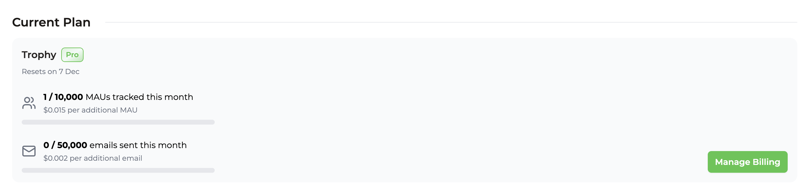

import { PlanBadge } from "../components/plan-badge.jsx";

## Usage-based Billing {#usage-based-billing}

Trophy follows a usage-based pricing model where customers only pay for the units of usage they consume. For Trophy, a unit of usage corresponds to a single [Monthly Active User](#monthly-active-users-maus) (MAU).

<Info>
  See our [pricing page](https://trophy.so/pricing) to get an estimate of your
  costs based on your expected usage.
</Info>

## Monthly Active Users (MAUs) {#monthly-active-users-maus}

Trophy defines an MAU as a single user that sends at least one [metric event](/features/events) to Trophy in a given month.

Bear in mind you never pay for churned users. If a user signs up for your product in a given month but doesn't return, you only pay for that user once and never again.

## Free Trial {#free-trial}

Every new account on the <PlanBadge plan="pro" /> and <PlanBadge plan="business" /> plans starts with a **30-day free trial** so you can test and evaluate Trophy before you pay.

## Plans {#plans}

Trophy has three plans, <PlanBadge plan="pro" />, <PlanBadge plan="business" /> and <PlanBadge plan="enterprise" />.

### Pro Plan {#pro-plan}

The <PlanBadge plan="pro" /> plan is for teams running Trophy in production. It includes all of Trophy's core gamification features: achievements, streaks, points, leaderboards, emails and push notifications.

### Business Plan {#business-plan}

The <PlanBadge plan="business" /> plan is for teams that need additional security, access controls and support, including single sign-on, role-based access control, data sync and a dedicated Slack channel.

### Enterprise Plan {#enterprise-plan}

The <PlanBadge plan="enterprise" /> plan is for larger organizations with custom requirements such as multi-tenancy, data residency, compliance reports and custom contracts. [Get in touch](mailto:support@trophy.so) to discuss pricing.

### Plan Allowances {#plan-allowances}

Here's a comparison of the allowances of each plan:

| Item                        | <PlanBadge plan="pro" /> | <PlanBadge plan="business" /> | <PlanBadge plan="enterprise" /> |
| --------------------------- | -------- | -------- | ---------- |
| Base price                  | `$299`   | `$599`   | Custom     |
| Included MAUs               | `10,000` | `10,000` | Custom     |
| Included Emails             | `20,000` | `20,000` | Custom     |
| Included Push Notifications | `20,000` | `20,000` | Custom     |

### Overages {#overages}

Overages are charged on the <PlanBadge plan="pro" /> and <PlanBadge plan="business" /> plans above the included [allowances](#plan-allowances) at the following rates:

| Item                     | <PlanBadge plan="pro" /> | <PlanBadge plan="business" /> |
| ------------------------ | -------- | -------- |
| 1 MAU                    | `$0.015` | `$0.015` |
| 1,000 Emails             | `$2.00`  | `$2.00`  |
| 1,000 Push Notifications | `$1.00`  | `$1.00`  |

Volume discounts are available as part of [custom contracts](#custom-contracts).

## Features {#features}

Here's a list of all Trophy features and the plan they become available on:

<PlanBadge plan="pro" />

- [Achievements](/features/achievements)
- [Streaks](/features/streaks)
- [Points](/features/points)
- [Leaderboards](/features/leaderboards)
- [Emails](/features/emails)
- [Push Notifications](/features/push-notifications)
- [Webhooks](/webhooks)
- Integration guidance for the first 30 days
- 99.9% uptime SLA
- 7-day audit logs

<PlanBadge plan="business" />

Everything in <PlanBadge plan="pro" />, plus:

- Ongoing integration guidance
- Data sync
- Slack support with a dedicated Slack channel
- Single sign-on (SSO)
- Multi-factor authentication (MFA)
- Role-based access control (RBAC)
- 30-day audit logs

<PlanBadge plan="enterprise" />

Everything in <PlanBadge plan="business" />, plus:

- Custom usage and volume discounts
- Reserved usage commitments
- Multi-tenancy
- Data residency control
- 99.99% uptime SLA
- SOC 2 and ISO reports
- Custom DPA and alternative data residency
- Custom audit logs, SLAs and support agreements
- Startup program eligibility

## Custom Contracts {#custom-contracts}

If you have more than 100K MAUs and would like to discuss custom contracts including volume discounts to suit your business needs then please [get in touch](mailto:support@trophy.so) and we'll be happy to help.

## Startup Program {#startup-program}

Eligible startups can get one free year of the <PlanBadge plan="pro" /> plan for up to 100K MAUs. Acceptance into the program is not guaranteed. [Get in touch](mailto:support@trophy.so) to find out more.

## Viewing Your Usage {#viewing-your-usage}

You can view your usage for the current billing period on the [billing page](https://app.trophy.so/billing) of the Trophy dashboard and view all past invoices in your billing portal.

<Frame>
  
</Frame>

## Frequently Asked Questions {#frequently-asked-questions}

<AccordionGroup>
    <Accordion title="When will I be charged?">
      We charge all customers on the 1st of the month for usage in arrears and for plan fees in advance.
    </Accordion>
</AccordionGroup>

## Get Support {#get-support}

Want to get in touch with the Trophy team? Reach out to us via [email](mailto:support@trophy.so). We're here to help!
