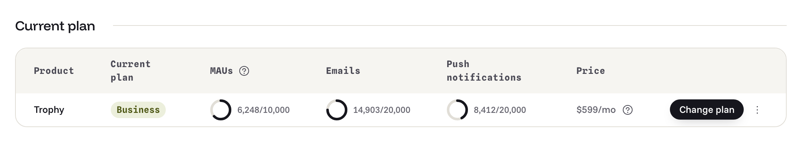

import { PlanBadge } from "../components/plan-badge.jsx";

## Usage-based billing {#usage-based-billing}

Trophy charges by [monthly active users](#monthly-active-users-maus) (MAUs), so you never pay for churn.

<Info>
  [Book a demo](https://trophy.so/contact-sales?utm_source=docs) and we'll help
  you find the right plan for your team, or compare plans on our [pricing
  page](https://trophy.so/pricing).
</Info>

## Monthly active users (MAUs) {#monthly-active-users-maus}

Trophy counts how many unique users you've told Trophy about each month. As long as a user sends at least one [metric event](/data-sources/events) in a given month, they count as an active user.

Users who aren't active in later months aren't charged. If a user signs up for your product in a given month but doesn't return, you only pay for that user once and never again.

## Plans {#plans}

Trophy has three plans, <PlanBadge plan="pro" />, <PlanBadge plan="business" /> and <PlanBadge plan="enterprise" />.

### Pro plan {#pro-plan}

The <PlanBadge plan="pro" /> plan is for teams who want to explore AI customer engagement. It includes:

- [AI lifecycle agents](/agentic-messaging/overview)
- In-app personalization: [milestones](/features/milestones), [streaks](/features/streaks), [points](/features/points), [leaderboards](/features/leaderboards) and [rewards](/features/rewards)
- A dedicated Slack channel

### Business plan {#business-plan}

The <PlanBadge plan="business" /> plan is for teams with additional security and support needs. It includes everything in <PlanBadge plan="pro" />, plus:

- [Single sign-on](/account/security#single-sign-on-sso)
- [Multi-factor authentication](/account/security#multi-factor-authentication-mfa)
- [Role-based access control](/account/security#role-based-access-control-rbac)

### Enterprise plan {#enterprise-plan}

The <PlanBadge plan="enterprise" /> plan is for high-volume applications with bespoke needs. It includes everything in <PlanBadge plan="business" />, plus:

- Data residency control
- Custom uptime SLA
- SOC 2 / ISO reports

[Contact sales](https://trophy.so/contact-sales?utm_source=docs) to discuss pricing.

## Features {#features}

Here's everything included in each plan.

### AI lifecycle agents {#ai-lifecycle-agents}

| Feature | <PlanBadge plan="pro" /> | <PlanBadge plan="business" /> | <PlanBadge plan="enterprise" /> |
| --- | --- | --- | --- |
| [AI lifecycle agents](/agentic-messaging/overview) | Included | Included | Included |
| Emails | Included | Included | Included |
| Push notifications | Included | Included | Included |

### In-app personalization {#in-app-personalization}

| Feature | <PlanBadge plan="pro" /> | <PlanBadge plan="business" /> | <PlanBadge plan="enterprise" /> |
| --- | --- | --- | --- |
| [Milestones](/features/milestones) | Included | Included | Included |
| [Streaks](/features/streaks) | Included | Included | Included |
| [Points](/features/points) | Included | Included | Included |
| [Leaderboards](/features/leaderboards) | Included | Included | Included |
| [Rewards](/features/rewards) | Included | Included | Included |

### Integration {#integration}

| Feature | <PlanBadge plan="pro" /> | <PlanBadge plan="business" /> | <PlanBadge plan="enterprise" /> |
| --- | --- | --- | --- |
| [Webhooks](/webhooks/introduction) | Included | Included | Included |
| [Multiple environments](/platform/environments) | Included | Included | Included |
| [MCP server](/mcp/overview) | Included | Included | Included |
| [Data sync](/platform/data-sync) | — | Included | Included |

### Deployment methods {#deployment-methods}

| Feature | <PlanBadge plan="pro" /> | <PlanBadge plan="business" /> | <PlanBadge plan="enterprise" /> |
| --- | --- | --- | --- |
| [Lifecycle emails](/features/emails) | Included | Included | Included |
| Drop-in pages | Included | Included | Included |
| Custom integrations | Included | Included | Included |
| [Multi-tenancy](/platform/multi-tenancy) | — | — | Included |

### Support {#support}

| Feature | <PlanBadge plan="pro" /> | <PlanBadge plan="business" /> | <PlanBadge plan="enterprise" /> |
| --- | --- | --- | --- |
| Dedicated Slack channel | Included | Included | Included |
| Uptime SLA | 99.9% | 99.9% | Custom |
| Custom agreements | — | — | Included |
| Support SLAs | — | — | Included |

### Compliance {#compliance}

| Feature | <PlanBadge plan="pro" /> | <PlanBadge plan="business" /> | <PlanBadge plan="enterprise" /> |
| --- | --- | --- | --- |
| [Audit logs](/account/security#audit-logs) | 7 days | 30 days | Custom |
| [Single sign-on](/account/security#single-sign-on-sso) | — | Included | Included |
| [Multi-factor authentication](/account/security#multi-factor-authentication-mfa) | — | Included | Included |
| [Role-based access control](/account/security#role-based-access-control-rbac) | — | Included | Included |
| SOC 2 / ISO reports | — | — | Included |
| Custom DPA | — | — | Included |
| Alternative residency | — | — | Included |

## Startup program {#startup-program}

Just getting started? Eligible startups can get one free year of the <PlanBadge plan="pro" /> plan. Acceptance into the program is not guaranteed. [Apply](https://trophy.so/contact-sales?program=startup&utm_source=docs) to find out more.

## Viewing your usage {#viewing-your-usage}

You can view your usage for the current billing period on the [billing page](https://app.trophy.so/billing) of the Trophy dashboard and view all past invoices in your billing portal.

<Frame>
  
</Frame>

## Frequently asked questions {#frequently-asked-questions}

<AccordionGroup>
    <Accordion title="When will I be charged?">
      We charge all customers on the 1st of the month for usage in arrears and for plan fees in advance.
    </Accordion>
</AccordionGroup>

## Get support {#get-support}

Want to get in touch with the Trophy team? Reach out to us via [email](mailto:support@trophy.so). We're here to help!
