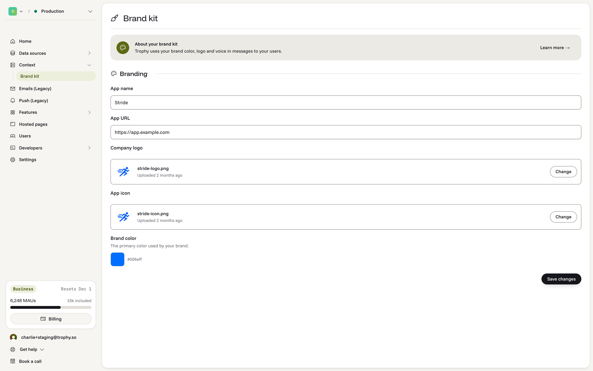

The brand kit holds the branding and context that Trophy uses across everything it sends to your users. It's shared across Trophy, so the same settings apply to [agentic messaging](/agentic-messaging/overview), [Emails (Legacy)](/features/emails) and [Push notifications (Legacy)](/features/push-notifications).

You'll find it on the [Brand kit](https://app.trophy.so/brand-kit) page under **Context** in the Trophy dashboard. The page has two sections:

- [Branding](#branding): your app's name, URL, logo, icon and brand color.
- [Agentic messaging](#agentic-messaging): what agents know about your app and how they write. This section only appears once agentic messaging is available on your account.

## Branding {#branding}

<Frame>
  
</Frame>

- **App name**: the name of your app or platform. Trophy uses it in the messages it sends to your users.
- **App URL**: the URL of your app or platform. Trophy uses it as the default link in messages, unless it's overridden. Usually this is your app's sign-in page.
- **Company logo**: shown in the header of every email Trophy sends. We recommend a horizontal logo with a transparent background, or a plain background color with rounded corners.
- **App icon**: shown in push notification previews.
- **Brand color**: the primary color of your brand. Trophy uses it for buttons and other elements in your emails.

<Tip>
  If you use [multi-tenancy](/platform/multi-tenancy), each tenant can have its
  own branding, so messages go out in each customer's brand.
</Tip>

The font used in legacy emails is set separately, on the [emails configure page](/features/emails#font-style).

You can also get and update your branding with the [organization settings Admin API](/admin-api/endpoints/settings/get-organization-settings).

## Agentic messaging {#agentic-messaging}

This section tells agents about your app and how you sound. Agents write every message inside the context and rules you set here, so every message stays on brand.

### About your app {#about-your-app}

A short **Description** of what your app is and who uses it. For example: "A language learning app for adults learning Spanish in short daily lessons."

### Voice {#voice}

- **Example messages**: two to five messages that sound like you, for each channel. Agents match their tone without copying them.
- **Use emoji**: whether agents may use emoji in messages.

### Metrics {#metrics}

**Metric context** explains each of your [metrics](/features/metrics) to agents, so they can talk about a user's activity in your own terms. For each metric, add:

| Field | What it's for | Example |
| --- | --- | --- |
| What it means | What one unit of the metric is | A lesson completed in the course player |
| Action | The action to ask users to take | Finish a lesson |
| Link | Where that action happens in your app | `https://example.com/lessons` |

Agents may only link to your app and to the links you add here, so add a link for every action you want agents to point users towards.

### Never say {#never-say}

**Phrases** agents must never use: terms you avoid, promises you can't make, competitor names and anything else that's off limits. If an agent writes something you don't like, add it here and agents stop doing it from then on.

### User attributes {#user-attributes}

**Shared attributes** are the [custom user attributes](/features/users#custom-user-attributes) agents may see for each user, like their plan or their goal. Add a short description of each one so agents understand what its values mean.

<Warning>
  The values of shared attributes are shared with the AI model provider that
  writes messages. Only share attributes you're comfortable sending to a third
  party, and never share sensitive personal data.
</Warning>

## Get support {#get-support}

Want to get in touch with the Trophy team? Reach out to us via [email](mailto:support@trophy.so). We're here to help!
