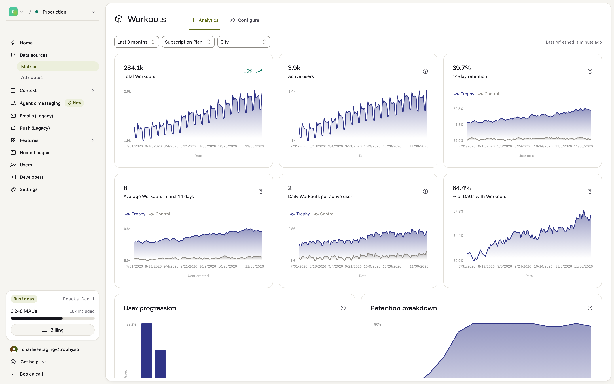
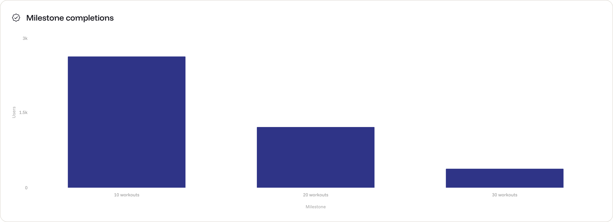

{/* TODO(media): re-create in the new dashboard theme: assets/features/metrics/metric_analytics.png, assets/features/metrics/achievement_completions.png */}

## What are metrics? {#what-are-metrics}

Customer engagement starts with how users interact with your product. At Trophy, we use the term **Metrics** to refer to the data objects that model those interactions within your web or mobile app.

Metrics are un-opinionated, meaning they can be used to model absolutely any user interaction you can think of. Examples could include:

- Followers, likes or posts
- Tasks completed
- Miles ran
- Lessons completed
- Words written
- ...

Metrics are the event layer for customer engagement. They power both Trophy's [agentic messaging](/agentic-messaging/overview) and its in-app features. Each user interaction that relates to a metric is stored as an [Event](/data-sources/events).

Events are stored and processed in chronological order. At any particular point in time, the combined state of a user's event history reflects their overall progress on your platform.

## Key attributes {#key-attributes}

Here we describe the key attributes that allow you to create metrics to best fit your use case.

### Units {#units}

You can easily assign units to metrics in the dashboard for either:

- Arbitrary numbers (tasks, posts, messages etc.)
- Currencies ($, £, €)

## Creating metrics {#creating-metrics}

To create a Metric, head over to the [Metrics](https://app.trophy.so/metrics) page within Trophy and click the **New Metric** button:

<Frame>
  <video
    autoPlay
    muted
    loop
    playsInline
    className="w-full aspect-video"
    src="../assets/features/metrics/create_new_metric.mp4"
  ></video>
</Frame>

<Steps>
  <Step title="Enter a name">
    Choose a name for the metric.
  </Step>
  
  <Step title="Click save">
    Save the new metric.
  </Step>

   <Step title="Configure settings">
    Configure additional settings like metric units or currency if applicable on the metric configure page.
  </Step>
</Steps>

## Metric analytics {#metric-analytics}

Trophy has a built-in analytics dashboard for each metric you create. It shows you:

- The total value of all tracked events against the metric
- The number of users actively making progress against the metric
- The metric's [Milestone Completion Chart](#achievement-completion-chart)

<Frame>
  
</Frame>

### Milestone completion chart {#achievement-completion-chart}

The milestone completion chart shows the current state of the userbase in terms of the number of users who have completed each milestone that you've configured against this metric.

[Learn more about milestones](/features/milestones).

<Frame>
  
</Frame>

## Frequently asked questions {#frequently-asked-questions}

<AccordionGroup>
  <Accordion title="How many metrics can I create?">
    As many as you want!
  </Accordion>

    <Accordion title="Can Trophy control my UI when events are tracked?">
    No, metrics are purely server-side and only support the business logic around milestones, streaks and other workflows like sending messages.

    They don't control any in-app UI, but our APIs provide all the data you need to build whatever UI you want.
    </Accordion>

</AccordionGroup>

## Get support {#get-support}

Want to get in touch with the Trophy team? Reach out to us via [email](mailto:support@trophy.so). We're here to help!
