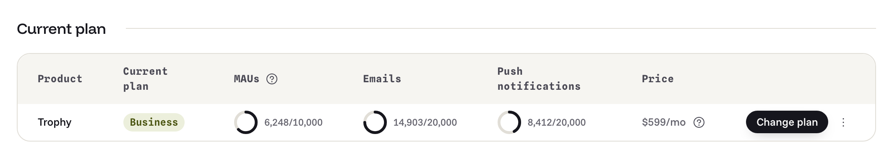

import { PlanBadge } from "../components/plan-badge.jsx";

## Facturación basada en uso {#usage-based-billing}

Trophy cobra por [usuarios activos mensuales](#monthly-active-users-maus) (MAU), así que nunca pagas por los usuarios que abandonan.

<Info>
  [Reserva una demo](https://trophy.so/contact-sales?utm_source=docs) y te
  ayudaremos a encontrar el plan adecuado para tu equipo, o compara los planes en
  nuestra [página de precios](https://trophy.so/pricing).
</Info>

## Usuarios activos mensuales (MAU) {#monthly-active-users-maus}

Trophy cuenta cuántos usuarios únicos le has comunicado cada mes. Siempre que un usuario envíe al menos un [evento de métrica](/es/data-sources/events) en un mes determinado, cuenta como usuario activo.

Los usuarios que no están activos en los meses siguientes no se cobran. Si un usuario se registra en tu producto en un mes determinado pero no vuelve, solo pagas por ese usuario una vez y nunca más.

## Planes {#plans}

Trophy tiene tres planes: <PlanBadge plan="pro" />, <PlanBadge plan="business" /> y <PlanBadge plan="enterprise" />.

### Plan Pro {#pro-plan}

El plan <PlanBadge plan="pro" /> está pensado para equipos que quieren explorar el customer engagement con IA. Incluye:

- [Agentes de marketing de ciclo de vida con IA](/es/agentic-messaging/overview)
- Personalización dentro de la app: [hitos](/es/features/milestones), [rachas](/es/features/streaks), [puntos](/es/features/points), [clasificaciones](/es/features/leaderboards) y [recompensas](/es/features/rewards)
- Un canal de Slack dedicado

### Plan Business {#business-plan}

El plan <PlanBadge plan="business" /> está pensado para equipos con necesidades adicionales de seguridad y soporte. Incluye todo lo de <PlanBadge plan="pro" />, y además:

- [Inicio de sesión único](/es/account/security#single-sign-on-sso)
- [Autenticación multifactor](/es/account/security#multi-factor-authentication-mfa)
- [Control de acceso basado en roles](/es/account/security#role-based-access-control-rbac)

### Plan Enterprise {#enterprise-plan}

El plan <PlanBadge plan="enterprise" /> está pensado para aplicaciones de gran volumen con necesidades a medida. Incluye todo lo de <PlanBadge plan="business" />, y además:

- Control de residencia de datos
- SLA de disponibilidad personalizado
- Informes SOC 2 / ISO

[Contacta con ventas](https://trophy.so/contact-sales?utm_source=docs) para hablar sobre los precios.

## Funcionalidades {#features}

Esto es todo lo que incluye cada plan.

### Agentes de marketing de ciclo de vida con IA {#ai-lifecycle-agents}

| Funcionalidad | <PlanBadge plan="pro" /> | <PlanBadge plan="business" /> | <PlanBadge plan="enterprise" /> |
| --- | --- | --- | --- |
| [Agentes de marketing de ciclo de vida con IA](/es/agentic-messaging/overview) | Incluido | Incluido | Incluido |
| Emails | Incluido | Incluido | Incluido |
| Notificaciones push | Incluido | Incluido | Incluido |

### Personalización dentro de la app {#in-app-personalization}

| Funcionalidad | <PlanBadge plan="pro" /> | <PlanBadge plan="business" /> | <PlanBadge plan="enterprise" /> |
| --- | --- | --- | --- |
| [Hitos](/es/features/milestones) | Incluido | Incluido | Incluido |
| [Rachas](/es/features/streaks) | Incluido | Incluido | Incluido |
| [Puntos](/es/features/points) | Incluido | Incluido | Incluido |
| [Clasificaciones](/es/features/leaderboards) | Incluido | Incluido | Incluido |
| [Recompensas](/es/features/rewards) | Incluido | Incluido | Incluido |

### Integración {#integration}

| Funcionalidad | <PlanBadge plan="pro" /> | <PlanBadge plan="business" /> | <PlanBadge plan="enterprise" /> |
| --- | --- | --- | --- |
| [Webhooks](/es/webhooks/introduction) | Incluido | Incluido | Incluido |
| [Múltiples entornos](/es/platform/environments) | Incluido | Incluido | Incluido |
| [Servidor MCP](/es/mcp/overview) | Incluido | Incluido | Incluido |
| [Sincronización de datos](/es/platform/data-sync) | — | Incluido | Incluido |

### Métodos de despliegue {#deployment-methods}

| Funcionalidad | <PlanBadge plan="pro" /> | <PlanBadge plan="business" /> | <PlanBadge plan="enterprise" /> |
| --- | --- | --- | --- |
| [Emails de ciclo de vida](/es/features/emails) | Incluido | Incluido | Incluido |
| Páginas listas para integrar | Incluido | Incluido | Incluido |
| Integraciones personalizadas | Incluido | Incluido | Incluido |
| [Multi-tenancy](/es/platform/multi-tenancy) | — | — | Incluido |

### Soporte {#support}

| Funcionalidad | <PlanBadge plan="pro" /> | <PlanBadge plan="business" /> | <PlanBadge plan="enterprise" /> |
| --- | --- | --- | --- |
| Canal de Slack dedicado | Incluido | Incluido | Incluido |
| SLA de disponibilidad | 99,9 % | 99,9 % | Personalizado |
| Acuerdos personalizados | — | — | Incluido |
| SLA de soporte | — | — | Incluido |

### Cumplimiento {#compliance}

| Funcionalidad | <PlanBadge plan="pro" /> | <PlanBadge plan="business" /> | <PlanBadge plan="enterprise" /> |
| --- | --- | --- | --- |
| [Registros de auditoría](/es/account/security#audit-logs) | 7 días | 30 días | Personalizado |
| [Inicio de sesión único](/es/account/security#single-sign-on-sso) | — | Incluido | Incluido |
| [Autenticación multifactor](/es/account/security#multi-factor-authentication-mfa) | — | Incluido | Incluido |
| [Control de acceso basado en roles](/es/account/security#role-based-access-control-rbac) | — | Incluido | Incluido |
| Informes SOC 2 / ISO | — | — | Incluido |
| DPA personalizado | — | — | Incluido |
| Residencia de datos alternativa | — | — | Incluido |

## Programa para startups {#startup-program}

¿Estás empezando? Las startups que cumplan los requisitos pueden obtener un año gratis del plan <PlanBadge plan="pro" />. La aceptación en el programa no está garantizada. [Presenta tu solicitud](https://trophy.so/contact-sales?program=startup&utm_source=docs) para obtener más información.

## Consulta tu uso {#viewing-your-usage}

Puedes consultar tu uso del período de facturación actual en la [página de facturación](https://app.trophy.so/billing) del panel de Trophy y ver todas las facturas anteriores en tu portal de facturación.

<Frame>
  
</Frame>

## Preguntas frecuentes {#frequently-asked-questions}

<AccordionGroup>
    <Accordion title="¿Cuándo se me cobrará?">
      Cobramos a todos los clientes el día 1 de cada mes: el uso se factura a mes vencido y las cuotas del plan, por adelantado.
    </Accordion>
</AccordionGroup>

## Obtener soporte {#get-support}

¿Quieres ponerte en contacto con el equipo de Trophy? Escríbenos por [correo electrónico](mailto:support@trophy.so). ¡Estamos aquí para ayudarte!
