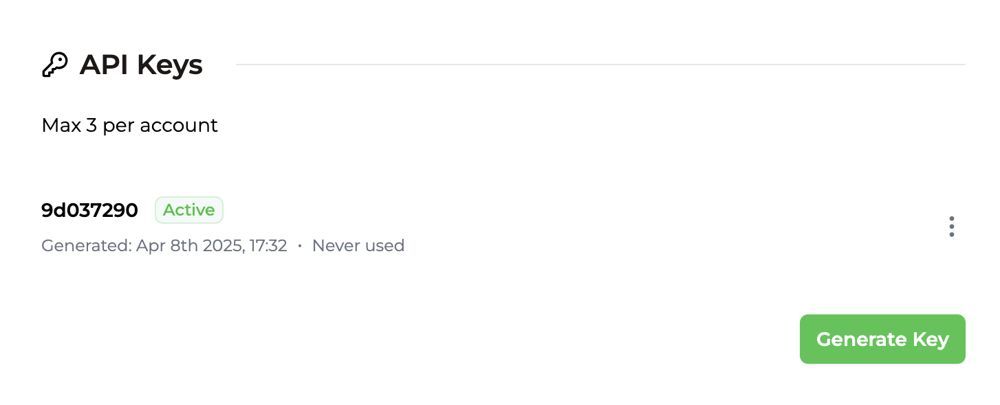
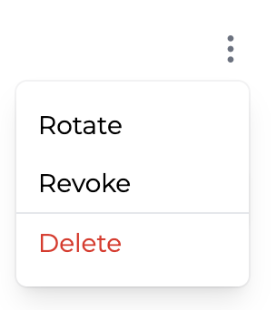

import AdminApiAuthenticateRequestBlock from "../../snippets/admin-api-authenticate-request-block.mdx";
import ApplicationApiAuthenticateRequestBlock from "../../snippets/application-api-authenticate-request-block.mdx";

<Tip>
  Para el acceso desde el cliente o de usuarios finales a la API de aplicación,
  crea en su lugar [claves de API de aplicación](/es/api-reference/authentication)
  limitadas a un solo usuario.
</Tip>

## Claves de API de administración {#admin-api-keys}

Las claves de API de administración son credenciales a nivel de cuenta con permisos amplios. Úsalas para autenticar las solicitudes a la API de administración y, opcionalmente, a la [API de aplicación](/es/api-reference/authentication) desde entornos de servidor de confianza.

Cada cuenta puede crear un máximo de 3 claves de API de administración desde la [página de integración](https://app.trophy.so/integration) del panel de Trophy.

Trophy registra y muestra cuándo se creó cada clave de API de administración de tu cuenta y cuándo se usó por última vez, para que puedas hacer un seguimiento sencillo del uso.

<Frame>
  
</Frame>

<Warning>
  Las claves de API de administración pueden acceder a cualquier usuario y a cualquier operación de administración de tu cuenta.
  No las expongas nunca en código del lado del cliente, aplicaciones móviles ni repositorios públicos.
</Warning>

### Anatomía de una clave de API de administración {#anatomy-of-an-admin-api-key}

Cada clave de API de administración consta de 2 partes separadas por un punto:

```bash
{prefix}.{body}
```

- El _prefijo_ son los primeros 8 caracteres. Es legible y siempre permanece igual, por lo que es fácil de reconocer.
- El _cuerpo_ es la parte secreta y solo se muestra una vez, cuando creas la clave.

<Note>
  Al usar la API, ambas partes de tu clave de API de administración deben enviarse en el
  encabezado `X-API-KEY`.
</Note>

### Autenticación de solicitudes {#authenticating-requests}

Al realizar solicitudes a la API de administración, incluye ambas partes de tu clave de API de administrador en el encabezado `X-API-KEY`, o pásala al inicializar un cliente del SDK:

<AdminApiAuthenticateRequestBlock />

La misma clave autentica las solicitudes a la API de aplicación cuando usas una clave de API de administrador desde un entorno de servidor:

<ApplicationApiAuthenticateRequestBlock />

Si no pasas una clave de API, o tu clave de API no es válida, recibirás un código de respuesta `401`.

## Gestión de las claves de API de administrador {#managing-admin-api-keys}

Hay varias operaciones que puedes realizar con las claves de API de administrador desde tu panel de Trophy para gestionar tu integración.

<Frame>
  
</Frame>

### Rotación de claves {#rotating-keys}

Las claves de API de administrador se pueden rotar si quieres cambiarlas por cualquier motivo. En el momento de la rotación, la clave de API original dejará de funcionar y las solicitudes que sigan usándola empezarán a recibir respuestas `401` de inmediato.

<Note>
  Ten en cuenta que, al rotar las claves, cambian tanto el prefijo como el cuerpo.
</Note>

### Revocación de claves {#revoking-keys}

Las claves de API de administrador también se pueden revocar por completo, y en ese caso pasan a estar _inactivas_. En el momento de la revocación, la clave de API dejará de funcionar y las solicitudes que sigan usándola empezarán a recibir respuestas `401` de inmediato.

Una vez revocada, puedes volver a activar la clave de API en cualquier momento.

<Note>
  Ni el prefijo ni el cuerpo de la clave cambian al revocarla o volver a activarla.
</Note>

### Eliminación de claves de API {#deleting-api-keys}

Si estás 100 % seguro de que ya no necesitas una clave de API de administrador, puedes eliminarla.

<Danger>Una vez eliminadas las claves de API, no se pueden recuperar.</Danger>

## Obtener soporte {#get-support}

¿Quieres ponerte en contacto con el equipo de Trophy? Escríbenos por [correo electrónico](mailto:support@trophy.so). ¡Estamos aquí para ayudarte!
