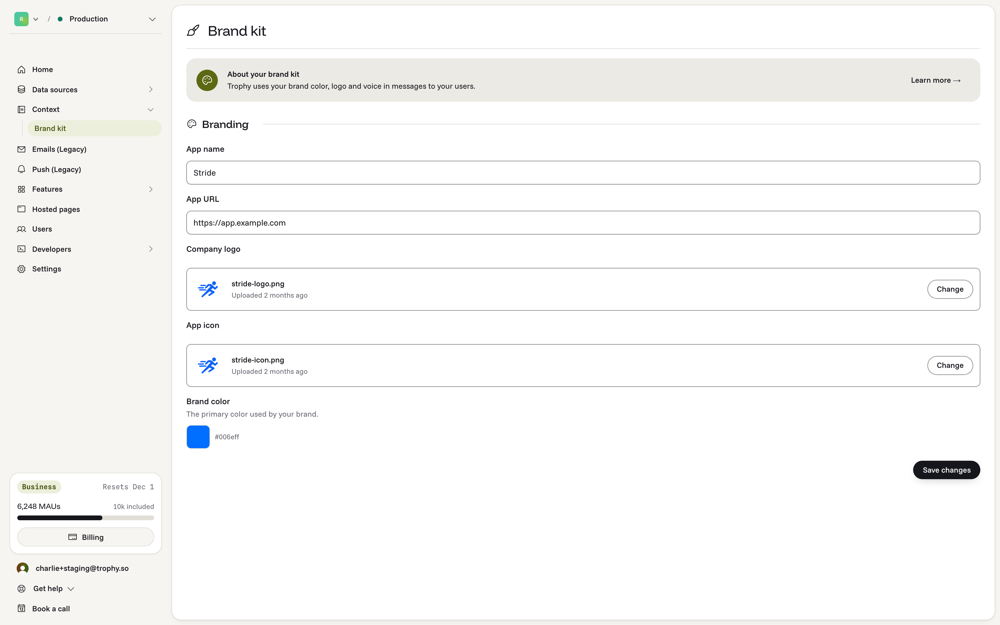

El kit de marca contiene la identidad de marca y el contexto que Trophy usa en todo lo que envía a tus usuarios. Se comparte en todo Trophy, así que la misma configuración se aplica a la [mensajería agéntica](/es/agentic-messaging/overview), a los [Emails (heredados)](/es/features/emails) y a las [Notificaciones push (heredadas)](/es/features/push-notifications).

Lo encontrarás en la página [Brand kit](https://app.trophy.so/brand-kit), dentro de **Context** en el panel de Trophy. La página tiene dos secciones:

- [Identidad de marca](#branding): el nombre, la URL, el logotipo, el icono y el color de marca de tu app.
- [Mensajería agéntica](#agentic-messaging): lo que los agentes saben sobre tu app y cómo escriben. Esta sección solo aparece cuando la mensajería agéntica está disponible en tu cuenta.

## Identidad de marca {#branding}

<Frame>
  
</Frame>

- **App name**: el nombre de tu app o plataforma. Trophy lo usa en los mensajes que envía a tus usuarios.
- **App URL**: la URL de tu app o plataforma. Trophy la usa como enlace predeterminado en los mensajes, salvo que se sustituya. Normalmente es la página de inicio de sesión de tu app.
- **Company logo**: se muestra en el encabezado de cada email que envía Trophy. Recomendamos un logotipo horizontal con fondo transparente, o con un color de fondo liso y esquinas redondeadas.
- **App icon**: se muestra en las vistas previas de las notificaciones push.
- **Brand color**: el color principal de tu marca. Trophy lo usa para los botones y otros elementos de tus emails.

<Tip>
  Si usas [multi-tenancy](/es/platform/multi-tenancy), cada cliente puede tener su
  propia identidad de marca, de modo que los mensajes salen con la marca de cada
  cliente.
</Tip>

La fuente de los emails heredados se configura por separado, en la [página de configuración de emails](/es/features/emails#font-style).

También puedes obtener y actualizar tu identidad de marca con la [API de administración de configuración de organización](/es/admin-api/endpoints/settings/get-organization-settings).

## Mensajería agéntica {#agentic-messaging}

Esta sección explica a los agentes cómo es tu app y cómo te expresas. Los agentes escriben cada mensaje dentro del contexto y las reglas que definas aquí, para que todos los mensajes sean fieles a tu marca.

### Sobre tu app {#about-your-app}

Una breve **Description** de qué es tu app y quién la usa. Por ejemplo: "Una app de aprendizaje de idiomas para adultos que aprenden español con lecciones diarias cortas".

### Voz {#voice}

- **Example messages**: de dos a cinco mensajes que suenen como tú, para cada canal. Los agentes imitan su tono sin copiarlos.
- **Use emoji**: si los agentes pueden usar emojis en los mensajes.

### Métricas {#metrics}

El **Metric context** explica cada una de tus [métricas](/es/data-sources/metrics) a los agentes, para que puedan hablar de la actividad de un usuario en tus propios términos. Para cada métrica, añade:

| Campo | Para qué sirve | Ejemplo |
| --- | --- | --- |
| What it means | Qué representa una unidad de la métrica | Una lección completada en el reproductor del curso |
| Action | La acción que se pide a los usuarios | Termina una lección |
| Link | Dónde ocurre esa acción en tu app | `https://example.com/lessons` |

Los agentes solo pueden enlazar a tu app y a los enlaces que añadas aquí, así que añade un enlace para cada acción hacia la que quieras que los agentes dirijan a los usuarios.

### Never say {#never-say}

**Phrases** que los agentes nunca deben usar: términos que evitas, promesas que no puedes hacer, nombres de competidores y cualquier otra cosa prohibida. Si un agente escribe algo que no te gusta, añádelo aquí y los agentes dejarán de hacerlo a partir de ese momento.

### Atributos de usuario {#user-attributes}

Los **Shared attributes** son los [atributos de usuario personalizados](/es/data-sources/users#custom-user-attributes) que los agentes pueden ver de cada usuario, como su plan o su meta. Añade una breve descripción de cada uno para que los agentes entiendan qué significan sus valores.

<Warning>
  Los valores de los atributos compartidos se comparten con el proveedor del
  modelo de IA que escribe los mensajes. Comparte solo los atributos que no te
  importe enviar a un tercero y nunca compartas datos personales sensibles.
</Warning>

## Obtener soporte {#get-support}

¿Quieres ponerte en contacto con el equipo de Trophy? Escríbenos por [correo electrónico](mailto:support@trophy.so). ¡Estamos aquí para ayudarte!
