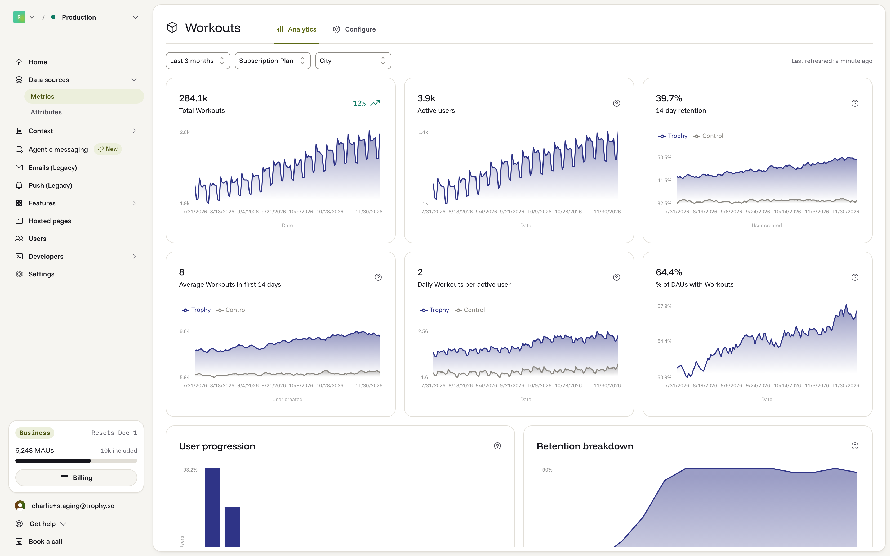
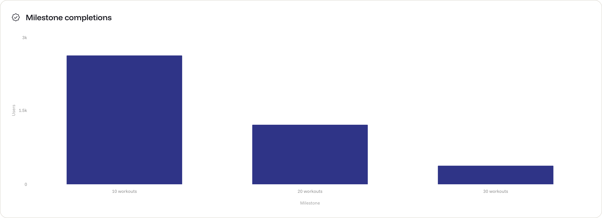

## ¿Qué son las Métricas? {#what-are-metrics}

El customer engagement empieza por cómo interactúan los usuarios con tu producto. En Trophy, usamos el término **Métricas** para referirnos a los objetos de datos que modelan esas interacciones dentro de tu aplicación web o móvil.

Las métricas no tienen opinión, lo que significa que se pueden usar para modelar absolutamente cualquier interacción de usuario que puedas imaginar. Los ejemplos podrían incluir:

- Seguidores, me gusta o publicaciones
- Tareas completadas
- Millas corridas
- Lecciones completadas
- Palabras escritas
- ...

Las métricas son la capa de eventos del customer engagement. Impulsan tanto la [mensajería agéntica](/es/agentic-messaging/overview) de Trophy como sus funciones dentro de la app. Cada interacción de usuario que se relaciona con una métrica se almacena como un [Evento](/es/data-sources/events).

Los eventos se almacenan y procesan en orden cronológico. En cualquier momento dado, el estado combinado del historial de eventos de un usuario refleja su progreso general en tu plataforma.

## Atributos Clave {#key-attributes}

Aquí describimos los atributos clave que te permiten crear métricas para que se ajusten mejor a tu caso de uso.

### Unidades {#units}

Puedes asignar fácilmente unidades a las métricas en el panel para:

- Números arbitrarios (tareas, publicaciones, mensajes, etc.)
- Monedas ($, £, €)

## Crear Métricas {#creating-metrics}

Para crear una métrica, dirígete a la página de [Métricas](https://app.trophy.so/metrics) dentro de Trophy y haz clic en el botón **Nueva Métrica**:

<Frame>
  <video
    autoPlay
    muted
    loop
    playsInline
    className="w-full aspect-video"
    src="../../assets/features/metrics/create_new_metric.mp4"
  ></video>
</Frame>

<Steps>
  <Step title="Introduce un nombre">
    Elige un nombre para la métrica.
  </Step>
  
  <Step title="Guarda">
    Guarda la nueva métrica.
  </Step>

   <Step title="Configura los ajustes">
    Configura ajustes adicionales como las unidades de la métrica o la moneda si corresponde en la página de configuración de la métrica.
  </Step>
</Steps>

## Analíticas de Métricas {#metric-analytics}

Trophy tiene un panel de analíticas integrado para cada métrica que creas. Te muestra:

- El valor total de todos los eventos rastreados contra la métrica
- El número de usuarios que están progresando activamente contra la métrica
- El [Gráfico de finalización de hitos](#achievement-completion-chart) de la métrica

<Frame>
  
</Frame>

### Gráfico de finalización de hitos {#achievement-completion-chart}

El gráfico de finalización de hitos muestra el estado actual de la base de usuarios en términos del número de usuarios que han completado cada hito que has configurado para esta métrica.

[Aprende más sobre los hitos](/es/features/milestones).

<Frame>
  
</Frame>

## Preguntas Frecuentes {#frequently-asked-questions}

<AccordionGroup>
  <Accordion title="¿Cuántas métricas puedo crear?">
    ¡Tantas como quieras!
  </Accordion>

    <Accordion title="¿Puede Trophy controlar mi interfaz cuando se rastrean eventos?">
    No, las métricas son puramente del lado del servidor y solo soportan la lógica de negocio relacionada con hitos, rachas y otros flujos de trabajo como el envío de mensajes.

    No controlan ninguna interfaz dentro de la aplicación, pero nuestras APIs proporcionan todos los datos que necesitas para construir la interfaz que desees.
    </Accordion>

</AccordionGroup>

## Obtén Soporte {#get-support}

¿Quieres contactar con el equipo de Trophy? Contáctanos por [correo electrónico](mailto:support@trophy.so). ¡Estamos aquí para ayudarte!
