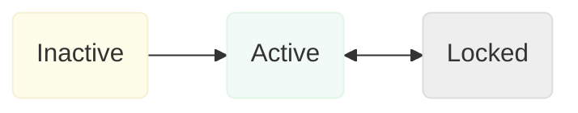
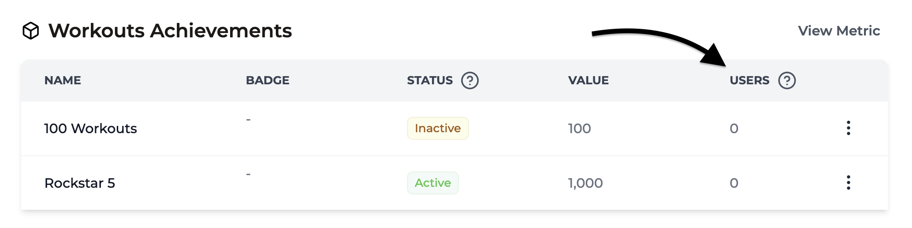
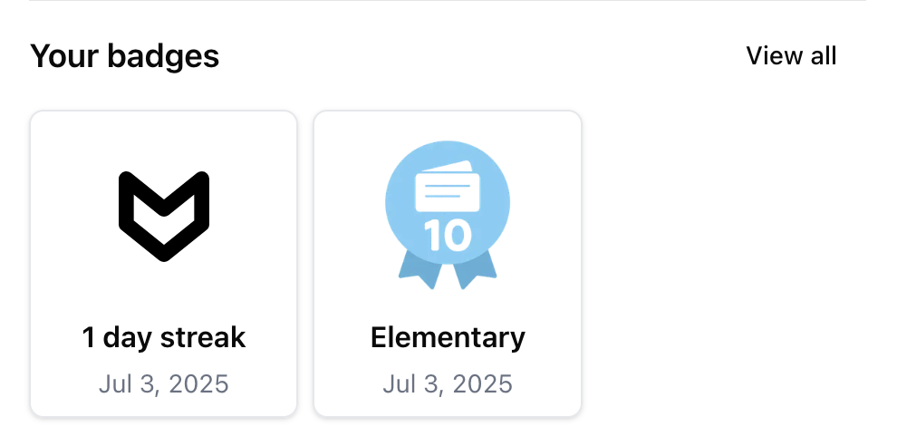
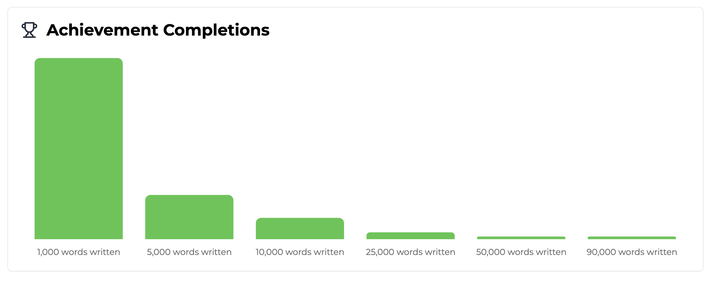

import MetricChangeResponseBlock from "../../snippets/metric-change-response-block.mdx";
import AllAchievementsResponseBlock from "../../snippets/all-achievements-response-block.mdx";

## ¿Qué son los Logros? {#what-are-achievements}

Los logros son recompensas que los usuarios pueden desbloquear mientras usan tu plataforma. Se pueden utilizar para recompensar a los usuarios por el progreso continuo en los recorridos principales del usuario, o para motivarlos a explorar funcionalidades más recientes.

Los logros funcionan mejor cuando están diseñados para incentivar a los usuarios a realizar acciones que probablemente conduzcan a un aumento de la retención.

<Tip>
  Usa las [analíticas de métricas](/es/features/metrics#metric-analytics) de Trophy para comparar
  la retención de cada interacción del usuario, luego configura logros en torno a
  estas interacciones para maximizar el impacto en la retención.
</Tip>

Aquí examinaremos los tipos de logros que puedes crear con Trophy, las diferentes formas de usarlos y cómo integrarlos en tu plataforma.

Mira a Charlie mientras explica el uso de logros en una aplicación NextJS:

<Frame>
  <iframe
    width="560"
    height="315"
    src="https://www.youtube.com/embed/U6TRxV036Lk?si=pAX37TXL8rNeFzz7"
    title="YouTube video player"
    frameborder="0"
    allow="accelerometer; autoplay; clipboard-write; encrypted-media; gyroscope; picture-in-picture"
    allowfullscreen
  ></iframe>
</Frame>

## Tipos de Logros {#achievement-types}

Trophy ofrece cinco tipos de logros: [Métrica](#metric-achievements), [API](#api-achievements), [Racha](#streak-achievements), [Aniversario](#anniversary-achievements) y [Logros compuestos](#composite-achievements), que se detallan a continuación.

### Logros de Métrica {#metric-achievements}

Los logros de métrica están vinculados a [Métricas](/es/features/metrics) y se utilizan mejor cuando quieres incentivar a los usuarios a realizar la misma acción una y otra vez.

Tomemos el ejemplo de una plataforma de estudio que usa Trophy para animar a los usuarios a ver más tarjetas de estudio con logros de métrica de la siguiente manera:

- 1.000 tarjetas de estudio
- 2.500 tarjetas de estudio
- 5.000 tarjetas de estudio
- 10.000 tarjetas de estudio
- 25.000 tarjetas de estudio
- 50.000 tarjetas de estudio

En este caso crearías una métrica llamada _Tarjetas Volteadas_ y crearías logros vinculados a la métrica para cada hito.

Dado que estos logros están directamente vinculados a la métrica _Tarjetas Volteadas_, Trophy rastreará automáticamente cuándo los usuarios desbloquean estos logros a medida que [incrementan la métrica](/es/features/events#tracking-metric-events).

Cuando se desbloquean logros, Trophy incluye información sobre ellos en la respuesta de la [API de eventos](/es/api-reference/endpoints/events/submit-a-metric-event) y, si está configurado, activa automáticamente los [correos de logros](/es/features/emails#achievement-emails).

<MetricChangeResponseBlock />

### Logros de API {#api-achievements}

Los logros de API solo se pueden completar una vez y son útiles para recompensar a los usuarios por realizar acciones específicas.

Ejemplos comunes incluyen:

- Un usuario que completa su perfil después de registrarse
- Un usuario que vincula su cuenta de redes sociales a una plataforma
- Un usuario que comparte su experiencia con el producto en redes sociales

Los logros de API sirven como una manera fácil de recompensar a los usuarios por completar cualquier acción que consideres importante para la retención.

Al igual que los logros de métrica, los logros de API también pueden activar [Emails de Logros](/es/features/emails#achievement-emails) automatizados si están configurados.

### Logros de Racha {#streak-achievements}

Los logros de racha están directamente vinculados a la [Racha](/es/features/streaks) de un usuario y se desbloquean automáticamente cuando los usuarios alcanzan una duración de racha particular.

Puedes crear tantos logros de racha como desees para duraciones de racha cada vez mayores, por ejemplo 7 días, 30 días y 365 días para motivar a los usuarios a usar tu aplicación cada vez más.

Al igual que los logros de métrica y API, puedes agregar un nombre personalizado y asignar una insignia a los logros de racha.

### Logros de aniversario {#anniversary-achievements}

Los logros de aniversario se desbloquean automáticamente cuando un usuario cumple un aniversario concreto de su fecha de registro.

Crea un logro por cada año que quieras celebrar, por ejemplo 1 año, 2 años y 5 años. Trophy desbloquea cada logro cuando se alcanza el [`signUpDate`](/es/features/users#optional-attributes) del usuario más ese número de años.

Los usuarios sin `signUpDate` no son elegibles. Define `signUpDate` cuando [identifiques](/es/features/users#identifying-users) o [actualices](/es/features/users#keeping-users-up-to-date) a los usuarios para que Trophy pueda detectar los aniversarios.

Trophy evalúa el aniversario en el día del calendario de la [`tz`](/es/features/users#optional-attributes) del usuario. Define `tz` para que el logro se desbloquee en el día local correcto.

Al igual que otros tipos de logros, los logros de aniversario pueden activar [correos de logros](/es/features/emails#achievement-emails) cuando se desbloquean.

### Logros compuestos {#composite-achievements}

Los logros compuestos se desbloquean automáticamente cuando un usuario ha completado todos los logros requisitos que selecciones. Son ideales para crear recompensas escalonadas o de nivel de maestría que reconozcan a los usuarios que han alcanzado un conjunto específico de hitos.

Por ejemplo, podrías crear un logro compuesto "Maestro del estudio" que se desbloquee cuando un usuario haya completado:
- 1000 tarjetas de estudio
- Racha de 7 días
- Onboarding completo

Los logros compuestos son útiles para crear rutas de progresión y animar a los usuarios a participar en distintas áreas de tu app. Al igual que otros tipos de logros, pueden activar [correos de logros](/es/features/emails#achievement-emails) cuando se desbloquean.

## Crear logros {#creating-achievements}

Para crear nuevos logros, ve a la [página de logros](https://app.trophy.so/achievements) en el panel de Trophy y haz clic en el botón **Nuevo logro**:

<Tip>
También puedes crear, actualizar y eliminar logros mediante programación con la [Admin API](/es/admin-api/endpoints/achievements/create-achievements).
</Tip>

<Frame>
  <video
    autoPlay
    muted
    loop
    playsInline
    className="w-full aspect-video"
    src="../../assets/features/achievements/create_new_achievement.mp4"
  ></video>
</Frame>

<Steps>
<Step title="Introduce un nombre">
  Introduce un nombre para el logro. Las API lo devolverán y estará disponible para usarlo en correos electrónicos y en otras áreas de Trophy cuando corresponda.
</Step>

<Step title="Introduce una descripción (opcional)">
  Introduce una breve descripción del logro. Las API la devolverán
  y estará disponible para usarla en correos electrónicos y en otras áreas de Trophy
  cuando corresponda.
</Step>

<Step title="Añade una insignia (opcional)">
  Puedes añadir una insignia subiendo una imagen o introduciendo una URL de imagen personalizada.
  La URL se devuelve en las respuestas de la API y se usa en correos electrónicos y en otras áreas de
  Trophy cuando corresponda.
</Step>

<Step title="Elige un tipo de activador">
  Elige cómo quieres que se desbloquee este logro.
  
- Si eliges **Métrica**, el logro se desbloqueará automáticamente cuando el total de la métrica del usuario alcance el valor de activación del logro.

- Si eliges **Racha**, el logro se desbloqueará automáticamente cuando la duración de la racha del usuario alcance el valor de activación del logro.

- Si eliges **Aniversario**, el logro se desbloqueará automáticamente cuando el usuario alcance el aniversario especificado de su [`signUpDate`](/es/features/users#optional-attributes).

- Si eliges **Llamada a la API**, el logro solo se desbloqueará cuando tu código lo marque explícitamente como completado mediante una solicitud a la [API para completar logros](/es/api-reference/endpoints/achievements/mark-an-achievement-as-completed).

- Si eliges **Compuesto**, el logro se desbloqueará automáticamente cuando el usuario haya completado todos los logros prerrequisito que selecciones.

</Step>

<Step title="Configurar el activador">
  Una vez que hayas elegido el tipo de activador para el logro, debes configurar sus ajustes.

- Si elegiste el activador **Métrica**, deberás seleccionar la métrica y el valor total del usuario que, al alcanzarse, desbloqueará el logro.

- Si elegiste el activador **Racha**, deberás definir la duración de la racha que desbloqueará el logro.

- Si elegiste el activador **Aniversario**, deberás definir el número de años desde el registro que desbloqueará el logro.

- Si elegiste el activador **Llamada a la API**, deberás definir una referencia única `key` que usarás para completar el logro mediante la [API](/es/api-reference/endpoints/achievements/mark-an-achievement-as-completed).

- Si elegiste el activador **Compuesto**, deberás seleccionar los logros prerrequisito que deben completarse para desbloquear este logro. El logro compuesto se desbloqueará automáticamente cuando un usuario complete el último prerrequisito.

</Step>

<Step title="Añadir filtros de atributos (opcional)">
Puedes asignar filtros de atributos a un logro para restringir aún más quién puede desbloquearlo y cuándo.

- Para limitar un logro de tipo **Métrica** de modo que solo se aplique a eventos con [atributos de evento personalizados](/es/features/events#custom-event-attributes) específicos, añade uno o más filtros en la sección **Atributos de evento**.

- Para limitar cualquier tipo de logro de modo que solo se aplique a usuarios con uno o más [atributos de usuario personalizados](/es/features/users#custom-user-attributes) específicos, añade los atributos y los valores deseados en la sección **Atributos de usuario**.

<Note>
  Si estableces varios filtros de atributos de evento, todos deben coincidir para que se aplique el
  logro de métrica. En las respuestas de la API, `eventAttributes` es el
  campo canónico e `eventAttribute` está obsoleto y se mantiene por compatibilidad con versiones anteriores.
</Note>

</Step>

<Step title="Haz clic en Guardar">
  Guarda el nuevo logro.
</Step>
</Steps>

## Gestión de logros {#managing-achievements}

Trophy incluye herramientas integradas para ayudarte a probar y controlar qué logros se pueden desbloquear, quién puede hacerlo y cuándo, sin afectar a producción.

### Estados de los logros {#achievement-statuses}

Esta es una descripción general de los distintos estados de los logros y de lo que significan.

**Inactivo**

Todos los logros se crean como inactivos. Los logros inactivos no se pueden completar y no se devuelven en ninguna API de logros. Los usuarios no los verán hasta que los actives.

**Activo**

Cuando activas un logro, pasa a estar «en vivo». Los usuarios pueden completarlo y se devuelve en todas las API de logros.

**Bloqueado**

Cuando bloqueas un logro, los usuarios que aún no lo han desbloqueado ya no podrán hacerlo, pero los usuarios que ya lo desbloquearon no se verán afectados.

Los logros bloqueados solo se devuelven en las API para los usuarios que ya los han conseguido.

### Flujo de trabajo de los logros {#achievement-workflow}

Los logros pueden pasar por distintos estados según el siguiente flujo de trabajo:



## Cómo completar logros {#completing-achievements}

Si utilizas logros de métrica, no es necesario _completar_ los logros de forma explícita. Una vez que hayas configurado el [seguimiento de métricas](/es/features/events#tracking-metric-events) en tu código, se hará un seguimiento automático de todos los logros vinculados a la métrica.

Del mismo modo, si utilizas logros de racha, todos los logros relacionados con la racha del usuario se desbloquearán automáticamente cuando este alcance la longitud de racha correspondiente.

Los logros de aniversario también se completan automáticamente. Se desbloquean cuando un usuario alcanza el aniversario configurado de su [`signUpDate`](/es/features/users#optional-attributes). Los usuarios que no tengan `signUpDate` no pueden desbloquearlos.

Los logros compuestos también se completan automáticamente. Se desbloquean en cuanto un usuario ha completado todos los logros que son requisito previo. No se necesitan llamadas adicionales a la API.

Sin embargo, si usas logros de API, tendrás que marcarlos como completados para cada usuario según corresponda. Para ello, puedes usar la [API de completar logro](/es/api-reference/endpoints/achievements/mark-an-achievement-as-completed) con el `key` del logro que quieras completar.

Esto devolverá una respuesta con los detalles del logro completado, que puedes usar en cualquier flujo de trabajo posterior a la finalización, como mostrar una notificación dentro de la aplicación.

{/* vale off */}

```json Response
{
  "completionId": "0040fe51-6bce-4b44-b0ad-bddc4e123534",
  "achievement": {
    "id": "5100fe51-6bce-6j44-b0hs-bddc4e123682",
    "trigger": "api",
    "name": "Finish onboarding",
    "description": "Complete the onboarding process.",
    "badgeUrl": "https://example.com/badge.png",
    "key": "finish-onboarding",
    "achievedAt": "2021-01-01T00:00:00Z"
  }
}
```

{/* vale on */}

## Aplicación retroactiva de logros {#backdating-achievements}

De forma predeterminada, cada vez que cambias un logro al [estado](#managing-achievements) 'Activo', Trophy comprueba si algún usuario existente cumple los requisitos del logro y se lo completa en segundo plano.

Esto significa que, cuando lanzas nuevos logros a producción o editas un logro activo existente, la aplicación retroactiva se realiza automáticamente.

Lo mismo ocurre cuando estableces o cambias el [`signUpDate`](/es/features/users#optional-attributes) de un usuario. Si el usuario ya cumple los requisitos de algún logro de aniversario activo, Trophy lo completa de forma silenciosa.

<Note>
  Cuando los logros se completan de esta manera, los usuarios no reciben
  ninguna notificación. Así se evita que los cambios en tus logros de Trophy
  provoquen que los usuarios reciban muchas notificaciones.
</Note>

Puedes comprobar cuántos usuarios han completado logros en cualquier momento en la [página de logros](https://app.trophy.so/achievements) del panel de Trophy. La columna _Usuarios_ de los logros puede actualizarse durante la aplicación retroactiva.

<Frame>
  
</Frame>

## Uso de insignias {#using-badges}

<Frame>
  <video
    autoPlay
    muted
    loop
    playsInline
    className="w-full aspect-video"
    src="../../assets/features/achievements/upload_badge.mp4"
  ></video>
</Frame>

Puedes asignar una insignia a cualquier logro subiendo una imagen (Trophy la aloja y devuelve la URL) o proporcionando tu propia URL de imagen. Las respuestas de API relevantes incluyen ese valor en `badgeUrl` para usarlo como `src` en las etiquetas ``.

```json Response {8}
{
  "completionId": "0040fe51-6bce-4b44-b0ad-bddc4e123534",
  "achievement": {
    "id": "5100fe51-6bce-6j44-b0hs-bddc4e123682",
    "trigger": "api",
    "name": "Finish onboarding",
    "description": "Complete the onboarding process.",
    "badgeUrl": "https://example.com/badge.png",
    "key": "finish-onboarding",
    "achievedAt": "2021-01-01T00:00:00Z"
  }
}
```

## Mostrar logros {#displaying-achievements}

Trophy ofrece varias API que permiten mostrar logros dentro de tus aplicaciones. Aquí veremos las distintas formas de usarlas y los tipos de interfaces que puedes crear.

<Tip>
  Consulta nuestra [guía completa](/es/guides/how-to-build-an-achievements-feature) sobre
  cómo añadir una función de logros a tu app para obtener más detalles.
</Tip>

### Todos los logros {#all-achievements}

Para mostrar una visión general de todos los logros que los usuarios pueden completar, usa el [endpoint de todos los logros](/es/api-reference/endpoints/achievements/all-achievements). Usa estos datos para crear una interfaz que dé a los usuarios una idea de las rutas de progresión dentro de tu aplicación.

<Frame>
  <video
    autoPlay
    muted
    loop
    playsInline
    className="w-full aspect-video"
    src="../../assets/features/achievements/displaying_trophy_cabinet.mp4"
  ></video>
</Frame>

El endpoint de todos los logros devuelve una lista de todos los logros de tu cuenta de Trophy. Cada logro devuelto también incluye `completions` (el número de usuarios que han completado el logro) e `rarity` (el porcentaje de usuarios que han completado el logro) de la siguiente manera:

<AllAchievementsResponseBlock />

### Logros del usuario {#user-achievements}

Si, en cambio, estás creando elementos de interfaz específicos de cada usuario, usa el [endpoint de logros del usuario](/es/api-reference/endpoints/users/get-a-users-completed-achievements) para obtener los logros que un usuario concreto ha completado.

<Tip>
  También puedes incluir los logros que un usuario aún no ha completado
  añadiendo el parámetro de consulta `includeIncomplete=true`.
</Tip>

<Frame>
  
</Frame>

## Analíticas de logros {#achievement-analytics}

Si tienes logros configurados para alguna de tus [Métricas](/es/features/metrics), la página de analíticas de la métrica muestra un gráfico con el progreso actual de todos los usuarios, como se muestra a continuación:

<Frame>
  
</Frame>

## Preguntas frecuentes {#frequently-asked-questions}

<AccordionGroup>
  <Accordion title="¿Qué tipo de logros debo usar?">
    Usa logros de métricas para recompensar a los usuarios por realizar la misma acción una y otra vez, y para incentivarlos a hacerlo más.

    Usa logros de racha para recompensar a los usuarios por mantener su racha.

    Usa logros de aniversario para recompensar a los usuarios por permanecer en tu plataforma a lo largo del tiempo.

    Usa logros de API cuando quieras recompensar a los usuarios por realizar acciones específicas que solo necesitan realizar una vez.

    Usa logros compuestos cuando quieras crear recompensas escalonadas o de nivel de maestría que se desbloqueen cuando los usuarios completen un conjunto específico de logros prerequisitos.

  </Accordion>

    <Accordion title="¿Qué logros debería crear?">
    Los logros, como toda la gamificación, ofrecen la mejor retención cuando están estrechamente alineados con la razón principal por la que el usuario usa tu plataforma.

    Usa los [análisis de métricas](/es/features/metrics#metric-analytics) de Trophy para comparar la retención de cada interacción del usuario, luego configura logros en torno a estas interacciones para maximizar el impacto en la retención.

</Accordion>

</AccordionGroup>

## Obtener soporte {#rewarding-achievements}

¿Quieres contactar con el equipo de Trophy? Comunícate con nosotros por [correo electrónico](mailto:support@trophy.so). ¡Estamos aquí para ayudarte!

## Obtener soporte {#get-support}

¿Quieres ponerte en contacto con el equipo de Trophy? Escríbenos por [correo electrónico](mailto:support@trophy.so). ¡Estamos aquí para ayudarte!
