Trophy puede enviar correos electrónicos automáticos a los usuarios a partir de desencadenantes clave, sin necesidad de escribir código. Aquí veremos cuáles son estos desencadenantes y cómo pueden formar parte de la experiencia de gamificación de tu producto.

## Tipos de correos electrónicos {#types-of-emails}

Trophy admite 4 tipos de correos electrónicos, cada uno diseñado para un escenario habitual en la creación de experiencias de gamificación.

Todos los correos son opcionales, pero los cuatro pueden usarse a la vez y se controlan desde la página [Emails](https://app.trophy.so/emails/configure) del panel de Trophy.

<Frame>
  <video
    autoPlay
    muted
    loop
    playsInline
    className="w-full aspect-15/4"
    src="../../assets/features/emails/email_types.mp4"
  ></video>
</Frame>

- **Los correos de Logro** se envían a los usuarios cada vez que desbloquean un [Logro](/es/features/achievements).
- **Los correos de resumen** se envían a los usuarios con una frecuencia predefinida para resumir su progreso. Puedes configurarlos para que se envíen a diario, semanal, mensual o anualmente, según tu caso de uso.
- **Los correos de Reactivación** se envían a los usuarios cuando dejan de estar activos, con el objetivo de que vuelvan a tu aplicación.
- **Los correos de Racha** se envían automáticamente a los usuarios para recordarles que extiendan su [Racha](/es/features/streaks).

## Envío de correos electrónicos {#sending-emails}

Para empezar a enviar correos electrónicos con Trophy, debes verificar tu dominio y añadir y activar plantillas de correo para los tipos que quieras enviar.

<Tip>
  Los usuarios pueden controlar qué notificaciones por correo reciben mediante la
  [API de preferencias de usuario](/es/features/users#notification-preferences) de Trophy. Esto te permite
  crear un centro de preferencias en tu aplicación donde los usuarios pueden
  activar o desactivar tipos de correo específicos.
</Tip>

### Verificación del dominio {#domain-verification}

Trophy permite enviar correos desde tu propio dominio de forma nativa. Hay dos maneras de configurarlo: Verificación del remitente único y Verificación de DNS.

Todos los ajustes de dominio están en la página [Dominios](https://app.trophy.so/emails/domains) del panel de Trophy.

<Tip>
  Si quieres configurarlo rápidamente, te recomendamos empezar con la Verificación del remitente único y configurar la Verificación de DNS cuando estés
  listo para pasar a producción.
</Tip>

<CardGroup cols={2}>
  <Card
    title="Verificación del remitente"
    icon="check"
    href="#sender-verification-basic"
  >
    Verifica rápidamente una única dirección de correo electrónico
  </Card>
  <Card title="Verificación de DNS" icon="lock" href="#dns-verification-advanced">
    Recomendada para uso en producción
  </Card>
</CardGroup>

#### Verificación del remitente (básica) {#sender-verification-basic}

Durante la incorporación se te pedirá configurar la Verificación del remitente. Es una forma muy sencilla de verificar rápidamente una única dirección de correo electrónico que quieras usar con Trophy, sin necesidad de cambiar código ni ajustes de DNS.

Se te pedirá que introduzcas la dirección de correo electrónico, el nombre del remitente y el correo de respuesta que quieres que Trophy use al enviar correos:

<Frame>
  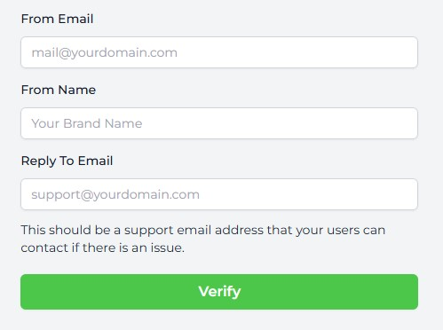
</Frame>

Trophy enviará un correo de verificación a esa dirección. Solo tienes que hacer clic en el enlace del correo para confirmar a Trophy que eres el propietario de la dirección, y ya estará todo listo.

<Note>
  El correo que recibirás procederá de nuestro proveedor de correo electrónico, Postmark. ¡Así que busca
  «Postmark Support» en tu bandeja de entrada!
</Note>

La Verificación del remitente es ideal para empezar, pero tiene limitaciones: no te beneficiarás de la reputación de tu correo electrónico actual y solo podrás enviar correos desde una dirección.

Además, si en el futuro quieres cambiar la dirección, tendrás que volver a realizar la Verificación del remitente, lo cual puedes hacer en la [pantalla de ajustes](https://app.trophy.so/integration?tab=domains).

#### Verificación de DNS (avanzada) {#dns-verification-advanced}

Para uso en producción, recomendamos la verificación de DNS. Una vez configurada, te permite configurar Trophy para enviar correos electrónicos desde cualquier dirección de tu dominio. Así, si quieres cambiar la dirección en el futuro, no tendrás que volver a verificarla.

Completar la verificación de DNS también te permite aprovechar al máximo la reputación que ya tenga tu dominio y es la mejor forma de asegurarte de que tus correos electrónicos no acaben en la carpeta de spam.

Sin embargo, esto requiere añadir un par de entradas nuevas en tu DNS para que Trophy pueda verificar que eres el propietario del dominio.

Sigue los pasos a continuación para configurar la verificación de DNS:

<Steps>
<Step title="Ve a la página de Emails">
    En la página de Emails encontrarás la pestaña [Domains](https://app.trophy.so/emails/domains), donde configurarás todo lo relacionado con el dominio de correo que Trophy usará para enviar correos electrónicos en tu nombre.
</Step>

<Step title="Configura tu dominio">
    Ve a la sección de verificación de DNS e introduce el dominio que quieres configurar con Trophy.

    También puedes configurar una Return Path personalizada. Es la dirección a la que Trophy reenviará las notificaciones de correos rebotados para ayudarte a investigar problemas de entregabilidad:

    <Frame>
      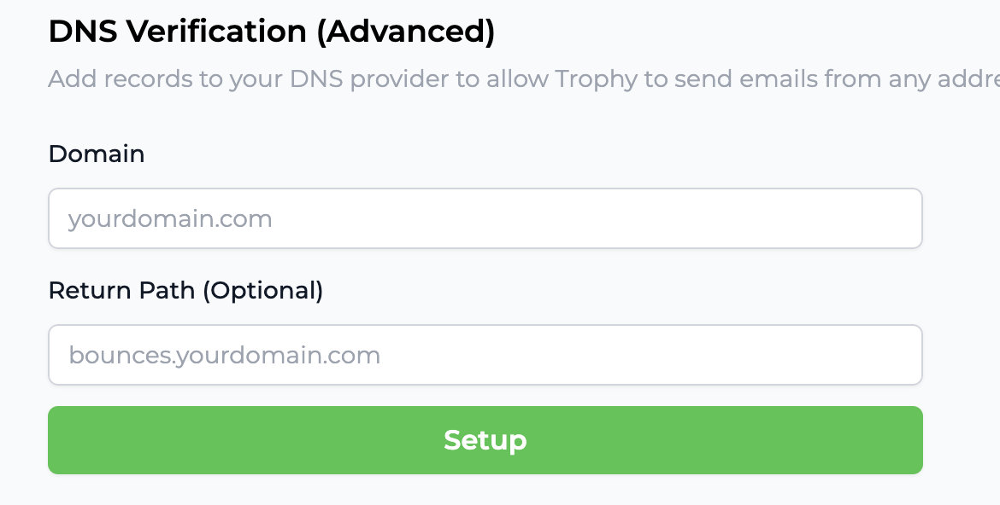
    </Frame>

</Step>

<Step title="Configura tus registros DNS">

    Una vez que hayas introducido el dominio de correo, Trophy te proporcionará los datos de dos nuevos registros DNS que deberás añadir en tu proveedor de DNS.

    <Frame>
      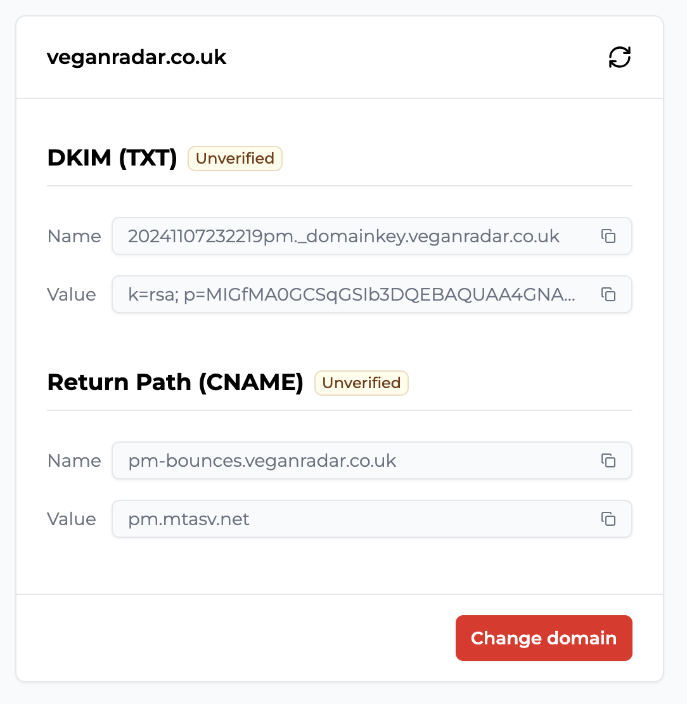
    </Frame>

    - El primero es el registro **DKIM**, que los proveedores de bandeja de entrada, como Google, utilizan para verificar la autenticidad de los correos electrónicos. Introduce el nombre y el valor proporcionados como un nuevo registro **TXT** en tu proveedor de DNS.
    - El segundo es el registro **Return Path**. Se utiliza para reenviar a tu dominio las notificaciones de correos rebotados. Introduce el nombre y el valor proporcionados como un nuevo registro **CNAME** en tu proveedor de DNS.

    Estas son las páginas de los proveedores de DNS más comunes con instrucciones para configurar nuevos registros:

    <AccordionGroup>
      <Accordion title='GoDaddy'>
          [Añadir un registro TXT](https://www.godaddy.com/en-uk/help/add-a-txt-record-19232)
          [Añadir un registro CNAME](https://www.godaddy.com/en-uk/help/add-a-cname-record-19236)
      </Accordion>
      <Accordion title='Cloudflare'>
          [Añadir registros DNS](https://developers.cloudflare.com/dns/manage-dns-records/how-to/create-dns-records/#create-dns-records)
      </Accordion>
      <Accordion title="NameCheap">
          [Añadir un registro CNAME](https://www.namecheap.com/support/knowledgebase/article.aspx/9646/2237/how-to-create-a-cname-record-for-your-domain/)
          [Añadir un registro TXT](https://www.namecheap.com/support/knowledgebase/article.aspx/317/2237how-do-i-add-txtspfdkimdmarc-records-for-my-domain/#:~:text=this%20guide%20.-,DKIM%20records,-DKIM%20(DomainKeys%20Identified))
      </Accordion>
    </AccordionGroup>

    <Warning>Nota: si usas un proxy como Cloudflare, asegúrate de desactivarlo para estos registros; de lo contrario, Trophy no podrá verificarlos correctamente.</Warning>

</Step>

<Step title="Verificar los registros DNS">

    Una vez que hayas añadido los dos registros en la configuración de tu DNS, haz clic en el icono de actualizar y Trophy intentará verificarlos por ti.

    Normalmente, Trophy puede verificar los registros en unos minutos, pero ten en cuenta que los cambios de DNS pueden tardar hasta unas horas en propagarse por completo.

    Si ves la siguiente alerta, es posible que los registros aún no se hayan propagado o que haya un problema en tu configuración.

    <Frame>
      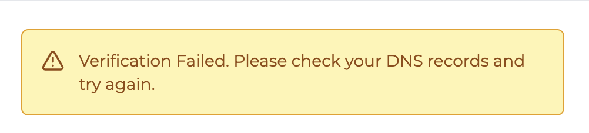
    </Frame>

    Cuando te asegures de que todo está configurado correctamente en tu proveedor de DNS, haz clic en actualizar y Trophy intentará verificar tus registros DNS de nuevo.

    En cuanto veas el siguiente mensaje, sabrás que todo está verificado:

    <Frame>
      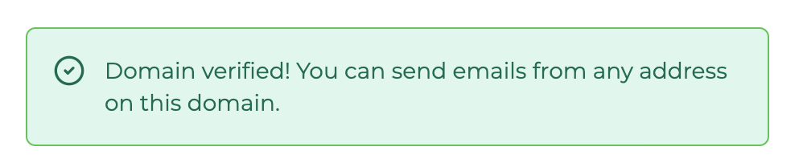
    </Frame>

</Step>

<Step title="Configurar tu dirección de envío">

    Una vez verificados tus registros DNS, es el momento de elegir la dirección de correo electrónico desde la que quieres enviar los correos. Ten en cuenta que, ahora que has verificado completamente tu dominio, puedes cambiar esta dirección cuando quieras sin afectar a la entregabilidad.

    Simplemente introduce la dirección de correo electrónico desde la que quieres que Trophy envíe los mensajes, el nombre que verán los usuarios en la bandeja de entrada cuando reciban los correos y una dirección de correo de soporte que puedan usar para contactarte si lo necesitan:

    <Frame>
      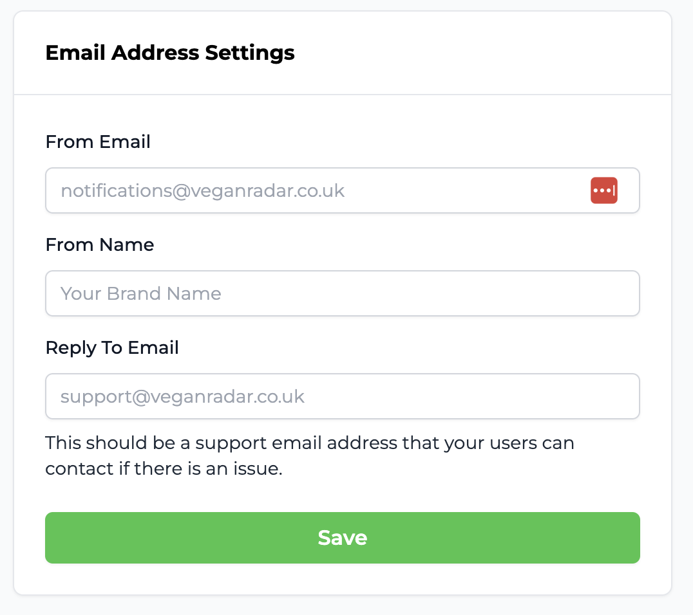
    </Frame>

</Step>

</Steps>

### Activadores de correo electrónico {#email-triggers}

En la página de [configuración de correo electrónico](https://app.trophy.so/emails/configure), cada tipo de correo tiene su propia sección. Añade plantillas al tipo correspondiente y activa una para empezar a enviar.

#### Correos de resumen {#recap-emails}

Los correos de **resumen** envían a los usuarios informes de progreso semanales o mensuales. Puedes cambiar la frecuencia de estos correos en la página de [integración](https://app.trophy.so/integration/configure) con el ajuste **Periodo de agregación**, o mediante la [API de administración para la configuración de la organización](/es/admin-api/endpoints/settings/update-organization-settings).

<Frame>
  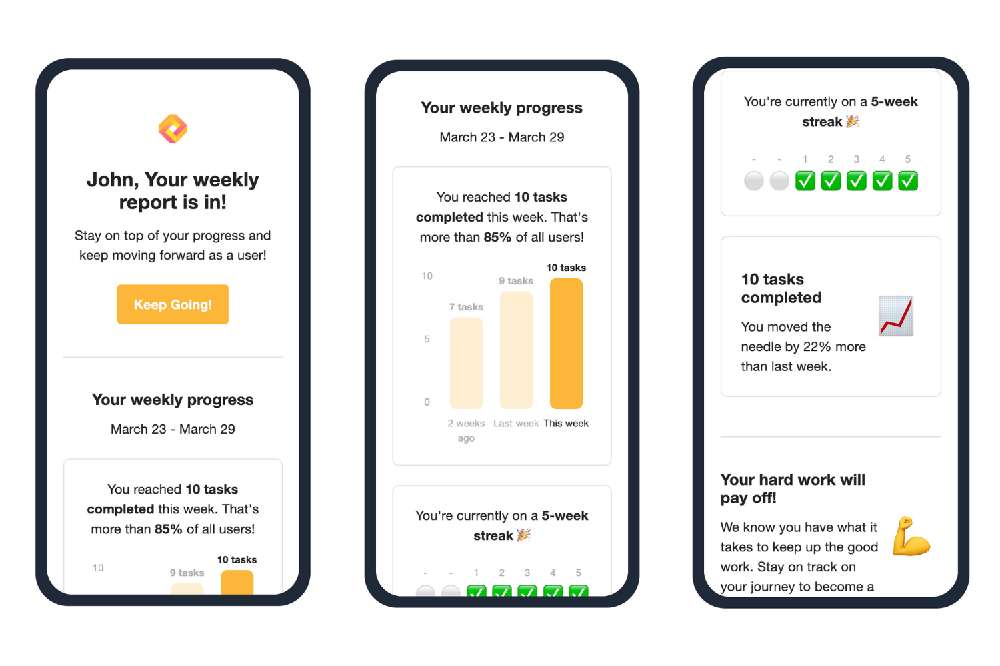
</Frame>

#### Correos de reactivación {#reactivation-emails}

Los correos de **reactivación** envían mensajes para recuperar a los usuarios cuando dejan de estar activos. Estos correos se envían según el siguiente calendario:

- Tras 3 días de inactividad
- Tras 5 días de inactividad
- Tras 7 días de inactividad
- Tras 14 días de inactividad
- Tras 30 días de inactividad

<Frame>
  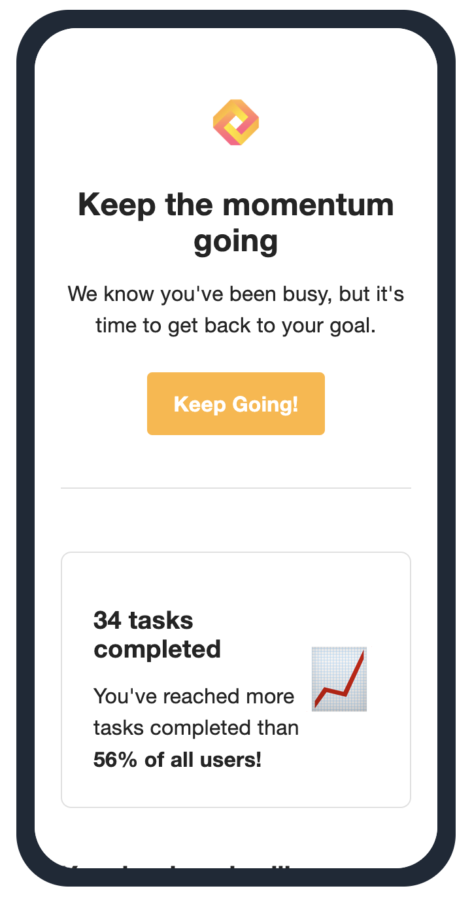
</Frame>

#### Correos de racha {#streak-emails}

Los correos de **racha** recuerdan a los usuarios que amplíen su racha antes de que expire. Estos correos se envían según la frecuencia de racha que hayas configurado en la [página de rachas](https://app.trophy.so/streaks):

- Si tu aplicación usa una **racha diaria**, este correo se enviará cuatro horas antes de que termine el día (en la zona horaria de cada usuario).
- Para las **rachas semanales**, se enviará el viernes por la mañana.
- Para las **rachas mensuales**, se enviará el día 25 del mes.

<Frame>
  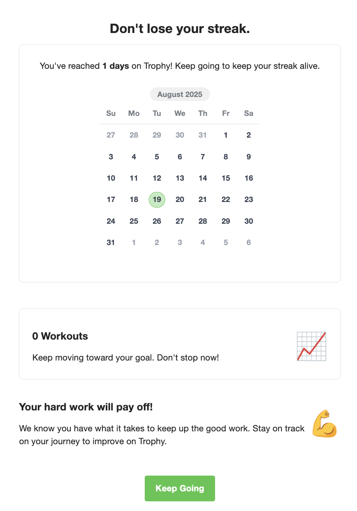
</Frame>

#### Correos de logro {#achievement-emails}

Los correos de **logro** felicitan a los usuarios cuando completan un [logro](/es/features/achievements) que has configurado en Trophy. Estos correos se envían entre las 17:00 y las 21:00 del día en que se completa el logro, o al día siguiente a las 17:00 si el usuario lo completa pasadas las 21:00.

<Frame>
  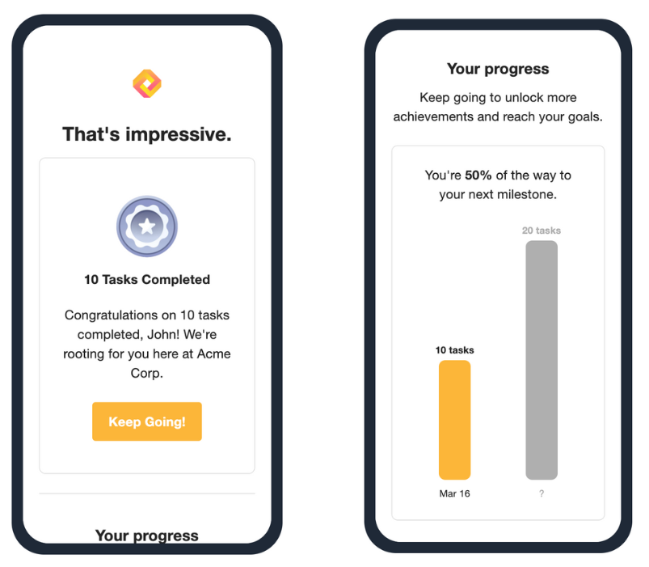
</Frame>

#### Limitar los correos electrónicos a tipos específicos de usuarios {#limiting-emails-to-specific-types-of-users}

Cada plantilla de correo electrónico se puede limitar a los usuarios con valores específicos de [atributos de usuario personalizados](/es/features/users#custom-user-attributes).

Para cada atributo al que quieras restringir el correo electrónico, haz clic en el icono de más junto al encabezado **Filtros de usuario** de la plantilla, selecciona el atributo e introduce el valor deseado. Solo los usuarios que tengan **todos** los valores de atributo especificados recibirán correos electrónicos de esta plantilla.

<Frame>
  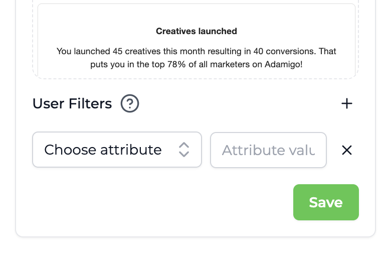
</Frame>

#### Zonas horarias {#time-zones}

Si especificas una zona horaria para cada usuario mediante [la identificación de usuarios](/es/features/users#param-tz), Trophy usará esa zona horaria local para programar los correos electrónicos según la lógica descrita anteriormente. Si no proporcionas zonas horarias para los usuarios que identificas, Trophy usará por defecto la hora del este (Eastern Time).

### Envío de correos electrónicos mediante webhooks {#sending-emails-via-webhooks}

En lugar de que Trophy envíe los correos electrónicos por ti, puedes suscribirte a los eventos de webhook de correo electrónico y enviar los mensajes tú mismo a través de tu propio proveedor de correo electrónico o pipeline.

Cuando corresponde enviar un correo electrónico, Trophy dispara el webhook correspondiente para que puedas encargarte del envío:

- [`emails.recap_due`](/es/webhooks/events/emails/recap-due)
- [`emails.reactivation_due`](/es/webhooks/events/emails/reactivation-due)
- [`emails.streak_reminder_due`](/es/webhooks/events/emails/streak-reminder-due)
- [`emails.achievement_due`](/es/webhooks/events/emails/achievement-due)

Estos webhooks se disparan según los propios desencadenantes de los correos electrónicos, independientemente de si hay plantillas de correo habilitadas o deshabilitadas, y de los [filtros de atributos de usuario](#limiting-emails-to-specific-types-of-users) configurados en esas plantillas. Si necesitas un filtrado equivalente, aplícalo en tu controlador de webhooks.

Los webhooks de correo electrónico respetan las [preferencias de notificación](/es/features/users#notification-preferences) y el [atributo de control](/es/platform/experimentation#control-ratio) utilizado para la experimentación. Trophy no disparará webhooks de correo electrónico para los usuarios que hayan rechazado ese tipo de correo ni para los usuarios del grupo de control.

<Warning>
  Si envías tú mismo correos electrónicos desde estos webhooks, asegúrate de que las plantillas de correo correspondientes estén desactivadas en Trophy. Los webhooks de correo se siguen activando cuando se cumplen los desencadenadores, incluso si las plantillas están desactivadas, pero si las plantillas siguen activadas, Trophy también enviará sus propios correos, lo que provocará un envío duplicado.
</Warning>

## Diseño de correos electrónicos {#designing-emails}

Trophy incluye un editor de correos basado en bloques, con todas las funciones, que te permite diseñar plantillas y controlar todo el texto y los asuntos de los correos. En la página de [correos electrónicos](https://app.trophy.so/emails/configure), añade plantillas en cada sección de [tipo de correo](#email-triggers) que quieras usar.

<Frame>
  <video
    autoPlay
    muted
    loop
    playsInline
    className="w-full aspect-15/4"
    src="../../assets/features/emails/designing_emails.mp4"
  ></video>
</Frame>

### Plantillas predeterminadas {#default-templates}

De forma predeterminada, Trophy ofrece una plantilla para cada [tipo de correo](#types-of-emails) como buen punto de partida. Las plantillas predeterminadas no se pueden modificar, pero puedes duplicarlas y personalizarlas como quieras.

<Tip>
  También puedes crear plantillas en blanco si prefieres empezar desde cero.
</Tip>

### Crear una plantilla nueva {#creating-a-new-template}

Para crear una plantilla de correo nueva, sigue estos pasos.

<Steps>
  <Step title="Ve a la página de correos electrónicos">
    En la página de correos electrónicos encontrarás la pestaña
    [Configurar](https://app.trophy.so/emails/configure), donde cada sección de tipo de correo contiene sus plantillas.
  </Step>
  <Step title="Añade una plantilla">
    Haz clic en el botón *Añadir plantilla* dentro de la sección del tipo de correo para el que quieras crear una plantilla.

    <Frame>
      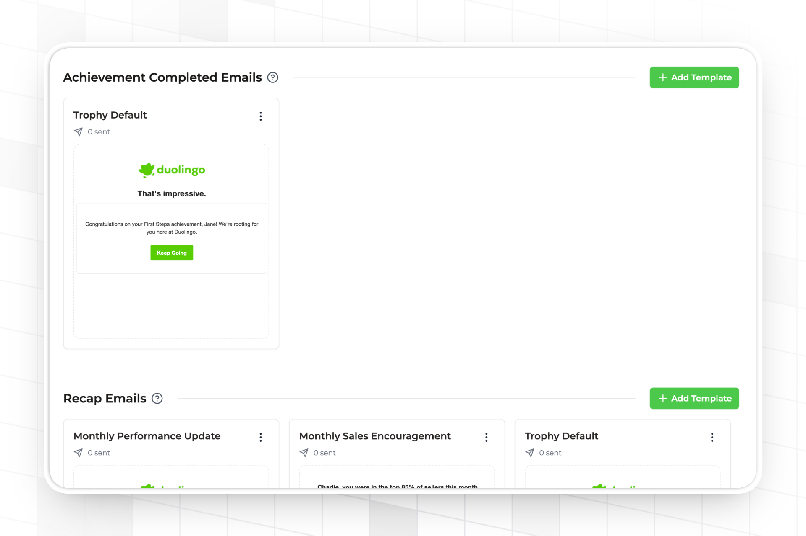
    </Frame>

  </Step>
  <Step title="Diseña tu nueva plantilla">
    Usa el editor basado en bloques para diseñar tu plantilla de correo.

    <Frame>
      <video
        autoPlay
        muted
        loop
        playsInline
        className="w-full aspect-15/4"
        src="../../assets/features/emails/designing_emails.mp4"
      ></video>
    </Frame>

  </Step>
</Steps>

### Tipos de bloques {#block-types}

El editor de correos electrónicos de Trophy admite varios tipos de bloques con distintos fines. Todos los componentes básicos que esperarías encontrar en un editor de correo, como párrafos, encabezados e imágenes, se denominan [Bloques básicos](#basic-blocks). También hay un conjunto de componentes más potentes, como gráficos y rachas, que aprovechan los datos de actividad de los usuarios y las funciones de gamificación de Trophy. Se denominan [Bloques inteligentes](#smart-blocks).

<Frame>
  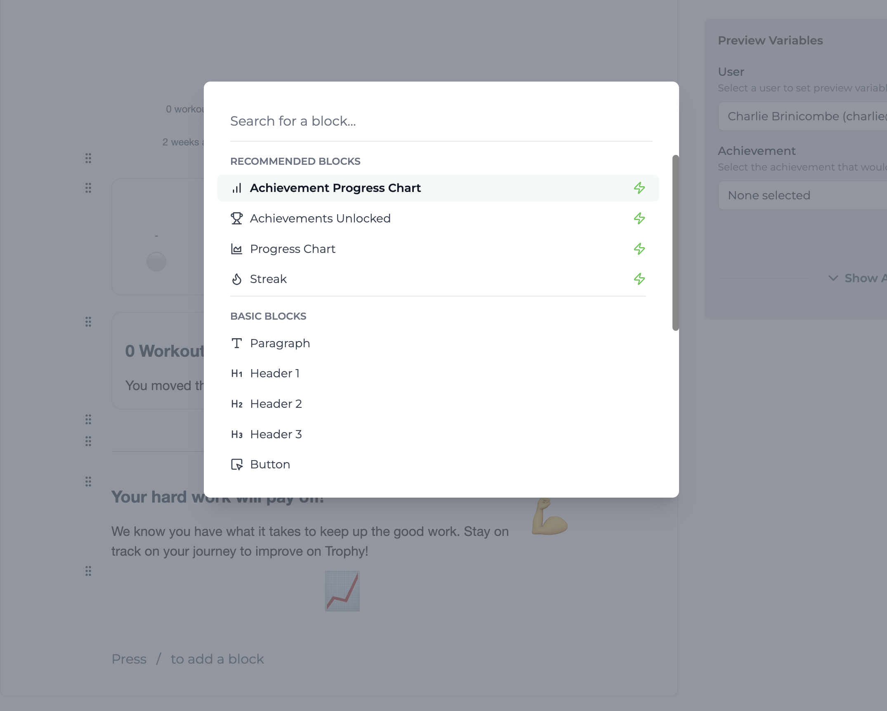
</Frame>

#### Bloques básicos {#basic-blocks}

Esta es la lista completa de bloques básicos de propósito general que admite Trophy:

- **Párrafo** - Ideal para fragmentos de texto cortos o largos.
- **H1, H2, H3** - Útiles para encabezados de distintos tamaños.
- **Botón** - Crea una llamada a la acción para que los usuarios la realicen desde el correo.
- **Tarjeta** - Puede anidar otros bloques para centrar la atención.
- **Divisor** - Ideal para separar el contenido en secciones lógicas.
- **Emoji** - Incluye cualquier emoji compatible y permite controlar su tamaño.
- **Imagen** - Sube cualquier imagen y Trophy la mostrará en los correos.
- **Espaciador** - Ideal para dar espacio a los bloques y que destaquen.
- **Columnas** - Útil para crear diseños de hasta 3 columnas con cualquier contenido.
- **Logotipo** - Muestra el logotipo de tu organización, configurado en la página de [Marca](https://app.trophy.so/branding).

#### Bloques condicionales {#conditional-blocks}

Trophy también incluye un potente sistema de renderizado condicional basado en el tipo de bloque _Condicional_.

Al anidar cualquier otro bloque dentro de un bloque condicional y configurar la lógica de las condiciones, puedes crear casi cualquier diseño de correo que muestre bloques distintos según el resultado de la evaluación de las condiciones en el momento del envío.

Si conoces los operadores lógicos `if/else`, esto te resultará muy familiar. Si no, aquí tienes un diagrama rápido que explica cómo funciona.

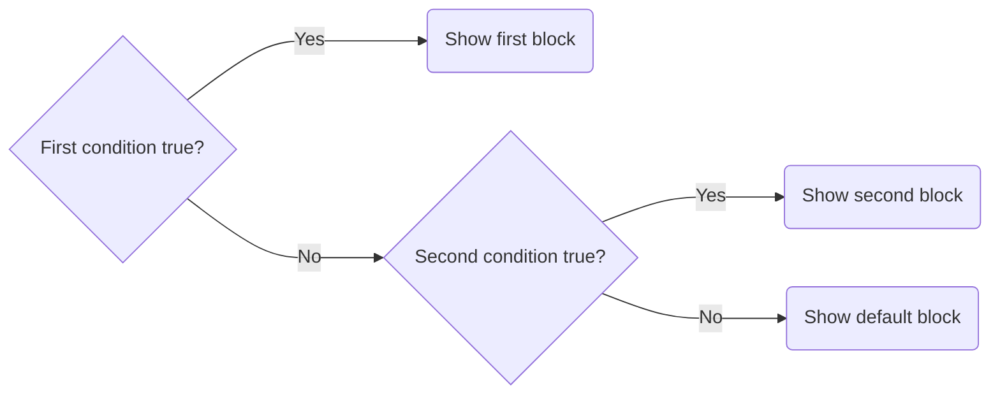

Un caso de uso común del bloque condicional es mostrar al usuario su racha (uno de los [Bloques inteligentes](#smart-blocks) integrados de Trophy) y un texto motivacional relacionado con la racha solo si tiene una racha activa. Si el destinatario no tiene una racha en el momento en que se envía el correo, se muestra un mensaje sencillo en su lugar.

<Frame>
  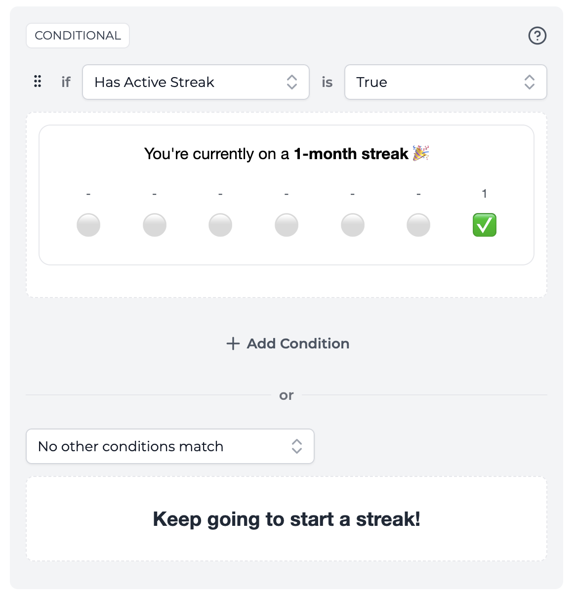
</Frame>

Esto crea un marco potente para diseñar correos electrónicos basados en datos de usuario muy relevantes y personalizados, y permite crear una amplia variedad de correos para los casos de uso más habituales de gamificación.

#### Bloques inteligentes {#smart-blocks}

Los bloques inteligentes son componentes potentes diseñados para cubrir casos de uso habituales de gamificación y se integran con todas las funciones de Trophy, incluidas las métricas, los logros y las rachas.

Encontrarás todos los bloques inteligentes en la sección _Bloques recomendados_ y siempre los reconocerás por el icono <Icon icon="zap" />.

Mira cómo Charlie explica los bloques inteligentes y cómo funcionan:

<Frame>
  <iframe
    width="560"
    height="315"
    src="https://www.youtube.com/embed/CA7i8Gd5K1s?si=mHkAwVPZYMoBPm15"
    title="Reproductor de vídeo de YouTube"
    frameborder="0"
    allow="accelerometer; autoplay; clipboard-write; encrypted-media; gyroscope; picture-in-picture"
    allowfullscreen
  ></iframe>
</Frame>

Descubre más sobre el caso de uso de cada bloque inteligente:

<AccordionGroup>
  <Accordion title="Gráfico de progreso de logros" icon="zap">
    El bloque de gráfico de progreso de logros muestra un gráfico con barras para hasta cinco logros de una métrica concreta y resalta los que el destinatario ha desbloqueado.
    
    Elige la métrica cuyos logros quieres mostrar con el selector de métricas.

    <Frame>
      <video
        autoPlay
        muted
        loop
        playsInline
        className="w-full aspect-video"
        src="../../assets/features/emails/achievement_progress_block.mp4"
      ></video>
    </Frame>

  </Accordion>

{" "}

<Accordion title="Logros desbloqueados" icon="zap">
  El bloque de logros desbloqueados muestra el logro que ha desbloqueado el destinatario. Solo resulta útil en el contexto de correos de logros desbloqueados. Si el destinatario no ha desbloqueado ningún logro, este bloque no se mostrará en los correos.

Cuando los logros tienen insignias, estas se muestran automáticamente, junto con el nombre del logro.

  <Frame>
      <video
        autoPlay
        muted
        loop
        playsInline
        className="w-full aspect-video"
        src="../../assets/features/emails/achievements_unlocked_block.mp4"
      ></video>
    </Frame>
</Accordion>

{" "}

<Accordion title="Gráfico de progreso" icon="zap">
  El bloque de gráfico de progreso muestra el progreso del destinatario en una métrica concreta durante los últimos 3 [periodos de agregación](#aggregation-period).

  <Frame>
      <video
        autoPlay
        muted
        loop
        playsInline
        className="w-full aspect-video"
        src="../../assets/features/emails/progress_chart_block.mp4"
      ></video>
    </Frame>
</Accordion>

  <Accordion title="Racha" icon="zap">
    El bloque de racha muestra la racha actual del destinatario según la configuración de rachas de tu cuenta.
    
    En las rachas diarias, se muestra un bloque de calendario con el historial de rachas del último mes. Las rachas semanales y mensuales muestran los últimos 7 periodos del historial de rachas.

    <Frame>
      <video
        autoPlay
        muted
        loop
        playsInline
        className="w-full aspect-video"
        src="../../assets/features/emails/streak_block.mp4"
      ></video>
    </Frame>

  </Accordion>
</AccordionGroup>

### Variables de correo {#email-variables}

Trophy ofrece un amplio conjunto de variables de correo que puedes usar para insertar texto personalizado y muy relevante en el cuerpo y en el asunto de los correos.

Las variables incorporan a tus plantillas de correo el contexto de tu cuenta de Trophy, los datos de progreso del destinatario y los ajustes específicos de cada correo.

Puedes insertar variables de correo escribiendo `@` en cualquier bloque que admita texto enriquecido, como encabezados, párrafos y botones, y buscando la variable que quieras.

Esto abrirá la ventana del editor de variables, donde podrás configurarlas como se muestra en la demo siguiente.

<Tip>También puedes usar variables en las líneas de asunto de los correos electrónicos.</Tip>

<Frame>
  <video
    autoPlay
    muted
    loop
    playsInline
    className="w-full aspect-video"
    src="../../assets/features/emails/email_variables_demo.mp4"
  ></video>
</Frame>

A continuación encontrarás la lista completa de las variables de correo electrónico compatibles con el editor de correos, organizadas por categoría.

<AccordionGroup>
<Accordion title="Usuario">
Variables relacionadas con el destinatario del correo electrónico.

- **Nombre**: El nombre del destinatario, si está definido

Además, todos los [atributos de usuario personalizados](/es/features/users#custom-user-attributes) están disponibles como variables de correo electrónico.

</Accordion>
<Accordion title="Métricas">
  Variables relacionadas con los datos de eventos del destinatario registrados en las métricas.

Cada métrica de Trophy admite las siguientes variables de correo electrónico:

- **Nombre de la métrica**: El nombre de la métrica
- **Unidades de la métrica**: Las unidades de la métrica
- **Total actual**: La suma de todos los valores de eventos del destinatario hasta la fecha
- **Cambio en este período**: Cambio absoluto en el total actual del destinatario durante el período de agregación actual
- **Cambio en este período (%)**: Cambio porcentual en el total actual del destinatario durante el período de agregación actual
- **Percentil (histórico)**: El total actual del destinatario en comparación con el de todos los demás usuarios en todo el historial
- **Percentil (este período)**: El total actual del destinatario en comparación con el de todos los demás usuarios durante el período de agregación actual

Además, los alias dinámicos **Más alto** y **Más bajo** admiten el mismo conjunto de variables. Al usar estos alias, Trophy elegirá la métrica en la que el destinatario tenga el total actual más alto o más bajo en el momento del envío.

Al usar variables de métricas, también tienes la opción de filtrar los datos a los que hace referencia cualquiera de las variables anteriores mediante un [atributo de evento personalizado](/es/features/events#custom-event-attributes).

    </Accordion>

<Accordion title="Puntos">

Al igual que las métricas, cada sistema de puntos tiene las siguientes variables, que se pueden usar para añadir datos dinámicos al texto de los correos:

- **Total actual**: Los puntos totales del destinatario
- **Cambio en este período**: Cambio absoluto en los puntos totales del destinatario durante el período de agregación actual
- **Cambio en este período (%)**: Cambio porcentual en los puntos totales del destinatario durante el período de agregación actual
- **Percentil (histórico)**: Los puntos totales del destinatario comparados con los de todos los demás usuarios a lo largo de todo el tiempo
- **Percentil (este período)**: Los puntos totales del destinatario comparados con los de todos los demás usuarios durante el período de agregación actual

.

</Accordion>
<Accordion title="Logros">
  <Note>
  Estas variables solo son relevantes para los [correos de logros](#achievement-emails).
  </Note>

Al configurar una plantilla para los correos de logros, están disponibles las siguientes variables:

- **Es el logro final**: Si el logro que activa el correo forma parte de una serie de logros de métricas, el valor es verdadero cuando ese logro es el último de la serie
- **Porcentaje hasta el siguiente logro**: Si el logro que activa el correo forma parte de una serie de logros de métricas, indica el porcentaje que falta para que el usuario desbloquee el siguiente logro de la serie
- **Nombre del logro**: El nombre del logro que activó el correo
- **Descripción del logro**: La descripción del logro que activó el correo

.

  </Accordion>
<Accordion title="Racha">
  Variables relacionadas con la racha del destinatario.

- **Tiene racha activa**: Verdadero si el destinatario tiene una racha activa en el momento de enviar el correo; falso en caso contrario
- **Duración de la racha**: La duración de la racha actual del destinatario
- **Racha extendida**: Verdadero si la racha del destinatario se extendió; falso en caso contrario
- **Días desde la última extensión**: El número de días transcurridos desde que el usuario extendió su racha por última vez

.

</Accordion>
<Accordion title="Reactivación">
  <Note>
  Estas variables solo son relevantes para los [correos electrónicos de reactivación](#reactivation-emails).
  </Note>

- **Número de mensaje**: el número del mensaje en la secuencia de reactivación (1-5)

.

</Accordion>
<Accordion id="aggregation-period" title="Período de agregación">
    <Note>
  Estas variables solo son relevantes para los [correos electrónicos de resumen](#recap-emails).
  </Note>

- **Rango de fechas del período actual**: las fechas de inicio y fin del período de agregación actual

.

</Accordion>
</AccordionGroup>

#### Uso avanzado {#advanced-usage}

Hay un par de opciones adicionales que conviene tener en cuenta al usar variables en los correos electrónicos.

**Prefijo y sufijo**

Puedes definir un prefijo y un sufijo para variables de texto, como el nombre del destinatario o el nombre de una métrica concreta.

<Frame>
  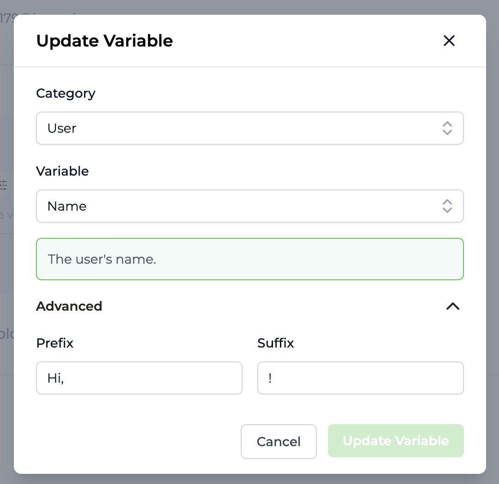
</Frame>

Si el valor de la variable no se puede renderizar cuando se envía el correo electrónico, Trophy no mostrará ni la variable ni el prefijo o sufijo, para mantener los correos limpios.

**Singular y plural**

Al usar variables numéricas, como el total actual de puntos del destinatario o el total de una métrica, también puedes definir un sufijo en singular y otro en plural que las acompañen.

<Frame>
  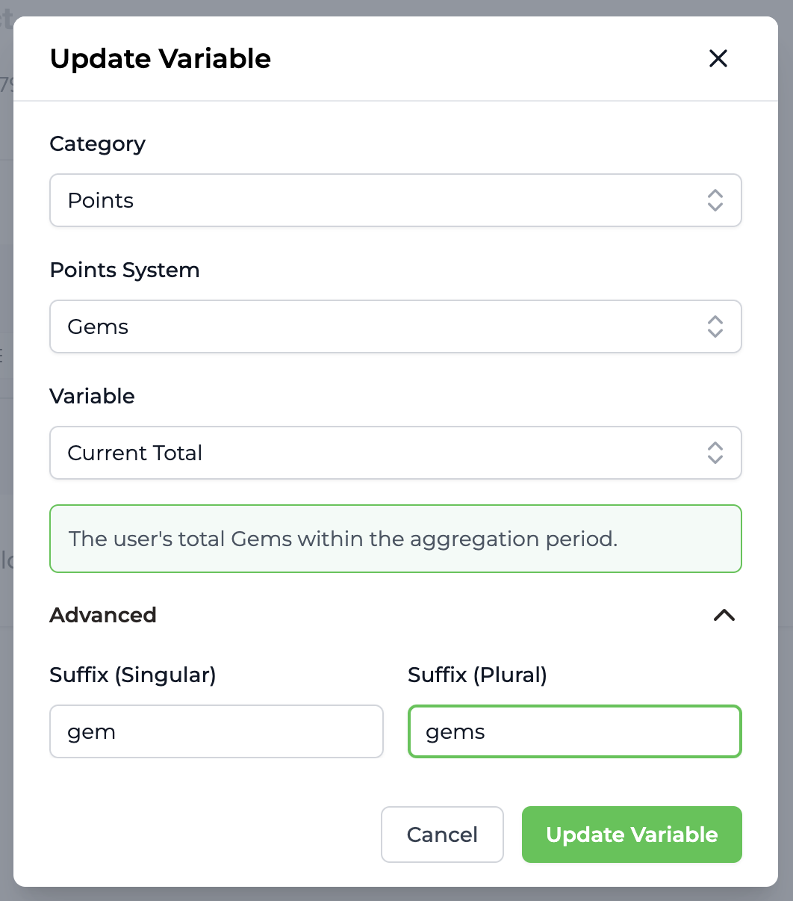
</Frame>

### Variaciones de texto {#text-variations}

Las variaciones sirven para añadir aleatoriedad al texto de los correos electrónicos que envía Trophy. Así se evita que los correos resulten monótonos y se mejoran las tasas de apertura y de clics.

<Frame>
  <iframe
    width="560"
    height="315"
    src="https://www.youtube.com/embed/mlxMqHsdql8?si=hhizWfwiylgxxEuV"
    title="Reproductor de vídeo de YouTube"
    frameborder="0"
    allow="accelerometer; autoplay; clipboard-write; encrypted-media; gyroscope; picture-in-picture"
    allowfullscreen
  ></iframe>
</Frame>

Cualquier bloque que admita la entrada de texto, incluidos H1, H2, H3 y párrafo, admite variaciones.

<Tip>También puedes usar variaciones para añadir aleatoriedad a las líneas de asunto de los correos electrónicos.</Tip>

Para crear una variación, haz clic en el botón _Añadir variación_ de cualquier bloque que las admita.

<Frame>
  <video
    autoPlay
    muted
    loop
    playsInline
    className="w-full aspect-video"
    src="../../assets/features/emails/creating_variations.mp4"
  ></video>
</Frame>

<Note>
  Las variaciones aún no admiten pruebas A/B, pero está en nuestra hoja de ruta, así que
  estate atento...
</Note>

### Uso del editor {#using-the-editor}

El editor de plantillas de correo electrónico es un lienzo en blanco para diseñar correos que se vean muy bien en la bandeja de entrada. El uso de [bloques](#block-types) preconfigurados facilita la creación de plantillas de correo que se ajustan a los casos de uso habituales de gamificación. A continuación, veremos cómo aprovechar al máximo el editor para crear correos con un aspecto genial.

#### Añadir bloques {#adding-blocks}

Para añadir un nuevo bloque a una plantilla de correo electrónico, pulsa la tecla <Icon icon="square-slash" />. Se abrirá el cuadro de diálogo de selección de bloques, donde podrás elegir el bloque que quieres añadir.

<Frame>
  <video
    autoPlay
    muted
    loop
    playsInline
    className="w-full aspect-video"
    src="../../assets/features/emails/add_new_block_slash.mp4"
  ></video>
</Frame>

O, si quieres añadir un bloque justo después de otro, usa el menú de bloques.

<Frame>
  <video
    autoPlay
    muted
    loop
    playsInline
    className="w-full aspect-video"
    src="../../assets/features/emails/add_new_block_by_block_menu.mp4"
  ></video>
</Frame>

#### Organizar bloques {#arranging-blocks}

Puedes arrastrar los bloques hacia arriba y hacia abajo con el menú de bloques.

<Frame>
  <video
    autoPlay
    muted
    loop
    playsInline
    className="w-full aspect-video"
    src="../../assets/features/emails/arranging_blocks.mp4"
  ></video>
</Frame>

#### Formato de texto {#text-formatting}

El editor de correo electrónico ofrece formato de texto enriquecido, que incluye negrita, cursiva, [hipervínculos](https://www.youtube.com/watch?v=dQw4w9WgXcQ) y formato `code`.

<Frame>
  <video
    autoPlay
    muted
    loop
    playsInline
    className="w-full aspect-video"
    src="../../assets/features/emails/rich_text_formatting.mp4"
  ></video>
</Frame>

### Estilo de fuente {#font-style}

En la [página de configuración de correos electrónicos](https://app.trophy.so/emails/configure) encontrarás un ajuste para cambiar el estilo de fuente que se usa en todos los correos.

<Frame>
  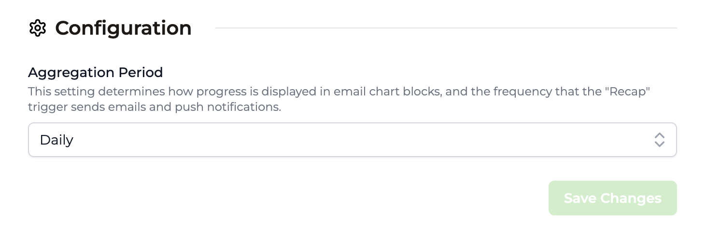
</Frame>

El resto de los estilos del correo se obtienen de los ajustes de [Marca](https://app.trophy.so/branding) de tu cuenta de Trophy.

## Gestión de las bajas de suscripción {#handling-unsubscribes}

Todos los correos electrónicos que envía Trophy incluyen un enlace y un mensaje para cancelar la suscripción. Esto es importante para cumplir con la normativa y no es posible ocultarlo.

<Info>
  El mensaje dice lo siguiente: Recibes este correo porque estás suscrito a los
  correos de informes de progreso y de logros. Si ya no deseas recibir estos
  correos, puedes cancelar la suscripción.
</Info>

Cualquier destinatario que haga clic en este enlace accederá a una página con tu marca que le permite controlar qué notificaciones por correo electrónico recibe.

<Tip>
  Como alternativa al enlace de cancelación de suscripción, también puedes crear
  un centro de preferencias en tu aplicación con la [API de preferencias de
  usuario](/es/features/users#notification-preferences) de Trophy. Esto ofrece a
  los usuarios un control más detallado sobre los tipos de correos que reciben.
</Tip>

## Analíticas de correo electrónico {#email-analytics}

Trophy incluye analíticas integradas para todos los correos electrónicos que envía. Estas incluyen:

- Destinatarios (el número total de personas que recibieron el correo)
- Tasa de apertura (el porcentaje de destinatarios que abrieron el correo)
- Tasa de clics (el porcentaje de destinatarios que hicieron clic en al menos un enlace del correo)
- Tasa de retención (el porcentaje de usuarios que abrieron el correo y volvieron a usar tu plataforma al menos 2 días después)

<Frame>
  <video
    autoPlay
    muted
    loop
    playsInline
    className="w-full aspect-video"
    src="../../assets/features/emails/email_analytics.mp4"
  ></video>
</Frame>

## Preguntas frecuentes {#frequently-asked-questions}

<AccordionGroup>
<Accordion title="¿Puedo enviar correos electrónicos desde mi propio dominio?">
    ¡Sí! El envío de correos electrónicos desde tu propio dominio es compatible de forma predeterminada. Sigue los pasos de la sección sobre [envío de correos electrónicos](#sending-emails) para empezar.
  </Accordion>

{" "}

<Accordion title="¿Limitan la cantidad de correos electrónicos que puedo enviar?">
  No, no limitamos la cantidad de correos electrónicos que puedes enviar. Sin embargo, supervisamos el uso
  para evitar abusos.
</Accordion>

</AccordionGroup>

## Obtener soporte {#get-support}

¿Quieres ponerte en contacto con el equipo de Trophy? Escríbenos por [correo electrónico](mailto:support@trophy.so). ¡Estamos aquí para ayudarte!
