import LeaderboardSingleAttributeRequest from "../../snippets/leaderboard-rankings-request-single-attribute.mdx";
import LeaderboardMultiAttributeRequest from "../../snippets/leaderboard-rankings-request-multiple-attributes.mdx";

## ¿Qué son las Clasificaciones? {#what-are-leaderboards}

Las Clasificaciones son competencias sociales entre usuarios de tu aplicación. Usa clasificaciones para aumentar la participación y fomentar la interacción social.

<Frame>
  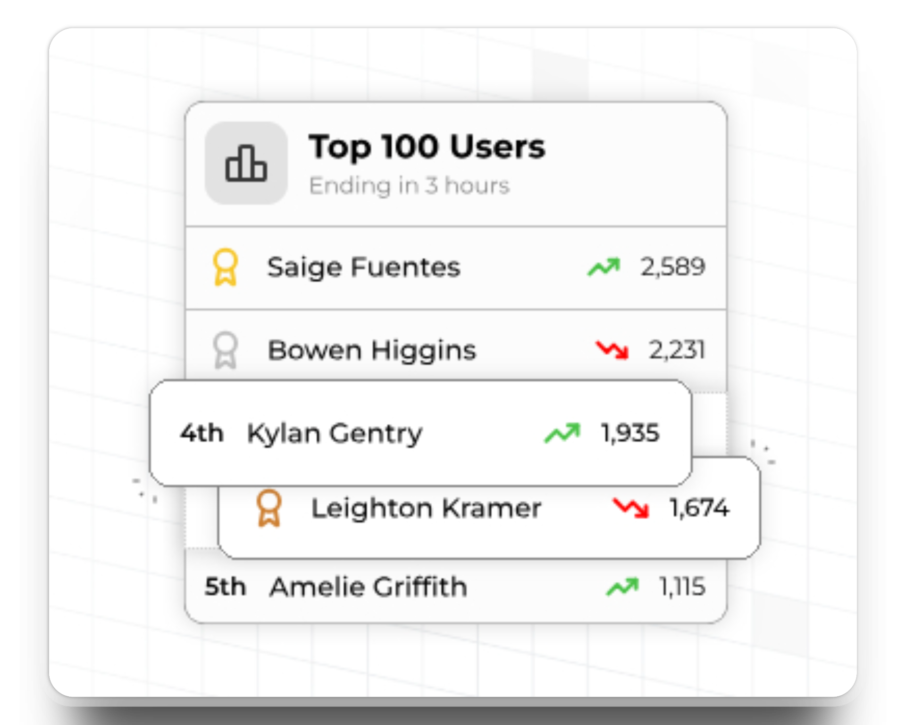
</Frame>

## Tipos de Clasificaciones {#types-of-leaderboards}

En esta sección describimos los diferentes tipos de clasificaciones compatibles con Trophy y cuándo usar cada una.

### Clasificaciones Perpetuas {#perpetual-leaderboards}

Las clasificaciones perpetuas nunca se reinician. Una vez iniciadas, rastrean y clasifican continuamente el progreso de los usuarios a lo largo del tiempo de forma permanente, o hasta la [fecha de finalización](#end-dates) configurada.

Usa clasificaciones perpetuas cuando quieras crear clasificaciones históricas de la actividad de los usuarios.

### Clasificaciones Recurrentes {#repeating-leaderboards}

Las clasificaciones recurrentes se pueden configurar para reiniciarse después de cualquier número arbitrario de días, meses o años.

En Trophy, cada instancia de una clasificación recurrente se llama **'ejecución'**. Por ejemplo, una clasificación mensual tendría 12 ejecuciones en un año, pero una clasificación diaria tendría `n` ejecuciones en un mes donde `n` es el número de días en un mes determinado.

Trophy rastrea las clasificaciones en cada ejecución de una clasificación recurrente de forma individual y proporciona [APIs](/es/api-reference/endpoints/leaderboards/get-leaderboard) para obtener datos de clasificación de ejecuciones históricas.

<Tip>
  Recomendamos usar clasificaciones recurrentes en lugar de perpetuas siempre que sea posible, ya que las clasificaciones recurrentes dan a los nuevos usuarios la misma oportunidad de competir con los usuarios existentes, lo que ayuda a evitar que las clasificaciones se vuelvan obsoletas.
</Tip>

#### Manejo de zonas horarias {#handling-time-zones}

Si has rastreado las [zonas horarias](/es/features/users#param-tz) de tus usuarios con Trophy, estas se utilizarán para garantizar que cada usuario tenga las mismas oportunidades de ganar sin importar dónde se encuentre en el mundo.

En la práctica, esto significa que las clasificaciones se finalizan y los ganadores se eligen aproximadamente 12 horas después de que terminen naturalmente en UTC para permitir que los usuarios de todas las zonas horarias hagan su último esfuerzo.

#### Consejos para clasificaciones semanales {#tips-for-weekly-leaderboards}

Para crear una clasificación semanal, configura una [clasificación recurrente](#repeating-leaderboards) con un cronograma de 7 días y establece la fecha de inicio en el próximo primer día de la semana.

Mientras esperas a que llegue la fecha de inicio, la clasificación estará en estado `scheduled` y se activará automáticamente en la fecha de inicio.

## Lógica de clasificación {#ranking-logic}

Las clasificaciones en Trophy son configurables para ordenar a los participantes de diferentes maneras y así admitir casos de uso comunes.

### Métodos de clasificación {#ranking-methods}

El método de clasificación de una clasificación determina en qué dimensión se ordenarán los participantes.

<Frame>
  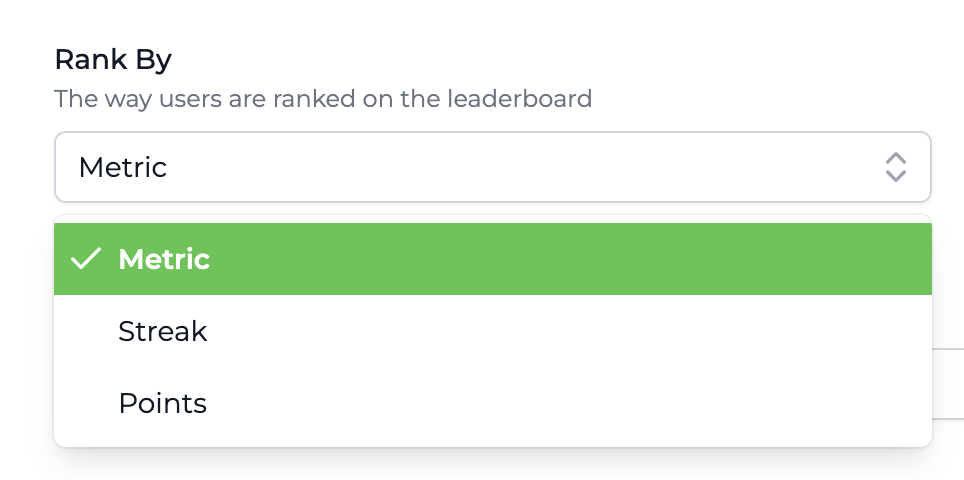
</Frame>

#### Clasificaciones por métrica {#metric-rankings}

Las clasificaciones por métrica están vinculadas a una [Métrica](/es/features/metrics) existente de Trophy y ordenan a los usuarios según su valor métrico total.

Utiliza clasificaciones por métrica si solo deseas ordenar a los usuarios según una única interacción.

#### Clasificaciones por puntos {#points-rankings}

Las clasificaciones por puntos están vinculadas a un [Sistema de Puntos](/es/features/points) existente de Trophy y ordenan automáticamente a los usuarios según sus puntos totales.

Utiliza una clasificación por puntos si deseas ordenar a los usuarios según una combinación de métricas, logros u otras funciones de Trophy.

#### Clasificaciones de Racha {#streak-rankings}

Las clasificaciones de racha ordenan a los usuarios según la duración de su racha actual.

<Note>
  Las clasificaciones de racha solo pueden ser [perpetuas](#perpetual-leaderboards).
</Note>

### Desgloses de Clasificación {#ranking-breakdowns}

Si tienes una base de usuarios grande, es una buena práctica dividir a los participantes de la clasificación en grupos más pequeños y socialmente conectados. Esto a menudo genera mayor participación que cuando se usan clasificaciones globales.

Las clasificaciones en Trophy se pueden configurar para agrupar usuarios en grupos más pequeños según uno o más [atributos de usuario personalizados](/es/features/users#custom-user-attributes).

<Tip>
  Cuando se usan desgloses de clasificación, los [límites de participantes](#participant-limits)
  se aplican a nivel de grupo, no globalmente.
</Tip>

Para configurar un desglose de clasificación, dirígete a la página de configuración de la clasificación y crea o selecciona uno o más atributos de usuario en el campo 'Atributos de Desglose'.

Trophy comenzará automáticamente a agrupar usuarios en clasificaciones más pequeñas según los valores de los atributos elegidos para cada usuario.

<Frame>
  <video
    autoPlay
    muted
    loop
    playsInline
    className="w-full aspect-15/4"
    src="../../assets/features/leaderboards/breakdowns.mp4"
  ></video>
</Frame>

Para obtener las clasificaciones de un grupo particular de usuarios con un valor de atributo específico, usa la [API de clasificaciones](/es/api-reference/endpoints/leaderboards/get-leaderboard), especificando un filtro de atributo en el parámetro `userAttributes` de la siguiente manera:

<LeaderboardSingleAttributeRequest />

Para obtener las clasificaciones de un grupo particular de usuarios con una combinación específica de atributos de usuario, pasa múltiples filtros `key:value` delimitados por comas en `userAttributes` de la siguiente manera:

<LeaderboardMultiAttributeRequest />

<Note>
  Cuando se proporcionan múltiples filtros `userAttributes`, todos los filtros deben coincidir
  para que un usuario se incluya en las clasificaciones devueltas.
</Note>

## Elegibilidad {#eligibility}

La elegibilidad controla qué usuarios pueden participar en una clasificación. Úsala cuando una clasificación deba estar abierta solo a un grupo específico de usuarios, por ejemplo, clientes de pago, una región concreta o una cohorte beta.

La elegibilidad se basa en [atributos de usuario personalizados](/es/features/users#custom-user-attributes). Un usuario solo puede participar en una clasificación, y aparecer en sus rankings, si sus atributos cumplen todas las reglas de elegibilidad que establezcas. Las clasificaciones sin reglas de elegibilidad están abiertas a todos los usuarios.

Para establecer reglas de elegibilidad, ve a la página de configuración de la clasificación y añade uno o más atributos de usuario, junto con los valores que deben tener los usuarios, en el campo **Atributos de usuario** de la sección **Elegibilidad**.

<Frame>
  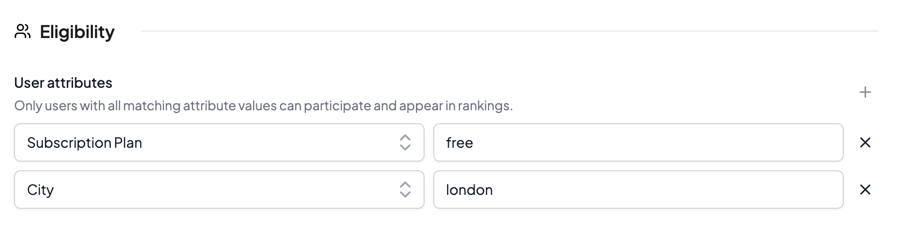
</Frame>

<Note>
  Si estableces varias reglas de elegibilidad, un usuario debe cumplirlas todas
  para ser elegible.
</Note>

Los usuarios que no son elegibles no reciben puntuación y no aparecen en los rankings. Las posiciones se calculan únicamente entre los usuarios elegibles, por lo que no quedan huecos donde habrían estado los usuarios no elegibles. Si los atributos de un usuario cambian y deja de cumplir las reglas, Trophy lo elimina de la ejecución actual de la clasificación.

Las ejecuciones históricas nunca se modifican. Una vez que una ejecución ha finalizado, sus rankings quedan fijados, independientemente de cómo cambien después los atributos de los usuarios.

<Note>
  Las reglas de elegibilidad solo se pueden cambiar mientras una clasificación está `Inactive`. Consulta los
  [estados de la clasificación](#leaderboard-statuses).
</Note>

### Elegibilidad frente a desgloses {#eligibility-vs-breakdowns}

Los [desgloses](#ranking-breakdowns) y la elegibilidad usan atributos de usuario, pero cumplen funciones distintas:

- Los **desgloses** dividen a los participantes en grupos más pequeños. Todos los usuarios siguen apareciendo en el ranking, pero dentro de su propio grupo.
- La **elegibilidad** decide quién puede participar. Los usuarios que no cumplen las reglas quedan excluidos por completo.

Puedes usar ambas en la misma clasificación, por ejemplo, para limitar una clasificación a usuarios de pago y luego agruparlos por país.

## Fechas de inicio y fin {#start-end-dates}

Usa las fechas de inicio y fin para controlar el periodo en el que las clasificaciones clasifican activamente a los usuarios.

<Frame>
  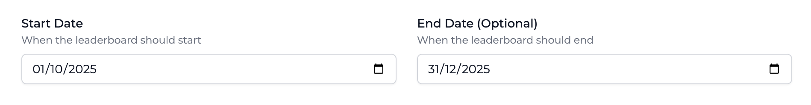
</Frame>

### Fechas de inicio {#start-dates}

Las clasificaciones de Trophy se pueden programar para que comiencen en la fecha futura que elijas. Esto suele ser útil para disponer de tiempo para hacer cambios o ajustes de última hora antes de que las clasificaciones empiecen a ordenar a los usuarios.

Las clasificaciones con una fecha de inicio futura quedan programadas y se activan automáticamente en la fecha de inicio que elijas.

### Fechas de fin {#end-dates}

Las clasificaciones de Trophy pueden tener fecha de fin. Si estableces una fecha de fin en una clasificación, después de esa fecha pasará al estado `finished`, las posiciones se finalizarán y se elegirán los ganadores.

<Note>
  Debido a las diferencias entre [zonas horarias](#handling-time-zones), las clasificaciones pueden
  finalizarse hasta 12 horas después de la fecha de fin en UTC, para permitir que todos los usuarios lleguen
  a la fecha de fin según su reloj local.
</Note>

## Restricciones de tiempo {#time-restrictions}

Además de las [fechas de inicio y fin](#start-end-dates), las clasificaciones se pueden configurar con restricciones de tiempo.

Cuando las restricciones de tiempo están habilitadas, las posiciones de la clasificación solo se actualizan durante el periodo configurado.

Las restricciones de tiempo son útiles al crear clasificaciones para eventos o promociones de duración limitada que se ejecutan durante un periodo específico.

Las restricciones de tiempo funcionan en todas las clasificaciones, incluidas las [clasificaciones recurrentes](#repeating-leaderboards). Cuando una clasificación recurrente tiene una restricción de tiempo, esta se aplica a cada ciclo de la clasificación.

### Configuración de restricciones de tiempo {#setting-time-restrictions}

Para establecer restricciones de tiempo en una clasificación, ve a la página de configuración de la clasificación y activa el interruptor con la etiqueta 'Restringir a franja horaria'. Esto mostrará dos campos: una hora de inicio y una hora de fin.

- Si estableces solo una hora de inicio, las posiciones de la clasificación empezarán a actualizarse únicamente después de esa hora, cada día en que la clasificación esté activa.
- Del mismo modo, si estableces solo una hora de fin, las posiciones de la clasificación dejarán de actualizarse después de esa hora, cada día en que la clasificación esté activa.
- Si estableces una hora de inicio y una de fin, las posiciones de la clasificación solo se actualizarán durante el periodo configurado.

<Frame>
  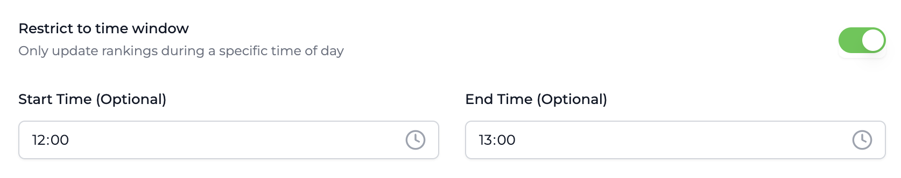
</Frame>

### Consideraciones sobre la zona horaria {#time-zone-considerations}

Las restricciones de tiempo en las clasificaciones se aplican en la **hora local** de cada participante, según su [zona horaria](/es/features/users#param-tz) configurada.

Esto significa que cada usuario puede participar en la clasificación en cualquier momento dentro de la restricción de tiempo configurada, según su reloj local.

## Límites de participantes {#participant-limits}

Las clasificaciones en Trophy tienen un número máximo de participantes predeterminado de **1000**. Sin embargo, se puede configurar una clasificación con cualquier número de participantes para admitir casos de uso como _Top 100_ o similares.

<Frame>
  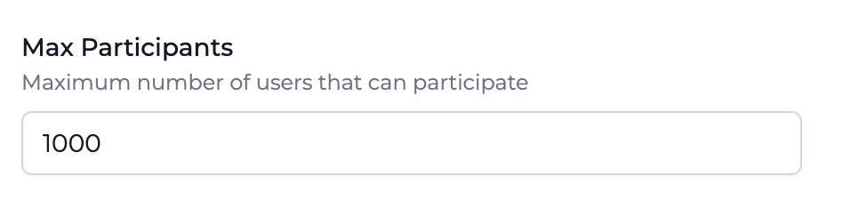
</Frame>

Si una clasificación ya tiene un número de participantes igual al máximo configurado, los nuevos usuarios tendrán que superar la puntuación del último puesto para unirse a ella.

La única excepción es cuando se usan [atributos de desglose](#ranking-breakdowns) para agrupar a los participantes en cohortes más pequeñas. Con los atributos de desglose, el límite de participantes se aplica a cada grupo, no al total.

Si una clasificación tiene reglas de [elegibilidad](#eligibility), el límite de participantes solo cuenta a los usuarios elegibles.

<Tip>
Si necesitas un límite de participantes mayor, considera usar [atributos de desglose](#ranking-breakdowns) para agrupar a los participantes en cohortes más pequeñas. También puedes escribirnos a [support@trophy.so](mailto:support@trophy.so) y con gusto aumentaremos tus valores predeterminados.
</Tip>

## Creación de clasificaciones {#creating-leaderboards}

Para crear una clasificación, ve a la [página de clasificaciones](https://app.trophy.so/leaderboards) en el panel de Trophy y haz clic en el botón _Nueva clasificación_.

<Frame>
  <video
    autoPlay
    muted
    loop
    playsInline
    className="w-full aspect-15/4"
    src="../../assets/features/leaderboards/creating_leaderboards.mp4"
  ></video>
</Frame>

<Steps>
  <Step title="Introduce un nombre">
    Elige un nombre para la clasificación.
  </Step>
  
  <Step title="Introduce una clave única">
    Introduce una clave de referencia única para la clasificación. Es la que usarás para hacer referencia a la clasificación en el código de tu aplicación.
  </Step>

   <Step title="Elige un método de ranking">
    Elige uno de los [métodos](#ranking-methods) con los que la clasificación ordenará a los usuarios:

    - **Métrica**: ordena a los usuarios por el valor total de una métrica elegida
    - **Puntos**: ordena a los usuarios por el total de puntos de un sistema de puntos elegido
    - **Racha**: ordena a los usuarios por la duración de su racha actual

  </Step>

    <Step title="Define el máximo de participantes">
    Elige el número máximo de participantes que debe admitir la clasificación. El
    límite superior actual que admite Trophy es de 1000. Lee [esta
    sección](#participant-limits) para saber más sobre cómo elegimos este límite.
    </Step>

    <Step title="Guarda los cambios">
    Guarda los cambios y ve a la página de configuración para definir la [elegibilidad](#eligibility), las [fechas de inicio y fin](#start-end-dates), los [calendarios de clasificaciones recurrentes](#repeating-leaderboards) y mucho más.
    </Step>

</Steps>

## Gestión de clasificaciones {#managing-leaderboards}

Las clasificaciones en Trophy tienen varios estados que te ayudan a controlar cuándo y cómo pueden unirse los usuarios.

### Estados de la clasificación {#leaderboard-statuses}

Las clasificaciones pueden tener uno de los siguientes estados:

- `Inactive`
- `Scheduled`
- `Active`
- `Finished`

Todas las clasificaciones nuevas se crean como `Inactive`. Mientras están inactivas, se puede cambiar cualquier propiedad o ajuste de la clasificación; no serán visibles para los usuarios y estos no podrán unirse a ellas.

Cuando quieras que los usuarios empiecen a participar, puedes establecerla como `Active`. Esto significa que Trophy empezará a registrar la actividad de los usuarios e incluirlos en las clasificaciones.

Las clasificaciones configuradas con una [fecha de inicio](#start-dates) en el futuro no se pueden activar; solo pueden estar en estado `Scheduled`. Cuando pase la fecha de inicio, Trophy las pasará automáticamente a `Active` y empezará a aceptar participantes.

Si una clasificación tiene una [fecha de finalización](#end-dates), cuando esta pase, Trophy la pasará automáticamente al estado `Finished` y dejará de monitorizar la actividad de los usuarios. Una vez finalizada, la clasificación no será visible para los usuarios, pero aún puedes consultar las API para obtener las posiciones de ejecuciones históricas.

## Mostrar clasificaciones {#displaying-leaderboards}

<Tip>
  Consulta nuestra [guía completa](/es/guides/how-to-build-a-leaderboards-feature) sobre
  cómo añadir clasificaciones a tu app para obtener más detalles.
</Tip>

## Analíticas de la clasificación {#leaderboard-analytics}

Trophy incluye analíticas integradas para ayudarte a entender cómo interactúan los usuarios con tus clasificaciones.

<Frame>
  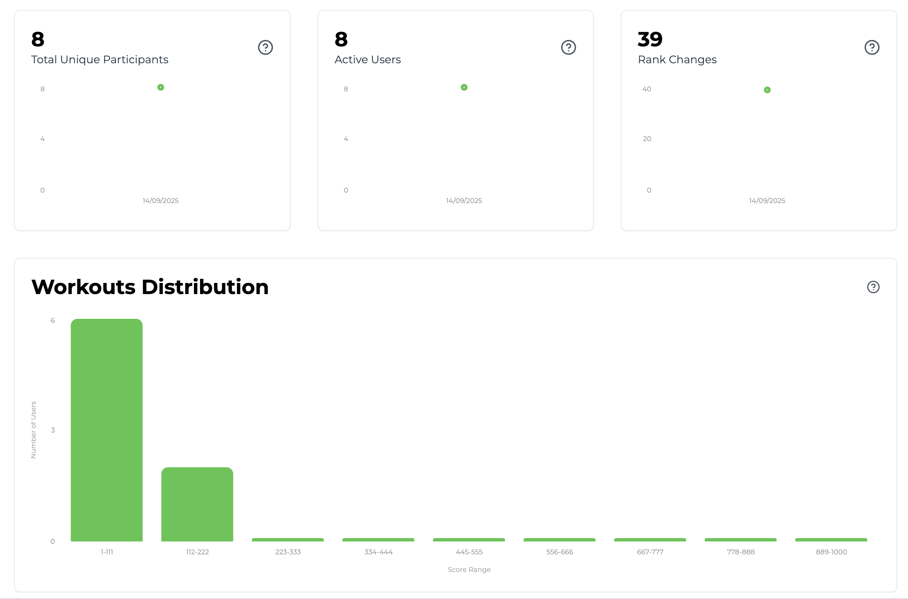
</Frame>

### Total de participantes únicos {#total-unique-participants}

Este gráfico muestra cuántos usuarios únicos han participado en cualquier ejecución de una clasificación a lo largo del tiempo. Es útil para entender cuántos de tus usuarios participan realmente en las clasificaciones y cómo influyen en ello los [límites de participantes](#participant-limits).

<Frame>
  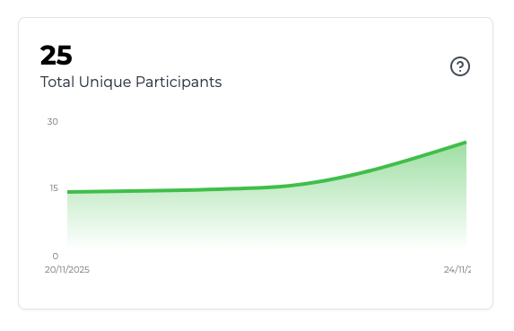
</Frame>

### Usuarios activos {#active-users}

Este gráfico muestra el número de usuarios que han cambiado de posición al menos una vez en una clasificación determinada. Es útil para hacerse una idea de lo competitivo que es el usuario promedio en una clasificación concreta.

<Frame>
  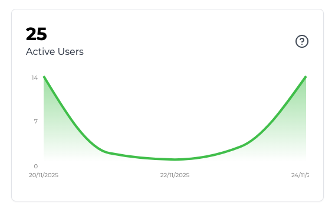
</Frame>

### Cambios de rango {#rank-changes}

Este gráfico muestra el número total de cambios de rango en una clasificación particular a lo largo del tiempo. Esto es útil para entender qué tan competitivos son los usuarios en general.

<Frame>
  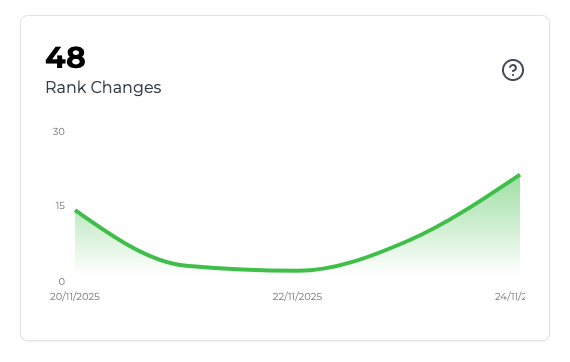
</Frame>

### Distribución de puntuaciones {#score-distribution}

Este gráfico es un histograma de las puntuaciones de los usuarios en una clasificación particular. Esto es útil para tener una idea de qué tan agrupados o dispersos están los usuarios, y qué secciones de las clasificaciones son las más competitivas.

<Frame>
  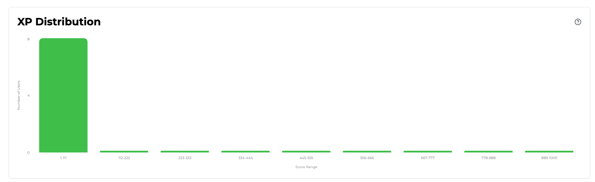
</Frame>

## Preguntas frecuentes {#frequently-asked-questions}

<AccordionGroup>
  <Accordion id="leaderboard-participant-limit-faq" title="¿Cuántos participantes pueden estar en una clasificación al mismo tiempo?">
    Limitamos las clasificaciones a 1,000 participantes.
    
    Lee más sobre esto en la [sección dedicada](#participant-limits) de esta página.

  </Accordion>

{" "}

<Accordion id="leaderboard-eligibility-faq" title="¿Puedo limitar una clasificación a determinados usuarios?">
  Sí. Añade reglas de [elegibilidad](#eligibility) a la clasificación mediante atributos
  de usuario personalizados, y solo los usuarios con los valores de atributo correspondientes podrán
  participar y aparecer en la clasificación.
</Accordion>

{" "}

<Accordion id="leaderboard-weekly-faq" title="No veo una opción de clasificación semanal, ¿cómo puedo configurar una?">
  Trophy admite la ejecución de clasificaciones repetitivas en cualquier número
  arbitrario de días. Así que una clasificación semanal sería simplemente una clasificación que se repite cada 7
  días. Lee [esta sección](#tips-for-weekly-leaderboards) para más consejos sobre
  la creación de clasificaciones semanales.
</Accordion>
</AccordionGroup>

## Obtener soporte {#rewarding-leaderboard-winners}

¿Quieres ponerte en contacto con el equipo de Trophy? Comunícate con nosotros por [correo electrónico](mailto:support@trophy.so). ¡Estamos aquí para ayudarte!

## Obtener soporte {#get-support}

¿Quieres ponerte en contacto con el equipo de Trophy? Escríbenos por [correo electrónico](mailto:support@trophy.so). ¡Estamos aquí para ayudarte!
