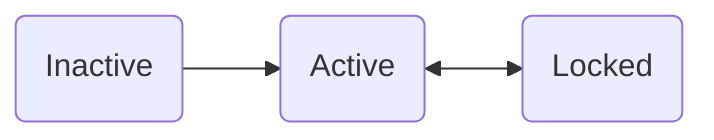
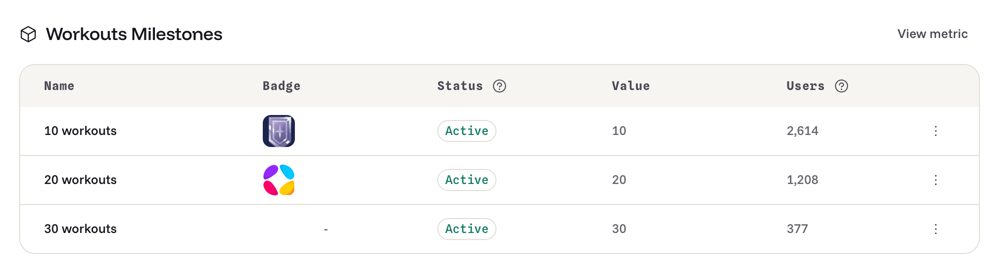
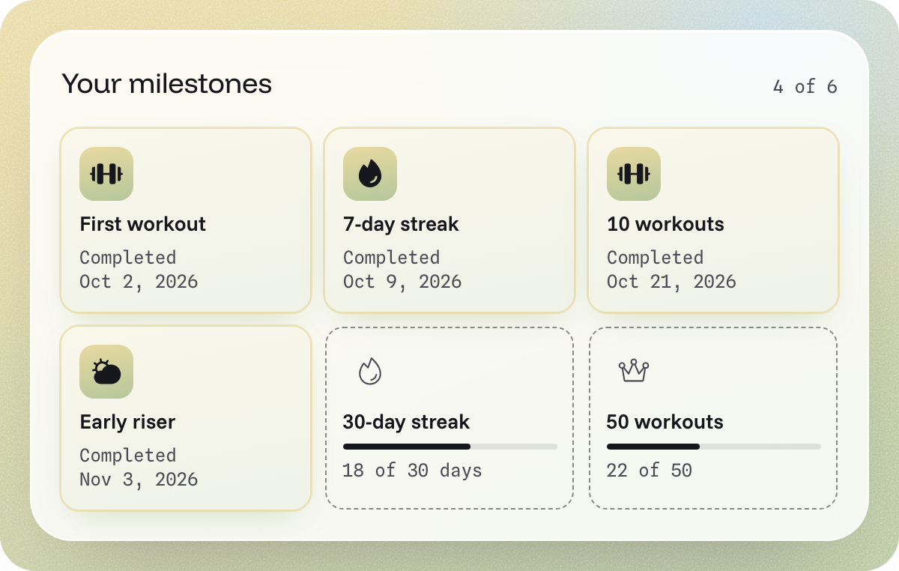
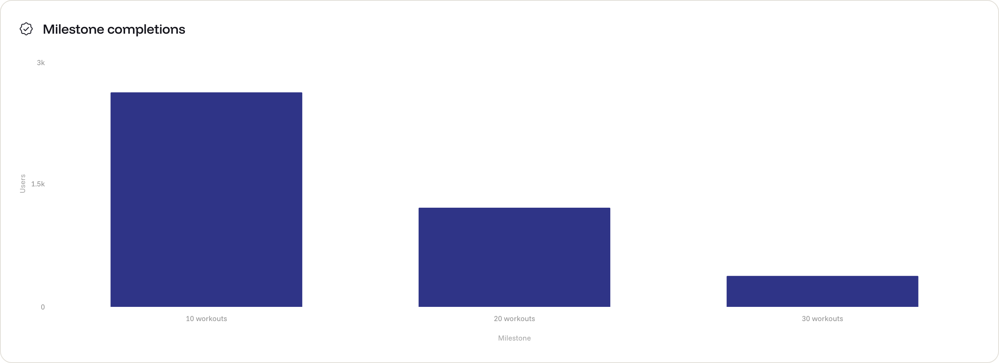

import MetricChangeResponseBlock from "../../snippets/metric-change-response-block.mdx";
import AllAchievementsResponseBlock from "../../snippets/all-achievements-response-block.mdx";

{/* TODO(media): re-create in the new dashboard theme: assets/features/achievements/displaying_trophy_cabinet.mp4 */}

## ¿Qué son los hitos? {#what-are-achievements}

<Note>
  En la API, los SDK y los webhooks de Trophy, los hitos se llaman achievements. Por ejemplo, consulta el [endpoint de todos los achievements](/es/api-reference/endpoints/achievements/all-achievements) y el [webhook `achievement.completed`](/es/webhooks/events/achievements/achievement-completed). Los nombres de los campos y endpoints mantienen la denominación `achievement`.
</Note>

Los hitos celebran el progreso que hacen los usuarios mientras usan tu plataforma. Se pueden utilizar para recompensar a los usuarios por el progreso continuo en los recorridos principales del usuario, o para motivarlos a explorar funcionalidades más recientes.

Los hitos funcionan mejor cuando están diseñados para incentivar a los usuarios a realizar acciones que probablemente conduzcan a un aumento de la retención.

<Tip>
  Usa las [analíticas de métricas](/es/data-sources/metrics#metric-analytics) de Trophy para comparar
  la retención de cada interacción del usuario, luego configura hitos en torno a
  estas interacciones para maximizar el impacto en la retención.
</Tip>

Aquí examinaremos los tipos de hitos que puedes crear con Trophy, las diferentes formas de usarlos y cómo integrarlos en tu plataforma.

## Tipos de hitos {#achievement-types}

Trophy ofrece cinco tipos de hitos: [Métrica](#metric-achievements), [API](#api-achievements), [Racha](#streak-achievements), [Aniversario](#anniversary-achievements) e [hitos compuestos](#composite-achievements), que se detallan a continuación.

### Hitos de métrica {#metric-achievements}

Los hitos de métrica están vinculados a [Métricas](/es/data-sources/metrics) y se utilizan mejor cuando quieres incentivar a los usuarios a realizar la misma acción una y otra vez.

Tomemos el ejemplo de una plataforma de estudio que usa Trophy para animar a los usuarios a ver más tarjetas de estudio con hitos de métrica de la siguiente manera:

- 1.000 tarjetas de estudio
- 2.500 tarjetas de estudio
- 5.000 tarjetas de estudio
- 10.000 tarjetas de estudio
- 25.000 tarjetas de estudio
- 50.000 tarjetas de estudio

En este caso crearías una métrica llamada _Tarjetas Volteadas_ y crearías un hito vinculado a la métrica para cada umbral.

Dado que estos hitos están directamente vinculados a la métrica _Tarjetas Volteadas_, Trophy rastreará automáticamente cuándo los usuarios desbloquean estos hitos a medida que [incrementan la métrica](/es/data-sources/events#tracking-metric-events).

Cuando se desbloquean hitos, Trophy incluye información sobre ellos en la respuesta de la [API de eventos](/es/api-reference/endpoints/events/submit-a-metric-event) y, si está configurado, activa automáticamente los [emails de hitos](/es/features/emails#achievement-emails).

<MetricChangeResponseBlock />

### Hitos de API {#api-achievements}

Los hitos de API solo se pueden completar una vez y son útiles para recompensar a los usuarios por realizar acciones específicas.

Ejemplos comunes incluyen:

- Un usuario que completa su perfil después de registrarse
- Un usuario que vincula su cuenta de redes sociales a una plataforma
- Un usuario que comparte su experiencia con el producto en redes sociales

Los hitos de API sirven como una manera fácil de recompensar a los usuarios por completar cualquier acción que consideres importante para la retención.

Al igual que los hitos de métrica, los hitos de API también pueden activar [emails de hitos](/es/features/emails#achievement-emails) automatizados si están configurados.

### Hitos de racha {#streak-achievements}

Los hitos de racha están directamente vinculados a la [Racha](/es/features/streaks) de un usuario y se desbloquean automáticamente cuando los usuarios alcanzan una duración de racha particular.

Puedes crear tantos hitos de racha como desees para duraciones de racha cada vez mayores, por ejemplo 7 días, 30 días y 365 días para motivar a los usuarios a usar tu aplicación cada vez más.

Al igual que los hitos de métrica y API, puedes agregar un nombre personalizado y asignar una insignia a los hitos de racha.

### Hitos de aniversario {#anniversary-achievements}

Los hitos de aniversario se desbloquean automáticamente cuando un usuario cumple un aniversario concreto de su fecha de registro.

Crea un hito por cada año que quieras celebrar, por ejemplo 1 año, 2 años y 5 años. Trophy desbloquea cada hito cuando se alcanza el [`signUpDate`](/es/data-sources/users#optional-attributes) del usuario más ese número de años.

Los usuarios sin `signUpDate` no son elegibles. Define `signUpDate` cuando [identifiques](/es/data-sources/users#identifying-users) o [actualices](/es/data-sources/users#keeping-users-up-to-date) a los usuarios para que Trophy pueda detectar los aniversarios.

Trophy evalúa el aniversario en el día del calendario de la [`tz`](/es/data-sources/users#optional-attributes) del usuario. Define `tz` para que el hito se desbloquee en el día local correcto.

Al igual que otros tipos de hitos, los hitos de aniversario pueden activar [emails de hitos](/es/features/emails#achievement-emails) cuando se desbloquean.

### Hitos compuestos {#composite-achievements}

Los hitos compuestos se desbloquean automáticamente cuando un usuario ha completado todos los hitos prerrequisito que selecciones. Son ideales para crear recompensas escalonadas o de nivel de maestría que reconozcan a los usuarios que han alcanzado un conjunto específico de hitos.

Por ejemplo, podrías crear un hito compuesto "Maestro del estudio" que se desbloquee cuando un usuario haya completado:
- 1000 tarjetas de estudio
- Racha de 7 días
- Onboarding completo

Los hitos compuestos son útiles para crear rutas de progresión y animar a los usuarios a participar en distintas áreas de tu app. Al igual que otros tipos de hitos, pueden activar [emails de hitos](/es/features/emails#achievement-emails) cuando se desbloquean.

## Crear hitos {#creating-achievements}

Para crear nuevos hitos, ve a la [página de hitos](https://app.trophy.so/milestones) en el panel de Trophy y haz clic en el botón **New milestone**:

<Tip>
También puedes crear, actualizar y eliminar hitos mediante programación con la [Admin API](/es/admin-api/endpoints/achievements/create-achievements).
</Tip>

<Frame>
  <video
    autoPlay
    muted
    loop
    playsInline
    className="w-full aspect-video"
    src="../../assets/features/achievements/create_new_achievement.mp4"
  ></video>
</Frame>

<Steps>
<Step title="Introduce un nombre">
  Introduce un nombre para el hito. Las API lo devolverán y estará disponible para usarlo en correos electrónicos y en otras áreas de Trophy cuando corresponda.
</Step>

<Step title="Introduce una descripción (opcional)">
  Introduce una breve descripción del hito. Las API la devolverán
  y estará disponible para usarla en correos electrónicos y en otras áreas de Trophy
  cuando corresponda.
</Step>

<Step title="Añade una insignia (opcional)">
  Puedes añadir una insignia subiendo una imagen o introduciendo una URL de imagen personalizada.
  La URL se devuelve en las respuestas de la API y se usa en correos electrónicos y en otras áreas de
  Trophy cuando corresponda.
</Step>

<Step title="Elige un tipo de activador">
  Elige cómo quieres que se desbloquee este hito.
  
- Si eliges **Metric**, el hito se desbloqueará automáticamente cuando el total de la métrica del usuario alcance el valor de activación del hito.

- Si eliges **Streak**, el hito se desbloqueará automáticamente cuando la duración de la racha del usuario alcance el valor de activación del hito.

- Si eliges **Anniversary**, el hito se desbloqueará automáticamente cuando el usuario alcance el aniversario especificado de su [`signUpDate`](/es/data-sources/users#optional-attributes).

- Si eliges **API Call**, el hito solo se desbloqueará cuando tu código lo marque explícitamente como completado mediante una solicitud a la [API para completar achievements](/es/api-reference/endpoints/achievements/mark-an-achievement-as-completed).

- Si eliges **Composite**, el hito se desbloqueará automáticamente cuando el usuario haya completado todos los hitos prerrequisito que selecciones.

</Step>

<Step title="Configura el activador">
  Una vez que hayas elegido el tipo de activador para el hito, debes configurar sus ajustes.

- Si elegiste el activador **Metric**, deberás seleccionar la métrica y el valor total del usuario que, al alcanzarse, desbloqueará el hito.

- Si elegiste el activador **Streak**, deberás definir la duración de la racha que desbloqueará el hito.

- Si elegiste el activador **Anniversary**, deberás definir el número de años desde el registro que desbloqueará el hito.

- Si elegiste el activador **API Call**, deberás definir una referencia única `key` que usarás para completar el hito mediante la [API](/es/api-reference/endpoints/achievements/mark-an-achievement-as-completed).

- Si elegiste el activador **Composite**, deberás seleccionar los hitos prerrequisito que deben completarse para desbloquear este hito. El hito compuesto se desbloqueará automáticamente cuando un usuario complete el último prerrequisito.

</Step>

<Step title="Añade filtros de atributos (opcional)">
Puedes asignar filtros de atributos a un hito para restringir aún más quién puede desbloquearlo y cuándo.

- Para limitar un hito de tipo **Metric** de modo que solo se aplique a eventos con [atributos de evento personalizados](/es/data-sources/events#custom-event-attributes) específicos, añade uno o más filtros en la sección **Event Attributes**.

- Para limitar cualquier tipo de hito de modo que solo se aplique a usuarios con uno o más [atributos de usuario personalizados](/es/data-sources/users#custom-user-attributes) específicos, añade los atributos y los valores deseados en la sección **User Attributes**.

<Note>
  Si estableces varios filtros de atributos de evento, todos deben coincidir para que se aplique el
  hito de métrica. En las respuestas de la API, `eventAttributes` es el
  campo canónico e `eventAttribute` está obsoleto y se mantiene por compatibilidad con versiones anteriores.
</Note>

</Step>

<Step title="Haz clic en Guardar">
  Guarda el nuevo hito.
</Step>
</Steps>

## Gestión de hitos {#managing-achievements}

Trophy incluye herramientas integradas para ayudarte a probar y controlar qué hitos se pueden desbloquear, quién puede hacerlo y cuándo, sin afectar a producción.

### Estados de los hitos {#achievement-statuses}

Esta es una descripción general de los distintos estados de los hitos y de lo que significan.

**Inactivo**

Todos los hitos se crean como inactivos. Los hitos inactivos no se pueden completar y no se devuelven en ninguna API de hitos. Los usuarios no los verán hasta que los actives.

**Activo**

Cuando activas un hito, pasa a estar «en vivo». Los usuarios pueden completarlo y se devuelve en todas las API de hitos.

**Bloqueado**

Cuando bloqueas un hito, los usuarios que aún no lo han desbloqueado ya no podrán hacerlo, pero los usuarios que ya lo desbloquearon no se verán afectados.

Los hitos bloqueados solo se devuelven en las API para los usuarios que ya los han conseguido.

### Flujo de trabajo de los hitos {#achievement-workflow}

Los hitos pueden pasar por distintos estados según el siguiente flujo de trabajo:



## Cómo completar hitos {#completing-achievements}

Si utilizas hitos de métrica, no es necesario _completar_ los hitos de forma explícita. Una vez que hayas configurado el [seguimiento de métricas](/es/data-sources/events#tracking-metric-events) en tu código, se hará un seguimiento automático de todos los hitos vinculados a la métrica.

Del mismo modo, si utilizas hitos de racha, todos los hitos relacionados con la racha del usuario se desbloquearán automáticamente cuando este alcance la longitud de racha correspondiente.

Los hitos de aniversario también se completan automáticamente. Se desbloquean cuando un usuario alcanza el aniversario configurado de su [`signUpDate`](/es/data-sources/users#optional-attributes). Los usuarios que no tengan `signUpDate` no pueden desbloquearlos.

Los hitos compuestos también se completan automáticamente. Se desbloquean en cuanto un usuario ha completado todos los hitos que son requisito previo. No se necesitan llamadas adicionales a la API.

Sin embargo, si usas hitos de API, tendrás que marcarlos como completados para cada usuario según corresponda. Para ello, puedes usar la [API para completar achievements](/es/api-reference/endpoints/achievements/mark-an-achievement-as-completed) con el `key` del hito que quieras completar.

Esto devolverá una respuesta con los detalles del hito completado, que puedes usar en cualquier flujo de trabajo posterior a la finalización, como mostrar una notificación dentro de la aplicación.

{/* vale off */}

```json Response
{
  "completionId": "0040fe51-6bce-4b44-b0ad-bddc4e123534",
  "achievement": {
    "id": "5100fe51-6bce-6j44-b0hs-bddc4e123682",
    "trigger": "api",
    "name": "Finish onboarding",
    "description": "Complete the onboarding process.",
    "badgeUrl": "https://example.com/badge.png",
    "key": "finish-onboarding",
    "achievedAt": "2021-01-01T00:00:00Z"
  }
}
```

{/* vale on */}

## Aplicación retroactiva de hitos {#backdating-achievements}

De forma predeterminada, cada vez que cambias un hito al [estado](#managing-achievements) 'Activo', Trophy comprueba si algún usuario existente cumple los requisitos del hito y se lo completa en segundo plano.

Esto significa que, cuando lanzas nuevos hitos a producción o editas un hito activo existente, la aplicación retroactiva se realiza automáticamente.

Lo mismo ocurre cuando estableces o cambias el [`signUpDate`](/es/data-sources/users#optional-attributes) de un usuario. Si el usuario ya cumple los requisitos de algún hito de aniversario activo, Trophy lo completa de forma silenciosa.

<Note>
  Cuando los hitos se completan de esta manera, los usuarios no reciben
  ninguna notificación. Así se evita que los cambios en tus hitos de Trophy
  provoquen que los usuarios reciban muchas notificaciones.
</Note>

Puedes comprobar cuántos usuarios han completado hitos en cualquier momento en la [página de hitos](https://app.trophy.so/milestones) del panel de Trophy. La columna _Users_ de los hitos puede actualizarse durante la aplicación retroactiva.

<Frame>
  
</Frame>

## Uso de insignias {#using-badges}

<Frame>
  <video
    autoPlay
    muted
    loop
    playsInline
    className="w-full aspect-video"
    src="../../assets/features/achievements/upload_badge.mp4"
  ></video>
</Frame>

Puedes asignar una insignia a cualquier hito subiendo una imagen (Trophy la aloja y devuelve la URL) o proporcionando tu propia URL de imagen. Las respuestas de API relevantes incluyen ese valor en `badgeUrl` para usarlo como `src` en las etiquetas ``.

```json Response {8}
{
  "completionId": "0040fe51-6bce-4b44-b0ad-bddc4e123534",
  "achievement": {
    "id": "5100fe51-6bce-6j44-b0hs-bddc4e123682",
    "trigger": "api",
    "name": "Finish onboarding",
    "description": "Complete the onboarding process.",
    "badgeUrl": "https://example.com/badge.png",
    "key": "finish-onboarding",
    "achievedAt": "2021-01-01T00:00:00Z"
  }
}
```

## Mostrar hitos {#displaying-achievements}

Trophy ofrece varias API que permiten mostrar hitos dentro de tus aplicaciones. Aquí veremos las distintas formas de usarlas y los tipos de interfaces que puedes crear.

### Todos los hitos {#all-achievements}

Para mostrar una visión general de todos los hitos que los usuarios pueden completar, usa el [endpoint de todos los achievements](/es/api-reference/endpoints/achievements/all-achievements). Usa estos datos para crear una interfaz que dé a los usuarios una idea de las rutas de progresión dentro de tu aplicación.

<Frame>
  <video
    autoPlay
    muted
    loop
    playsInline
    className="w-full aspect-video"
    src="../../assets/features/achievements/displaying_trophy_cabinet.mp4"
  ></video>
</Frame>

El endpoint de todos los hitos devuelve una lista de todos los hitos de tu cuenta de Trophy. Cada hito devuelto también incluye `completions` (el número de usuarios que han completado el hito) y `rarity` (el porcentaje de usuarios que han completado el hito) de la siguiente manera:

<AllAchievementsResponseBlock />

### Hitos del usuario {#user-achievements}

Si, en cambio, estás creando elementos de interfaz específicos de cada usuario, usa el [endpoint de achievements del usuario](/es/api-reference/endpoints/users/get-a-users-completed-achievements) para obtener los hitos que un usuario concreto ha completado.

<Tip>
  También puedes incluir los hitos que un usuario aún no ha completado
  añadiendo el parámetro de consulta `includeIncomplete=true`.
</Tip>

<Frame>
  
</Frame>

## Analíticas de hitos {#achievement-analytics}

Si tienes hitos configurados para alguna de tus [Métricas](/es/data-sources/metrics), la página de analíticas de la métrica muestra un gráfico con el progreso actual de todos los usuarios, como se muestra a continuación:

<Frame>
  
</Frame>

## Preguntas frecuentes {#frequently-asked-questions}

<AccordionGroup>
  <Accordion title="¿Qué tipo de hitos debo usar?">
    Usa hitos de métrica para recompensar a los usuarios por realizar la misma acción una y otra vez, y para incentivarlos a hacerlo más.

    Usa hitos de racha para recompensar a los usuarios por mantener su racha.

    Usa hitos de aniversario para recompensar a los usuarios por permanecer en tu plataforma a lo largo del tiempo.

    Usa hitos de API cuando quieras recompensar a los usuarios por realizar acciones específicas que solo necesitan realizar una vez.

    Usa hitos compuestos cuando quieras crear recompensas escalonadas o de nivel de maestría que se desbloqueen cuando los usuarios completen un conjunto específico de hitos prerrequisito.

  </Accordion>

    <Accordion title="¿Qué hitos debería crear?">
    Los hitos ofrecen la mejor retención cuando están estrechamente alineados con la razón principal por la que el usuario usa tu plataforma.

    Usa las [analíticas de métricas](/es/data-sources/metrics#metric-analytics) de Trophy para comparar la retención de cada interacción del usuario, luego configura hitos en torno a estas interacciones para maximizar el impacto en la retención.

</Accordion>

</AccordionGroup>

## Recompensar hitos {#rewarding-achievements}

Para dar algo a los usuarios cuando desbloquean un hito, como puntos extra que reclaman o un premio que entregas tú mismo, añade un activador de hito a una [recompensa](/es/features/rewards#achievement-triggers). Si solo quieres que se sumen puntos automáticamente, usa en su lugar un [activador de puntos](/es/features/points#achievement-triggers).

## Hitos en la mensajería agéntica {#milestones-in-agentic-messaging}

Los hitos también dan a la [mensajería agéntica](/es/agentic-messaging/overview) un motivo para contactar. Los agentes de ciclo de vida pueden celebrar los hitos que los usuarios acaban de completar, o animar a los usuarios que están cerca del siguiente, eligiendo el mejor mensaje para cada usuario en el mejor momento.

## Obtener soporte {#get-support}

¿Quieres ponerte en contacto con el equipo de Trophy? Escríbenos por [correo electrónico](mailto:support@trophy.so). ¡Estamos aquí para ayudarte!
