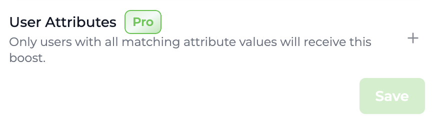
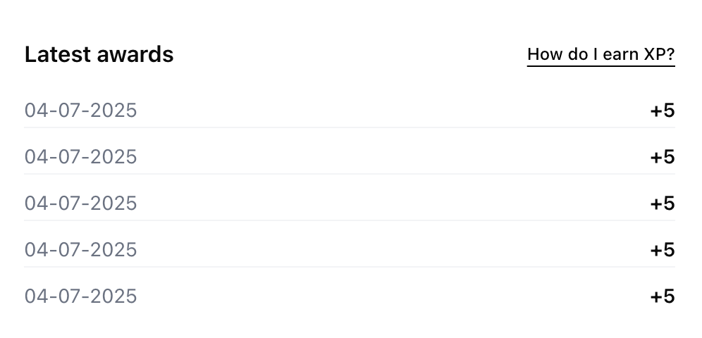
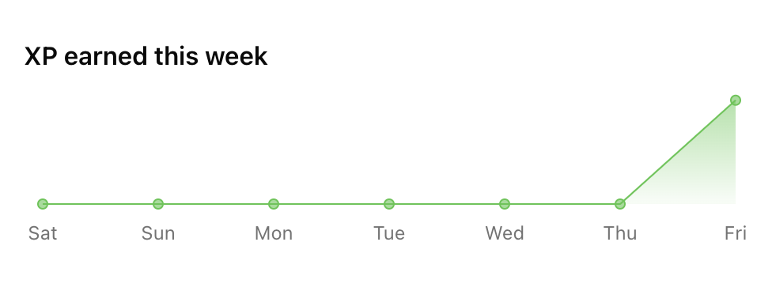
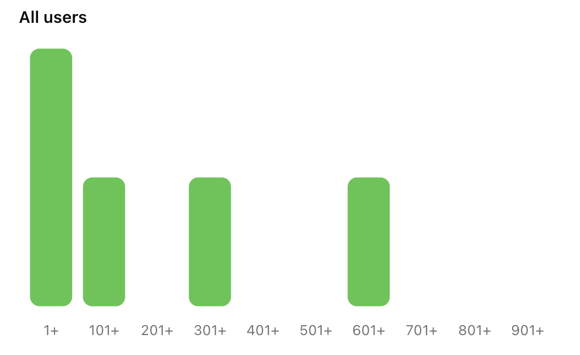
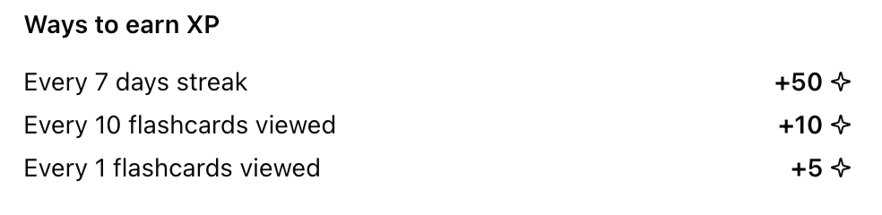
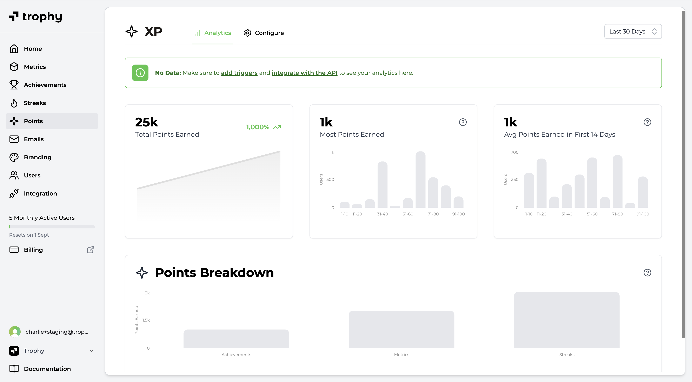

import MetricChangeResponseBlock from "../../snippets/metric-change-response-block.mdx";
import MetricChangeEventPointsLevelExcerpt from "../../snippets/metric-change-event-points-level-excerpt-block.mdx";
import PointsHistogramSummaryResponse from "../../snippets/points-histogram-summary-response-block.mdx";
import PointsLevelSummaryResponse from "../../snippets/points-level-summary-response-block.mdx";
import PointsLevelsListResponse from "../../snippets/points-levels-list-response-block.mdx";
import PointsSystemResponse from "../../snippets/points-system-response-block.mdx";
import UserPointsResponse from "../../snippets/user-points-response-block.mdx";
import UserPointsEventSummaryResponse from "../../snippets/user-points-summary-response-block.mdx";
import WebhookPointsLevelChangedPayload from "../../snippets/webhook-points-level-changed-payload-block.mdx";

## ¿Qué es un Sistema de Puntos? {#what-is-a-points-system}

Los sistemas de puntos se utilizan para crear contadores que rastrean las interacciones de los usuarios con [Métricas](/es/features/metrics), [Logros](/es/features/achievements) y [Rachas](/es/features/streaks). Luego puedes construir funcionalidades como 'XP' y 'Energía' alrededor de estos contadores dentro de tu producto.

## Casos de Uso {#use-cases}

### Recompensas automáticas {#automatic-rewards}

Los sistemas de puntos permiten crear funcionalidades como 'XP' o 'Gemas' que recompensan automáticamente a los usuarios por distintas interacciones, a ritmos diferentes. Los puntos se suman al saldo del usuario en cuanto se activa un [disparador de puntos](#points-triggers).

De esta manera, los puntos pueden usarse para ponderar el valor de ciertas interacciones de forma diferente a otras, recompensando a los usuarios por realizar las acciones que consideras más estrechamente correlacionadas con la retención.

<Tip>
  Usa un disparador de puntos cuando quieras que los puntos se apliquen automáticamente al saldo del usuario. Si los usuarios deben reclamar una recompensa antes de que se aplique, o si quieres entregar algo que no sean puntos, usa [Recompensas](/es/features/rewards).
</Tip>

### Medición de uso {#metering}

Los sistemas de puntos también sirven para crear funcionalidades como 'Energía', que miden el uso de tu producto y te dan control para fomentar o restringir la actividad de los usuarios.

Así puedes controlar la frecuencia con la que los usuarios utilizan tu producto mediante un mecanismo flexible que funciona fuera de tu código base.

## Crear sistemas de Puntos {#creating-points-systems}

Trophy te permite configurar varios sistemas de puntos para distintos casos de uso dentro de tu aplicación.

<Frame>
  <video
    autoPlay
    muted
    loop
    playsInline
    className="w-full aspect-video"
    src="../../assets/features/points/create_system.mp4"
  ></video>
</Frame>

Para crear un sistema de puntos, ve a la [página de puntos](https://app.trophy.so/points) y sigue estos pasos.

<Steps>
  <Step title="Haz clic en Nuevo sistema de Puntos">
    Asigna un nombre y una clave única al nuevo sistema de puntos. La clave es la
    que usarás para hacer referencia al sistema de puntos en las API y, si
    corresponde, en las plantillas de correo electrónico.
  </Step>
  <Step title="Añade una descripción (opcional)">
    También puedes asignar una descripción al sistema de puntos. Las API la
    devuelven para que la muestres en tu aplicación.
  </Step>
  <Step title="Configura el máximo de puntos (opcional)">
  Si quieres limitar el número de puntos que cada usuario puede tener en tu nuevo sistema, define un valor en el campo 'máximo de puntos'.

  <Tip>
  Los [activadores de puntos](#points-triggers) que configures en este sistema de puntos respetarán el máximo establecido.
  </Tip>
  </Step>
  <Step title="Asigna una insignia (opcional)">
    Puedes asignar una insignia o un logotipo subiendo una imagen o introduciendo una
    URL de imagen personalizada. Las API devuelven una URL compatible con `src` para mostrarla en tu
    aplicación.
  </Step>
</Steps>

## Activadores de puntos {#points-triggers}

En Trophy, los puntos se otorgan o se deducen a los usuarios mediante activadores. Estos definen las distintas mecánicas que componen tu sistema de puntos.

Puedes añadir tantos activadores como quieras a cada sistema de puntos que configures, lo que te permite crear una lógica distinta para otorgar o deducir puntos en cada sistema de puntos.

<Note>
  Los activadores de puntos suman puntos al saldo de un usuario automáticamente. Si necesitas que los usuarios canjeen los puntos antes de aplicarlos, utiliza en su lugar una [recompensa de puntos](/es/features/rewards#points-rewards). Los puntos otorgados por recompensas canjeadas también cuentan para el saldo, el historial y los niveles del sistema de puntos.
</Note>

### Tipos de activadores {#types-of-triggers}

En Trophy hay varios tipos de activadores que puedes usar para otorgar o deducir puntos de distintas maneras.

#### Activadores de métricas {#metric-triggers}

Los puntos se pueden otorgar o deducir de forma continua a medida que los usuarios incrementan las [Métricas](/es/features/metrics). Puedes elegir otorgar o deducir cualquier cantidad de puntos en cualquier umbral de métrica, por ejemplo: "otorga 10 puntos por cada 3 tareas completadas".

#### Activadores de rachas {#streak-triggers}

Los puntos se pueden otorgar o deducir al alcanzar cualquier duración de una [Racha](/es/features/streaks), por ejemplo: "otorga 50 puntos por cada racha de 7 días".

#### Activadores de logros {#achievement-triggers}

Los puntos se pueden otorgar o deducir cuando los usuarios desbloquean [Logros](/es/features/achievements) específicos, por ejemplo: "otorgar 100 puntos cuando los usuarios completen el logro `profile-completed`".

#### Activadores basados en tiempo {#time-based-triggers}

Los puntos se pueden otorgar o deducir a intervalos de tiempo repetitivos, como cada hora o cada día. Por ejemplo: "otorgar 10 puntos cada 3 horas".

#### Activadores de identificación de usuarios {#user-identification-triggers}

Los puntos se pueden otorgar cuando los usuarios se identifican por primera vez en Trophy, lo que resulta útil para conceder una cantidad inicial de puntos cuando se registran en tu producto.

### Crear activadores {#creating-triggers}

Para crear un nuevo activador de puntos, ve al sistema de puntos para el que quieres crear el activador y sigue los pasos a continuación.

<Tip>
  Todos los activadores de puntos nuevos se crean como 'Inactivos' para permitir
  las pruebas y el ajuste del equilibrio antes de pasar a producción.
</Tip>

<Frame>
  <video
    autoPlay
    muted
    loop
    playsInline
    className="w-full aspect-video"
    src="../../assets/features/points/create_trigger.mp4"
  ></video>
</Frame>

<Steps>
<Step title="Elige un tipo de activador">
  Elige cómo quieres que se otorguen o se deduzcan los puntos según los [tipos de activadores](#types-of-triggers) disponibles.
</Step>

<Step title="Configura el activador">
  Una vez que hayas elegido el tipo de activador de puntos, debes configurar los ajustes del activador.

- Si elegiste el activador de **Métrica**, deberás elegir la métrica y el umbral en el que se otorgarán o deducirán puntos.

- Si elegiste el activador de **Racha**, deberás establecer la duración de la racha que debe otorgar o deducir puntos.

- Si elegiste el activador de **Logro**, deberás elegir el logro que debe otorgar o deducir puntos al completarse.

- Si elegiste el activador de **Tiempo**, deberás elegir la unidad de tiempo en la que quieres otorgar o deducir puntos (horas o días) y el número de esas unidades de tiempo tras el cual quieres otorgar o deducir puntos.

- Si elegiste el disparador **Primera identificación de usuario**, no necesitas añadir ninguna configuración adicional.

</Step>

<Step title="Define los puntos que se otorgan o se restan">
  Una vez configurado el disparador, define la cantidad de puntos que se otorgan o se restan
  cuando se activa.
</Step>

<Step title="Añade filtros de atributos (opcional)">
  Puedes asignar filtros de atributos a un disparador de puntos para restringir aún más cuándo se aplica.

- Para limitar un **disparador de métrica** de modo que solo se aplique a eventos con [atributos de evento personalizados](/es/features/events#custom-event-attributes) específicos, añade uno o más filtros en la sección **Atributos del evento**.

- Para limitar cualquier tipo de disparador de modo que solo se aplique a usuarios con uno o más [atributos de usuario personalizados](/es/features/users#custom-user-attributes) específicos, añade los atributos y los valores deseados en la sección **Atributos del usuario**.

<Note>
  Si defines varios filtros de atributos de evento, todos deben coincidir para que
  se active el disparador de métrica.
</Note>

</Step>

<Step title="Guarda los cambios">
  Guarda el nuevo disparador de puntos.
</Step>
<Step title="Actívalo">
  Cuando estés seguro de que el nuevo disparador se comportará como esperas, cambia su estado a activo para ponerlo en producción.
</Step>
</Steps>

## Cómo equilibrar los Puntos {#balancing-points}

Para que un sistema de puntos sea eficaz, es necesario encontrar el ritmo óptimo al que los usuarios ganan puntos. Si es demasiado rápido, los usuarios sufrirán fatiga de puntos y estos perderán todo su valor. Si es demasiado lento, los usuarios pueden aburrirse y abandonar el producto.

La herramienta de vista previa de Trophy puede modelar distintos escenarios para ayudarte a determinar con qué frecuencia deben ganar puntos los usuarios en cada uno de tus sistemas de puntos.

<Frame>
  <video
    autoPlay
    muted
    loop
    playsInline
    className="w-full aspect-video"
    src="../../assets/features/points/points_preview.mp4"
  ></video>
</Frame>

## Multiplicadores de Puntos {#points-boosts}

Los multiplicadores de puntos permiten aumentar la cantidad de puntos que se otorgan a los usuarios durante un período de tiempo específico.

Esta sección explica cómo funcionan los boosts y cómo puedes usarlos para aumentar la retención y la interacción en tu aplicación.

### Segmentación de boosts {#boost-targeting}

Hay varias formas de usar boosts en Trophy.

- **Los boosts globales** multiplican los puntos que obtienen todos los usuarios durante el periodo del boost, o pueden limitarse a una cohorte de usuarios específica mediante [atributos de usuario personalizados](/es/features/users#custom-user-attributes).
- **Los boosts específicos de usuario** solo multiplican los puntos que obtiene un único usuario durante el periodo del boost.

Normalmente, los boosts globales se usan para aumentar la interacción en toda la plataforma durante fechas clave del calendario, como el Black Friday/Cyber Monday en el comercio electrónico, el Año Nuevo en fitness o la temporada de exámenes en plataformas de ed-tech.

Por el contrario, los boosts específicos de usuario se suelen usar para ofrecer incentivos adicionales que animen a los usuarios a realizar acciones relacionadas con una mayor retención.

### Crear boosts {#creating-boosts}

<Note>
Los boosts específicos de usuario solo se pueden crear de forma programática a través de la [Admin API](/es/admin-api/endpoints/points/create-boosts).
</Note>

Para crear un boost de puntos global en el panel de Trophy, sigue estos pasos.

<Frame>
  <video
    autoPlay
    muted
    loop
    playsInline
    className="w-full aspect-15/4"
    src="../../assets/features/points/create_points_boost.mp4"
  ></video>
</Frame>

<Steps>
  <Step title="Ve a la página de Boosts">
    Ve a la [página de puntos](https://app.trophy.so/points) y haz clic en el sistema de puntos para el que quieras crear un boost. Después, ve a la pestaña Boosts y haz clic en el botón *Nuevo boost*.
  </Step>
  <Step title="Elige un nombre">
    Elige un nombre para tu boost que describa claramente su finalidad. Por ejemplo: "Boost 2X - Todos los usuarios - Navidad 2026".
  </Step>
  <Step title="Define el multiplicador">
    Define el valor numérico por el que el boost multiplicará los puntos obtenidos. Si eliges un multiplicador decimal, podrás elegir el [comportamiento de redondeo](#boost-rounding) que debe usar el boost.
  </Step>
  <Step title="Define el periodo del boost">
    Elige una fecha de inicio y, de forma opcional, una fecha de finalización para tu boost. Si eliges una fecha de inicio futura, Trophy programará el boost para que se active en la fecha elegida. Del mismo modo, si defines una fecha de finalización, Trophy se encargará de detener el boost por ti.
  </Step>
  <Step title="Añade filtros de atributos (opcional)">
    Si quieres que tu boost afecte solo a una cohorte de usuarios específica, define condiciones de atributos de usuario que coincidan con las de tu cohorte objetivo. Trophy se encargará de aplicar el boost únicamente a los puntos obtenidos por los usuarios con valores de atributos coincidentes.

    <Frame>
      
    </Frame>
  </Step>
  <Step title="Activar impulso">
    Haz clic en *Guardar impulso* para guardar tu nuevo impulso en tu cuenta. El impulso estará inactivo de forma predeterminada. Para activarlo, haz clic en el menú desplegable a la derecha del nombre del impulso en la página de Impulsos y haz clic en Activar.
  </Step>
</Steps>

### Multiplicadores de impulsos {#boost-multipliers}

Cada impulso tiene un único valor de multiplicador que aumenta los Puntos totales ganados por los usuarios afectados por ese impulso.

Los multiplicadores de impulsos deben ser números positivos, pero pueden ser decimales para admitir escenarios donde se requieran impulsos porcentuales como '50% más de Puntos'.

### Apilamiento de impulsos {#boost-stacking}

Los impulsos de Puntos en Trophy se apilan mediante [multiplicación](#boost-multipliers). Esto permite que los usuarios se beneficien de múltiples impulsos simultáneamente.

Para demostrar el apilamiento, considera un impulso de 2X, uno de 1.5X y uno de 3X, todos activos dentro del mismo período de tiempo. El multiplicador de impulso resultante para un usuario que califique para los tres impulsos sería el siguiente:

```txt Boost Stacking Example
Overall Multiplier (3 boosts) = 2X * 1.5X * 3X = 9X
```

### Redondeo de impulsos {#boost-rounding}

Trophy admite [valores de eventos de métricas de punto flotante](/es/features/events#event-value), pero se encarga de redondear los Puntos a enteros automáticamente.

Sin embargo, al usar [multiplicadores de impulsos](#boost-multipliers) decimales, puede haber algunos escenarios donde este redondeo predeterminado no sea suficiente para producir siempre valores de Puntos enteros.

Por lo tanto, Trophy ofrece tres modos de redondeo para proporcionar control adicional sobre el comportamiento de redondeo específicamente cuando los impulsos están involucrados en los cálculos de Puntos.

- **Redondear hacia abajo**: Por defecto, Trophy redondeará los Puntos hacia abajo al entero más cercano cuando la multiplicación de impulsos resulte en un decimal.
- **Redondear hacia arriba**: Trophy redondea los Puntos decimales hacia arriba al entero más cercano después de la multiplicación de impulsos.
- **Redondear al más cercano**: Trophy redondeará los Puntos al entero más cercano, hacia arriba o hacia abajo, según el valor final después de la multiplicación de impulsos. Por ejemplo, `1.2` se redondea a `1` y `1.7` se redondea a `2`.

<Tip>
En escenarios donde los Puntos se utilizan para imitar mecánicas de crédito de plataforma, se recomienda usar el comportamiento de redondeo hacia abajo por defecto para proteger contra deslizamientos.
</Tip>

Simplemente elige tu modo de redondeo preferido al [crear impulsos](/es/features/points#creating-boosts) a través del panel de Trophy.

## Niveles de Puntos {#points-levels}

Los niveles de Puntos son hitos discretos que defines en un sistema de Puntos en Trophy.

Cada nivel tiene un umbral. Cuando el total de Puntos de un usuario en el sistema excede este umbral, Trophy le asigna ese nivel automáticamente. No necesitas mantener la lógica de niveles en tu propio código base.

Usa los niveles para niveles de rango, UI de progresión, niveles de recompensas o analíticas. Trophy mantiene el nivel actual de cada usuario sincronizado cada vez que ganan o pierden Puntos en ese sistema.

### Configurar niveles {#configuring-levels}

Para configurar niveles para un sistema de Puntos, ábrelo desde la [página de Puntos](https://app.trophy.so/points) en el panel de Trophy y usa la pestaña de niveles para agregar o gestionar niveles.

<Frame>
  <video
    autoPlay
    muted
    loop
    playsInline
    className="w-full aspect-video"
    src="../../assets/features/points/create_points_level.mp4"
  ></video>
</Frame>

<Steps>
  <Step title="Abre tu sistema de puntos">
    Desde la página de puntos, selecciona el sistema de puntos al que deseas agregar niveles.
  </Step>
  <Step title="Abre la pestaña de niveles">
    Desde la página de tu sistema de puntos, abre la pestaña de niveles.
  </Step>
  <Step title="Agrega niveles">
    Crea cada nivel con una clave estable, un nombre para mostrar, una descripción opcional, una imagen de insignia y el umbral de puntos requerido para alcanzar ese nivel.
    
    Los umbrales deben reflejar cómo deseas que se sienta la progresión a medida que los usuarios acumulan puntos desde tus activadores.
  </Step>
  <Step title="Guarda">
    Guarda tus niveles. Trophy evaluará los totales contra estos umbrales en cada cambio de puntos.
  </Step>
</Steps>

### Mostrar Niveles {#displaying-levels}

La mayoría de los equipos combinan tres enfoques: una imagen estática de cada nivel (para pantallas de progresión), el nivel actual del usuario (para encabezados y perfiles), y retroalimentación inmediata cuando una acción los impulsa a un nuevo nivel.

#### Mostrar Todos los Niveles {#displaying-all-levels}

Llama al [API de obtener niveles](/es/api-reference/endpoints/points/get-points-levels) una vez por clave de sistema de puntos (por ejemplo, al cargar la aplicación o desde tu servidor al renderizar una página de progresión).

La respuesta es un arreglo de niveles con `key`, `name`, `description`, `badgeUrl` opcional, y el umbral `points` para cada nivel. Al vincular tu interfaz a la respuesta del API de Trophy, te asegurarás de que se actualice automáticamente cuando realices cambios en los niveles desde el panel de Trophy.

<PointsLevelsListResponse />

#### Mostrar Nivel del Usuario {#displaying-user-level}

El [API de puntos del usuario](/es/api-reference/endpoints/users/get-a-users-points) devuelve los `total` del usuario, su objeto `level` actual, y `awards` recientes. El campo `level` contiene el nivel actual del usuario, o null si no existen niveles o aún no han alcanzado el umbral de puntos para ningún nivel.

Combina `total` con la lista de niveles ordenada del paso anterior para dibujar una barra de progreso entre el umbral actual y el siguiente.

<UserPointsResponse />

#### Notificaciones de cambio de nivel {#level-change-notifications}

Cuando envías un [evento de cambio de métrica](/es/api-reference/endpoints/events/submit-a-metric-event), la respuesta incluye un mapa `points` indexado por las claves de tus sistemas de puntos, con una entrada por cada sistema que haya cambiado como resultado del evento.

Los datos contienen una clave `level` solo cuando el nivel del usuario cambió debido a este evento. Si su nivel permaneció igual, esa clave se omite, por lo que puedes tratar de forma segura un `level` presente como una señal de cambio de nivel sin necesidad de seguimiento adicional.

<MetricChangeEventPointsLevelExcerpt />

Un patrón típico es verificar el objeto de tu sistema después de un evento exitoso y luego activar un toast, modal o sonido:

```ts
const pts = response.points?.xp; // use your points system key

if (pts?.level) {
  // Level changed on this request — e.g. toast, modal, confetti if level up
  notifyLevelChange(pts.level.name, pts.total);
}
```

El mismo comportamiento de `level` se aplica cuando los puntos cambian desde la [finalización de un logro](/es/api-reference/endpoints/achievements/mark-an-achievement-as-completed).

Para notificaciones impulsadas por el servidor (correo electrónico, push, CRM) que no deben depender de que el cliente vea la respuesta HTTP, suscríbete al webhook [`points.level_changed`](/es/webhooks/events/points/points-level-changed) en su lugar.

Este webhook se activa cuando el nivel de un usuario cambia como resultado de ganar o perder puntos, e incluye `previousLevel` y `newLevel`.

#### Analíticas a nivel de cuenta {#account-level-analytics}

La [API de resumen de niveles](/es/api-reference/endpoints/points/get-points-level-summary) devuelve cuántos usuarios están actualmente en cada nivel, lo cual es útil para paneles de administración, vistas de embudo o equilibrio de progresión.

<PointsLevelSummaryResponse />

## Mostrar Puntos {#displaying-points}

Existen varias formas de usar Trophy para obtener y mostrar puntos en tu aplicación.

<Note>
  Para ver ejemplos prácticos, consulta nuestras guías sobre cómo agregar una [función de
  XP](/es/guides/how-to-build-an-xp-feature) o una [función de
  energía](/es/guides/how-to-build-an-energy-feature) a tu aplicación web o móvil.
</Note>

<Frame>
  <video
    autoPlay
    muted
    loop
    playsInline
    className="w-full aspect-video"
    src="../../assets/features/points/displaying_points.mp4"
  ></video>
</Frame>

### Activación de UI transaccional {#triggering-transactional-ui}

En primer lugar, los puntos otorgados a los usuarios o deducidos de ellos como resultado de un evento de cambio de métrica se devuelven en la respuesta al usar la [API de eventos de cambio de métrica](/es/api-reference/endpoints/events/submit-a-metric-event).

La respuesta incluye el nuevo total de puntos del usuario, cuántos puntos se otorgaron o dedujeron como resultado del evento, y los detalles de los activadores de puntos específicos que se dispararon. Cuando los [Niveles de Puntos](#points-levels) están habilitados, cada objeto de puntos en esa respuesta también puede incluir **`level`**: Trophy incluye el **nuevo** nivel del usuario **solo cuando cambió** como resultado de ese evento. El mismo comportamiento opcional de `level` se aplica cuando los puntos cambian debido a la [finalización de un logro](/es/api-reference/endpoints/achievements/mark-an-achievement-as-completed).

Ejemplo de respuesta `POST /metrics/{key}/event` (los campos coinciden con la especificación de la API de Trophy; tus claves bajo `points` e `leaderboards` dependen de tu cuenta):

<MetricChangeResponseBlock />

Esto facilita enormemente la lectura de la respuesta y la activación de cualquiera de las siguientes UI transaccionales en tu aplicación:

- Mostrar notificaciones y ventanas emergentes dentro de la aplicación
- Reproducir efectos de sonido

### Mostrar los Puntos del usuario {#displaying-users-points}

Trophy también tiene APIs que te permiten obtener los datos de puntos del usuario cuando lo desees.

Primero, la [API de puntos de usuario](/es/api-reference/endpoints/users/get-a-users-points) devuelve el total de puntos del usuario para un sistema de puntos particular, su **`level`** actual (o `null` si los niveles no están en uso o no han alcanzado un nivel todavía), y hasta 100 de los eventos más recientes que otorgaron o dedujeron puntos.

Puedes usar esta API para mostrar el total de puntos del usuario en cualquier lugar de tu plataforma, así como una sección de 'Últimas recompensas' o similar.

`GET /users/{id}/points/{key}` — ejemplo de cuerpo de respuesta (especificación de API de Trophy):

<UserPointsResponse />

<Frame>
  
</Frame>

Luego, puedes usar la [API de resumen de puntos de usuario](/es/api-reference/endpoints/users/get-a-users-points-summary) para obtener datos históricos de puntos de un usuario en particular.

Los datos se pueden agregar de forma diaria, semanal o mensual entre una fecha de inicio y una fecha final. Usa esta API para mostrar a los usuarios gráficos de progreso de puntos en cualquier periodo de tiempo.

Ejemplo de respuesta `GET /users/{id}/points/{key}/event-summary` **200** (especificación de API de Trophy; la estructura coincide con tus parámetros de consulta `aggregation`, `startDate` y `endDate`):

<UserPointsEventSummaryResponse />

<Frame>
  
</Frame>

### Mostrar Datos Agregados {#displaying-aggregate-data}

Además, hay varias APIs que puedes usar para obtener y mostrar datos de puntos a nivel de cuenta.

Primero, la [API de resumen de puntos](/es/api-reference/endpoints/points/get-points-summary) devuelve datos agregados del sistema de puntos de toda tu base de usuarios.

Usa estos datos para mostrar un histograma de puntos de un sistema de puntos en particular y mostrar a los usuarios cómo se comparan con otros en la plataforma. Cuando usas [Niveles de Puntos](#points-levels), la [API de resumen de niveles](/es/api-reference/endpoints/points/get-points-level-summary) complementa esto con un conteo de usuarios por nivel.

`GET /points/{key}/summary` — ejemplo de respuesta **200** (especificación de API de Trophy):

<PointsHistogramSummaryResponse />

Finalmente, la [API del sistema de puntos](/es/api-reference/endpoints/points/get-points) devuelve los metadatos del sistema y los activadores. Ejemplo de respuesta **200** (especificación de API de Trophy):

<PointsSystemResponse />

<Tip>
  La API de resumen de puntos también se puede filtrar para devolver solo datos de usuarios con
  [atributos de usuario personalizados](/es/features/users#custom-user-attributes) específicos.
</Tip>

<Frame>
  
</Frame>

Usa la respuesta de la [API del sistema de puntos](/es/api-reference/endpoints/points/get-points) para mostrar a los usuarios cómo pueden ganar puntos en tu plataforma. Cualquier activador nuevo que agregues se devolverá automáticamente desde esta API, reduciendo cambios de código en tu plataforma y trasladando las operaciones a Trophy.

<Frame>
  
</Frame>

## Análisis de Puntos {#points-analytics}

Trophy cuenta con análisis integrado para rastrear la asignación de puntos de cada sistema de puntos que configures en todos tus usuarios en tiempo real, incluyendo:

- Total de puntos ganados por todos los usuarios a lo largo del tiempo
- Mayor cantidad de puntos ganados por un solo usuario
- Promedio de puntos ganados en los primeros 14 días (útil para comprender los patrones de retención de nuevos usuarios y el impacto de los puntos)
- Un desglose de los disparadores de puntos más comúnmente otorgados

<Frame>
  
</Frame>

## Obtener Soporte {#get-support}

¿Quieres ponerte en contacto con el equipo de Trophy? Contáctanos por [correo electrónico](mailto:support@trophy.so). ¡Estamos aquí para ayudarte!
