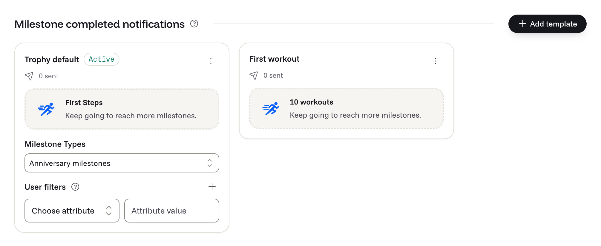
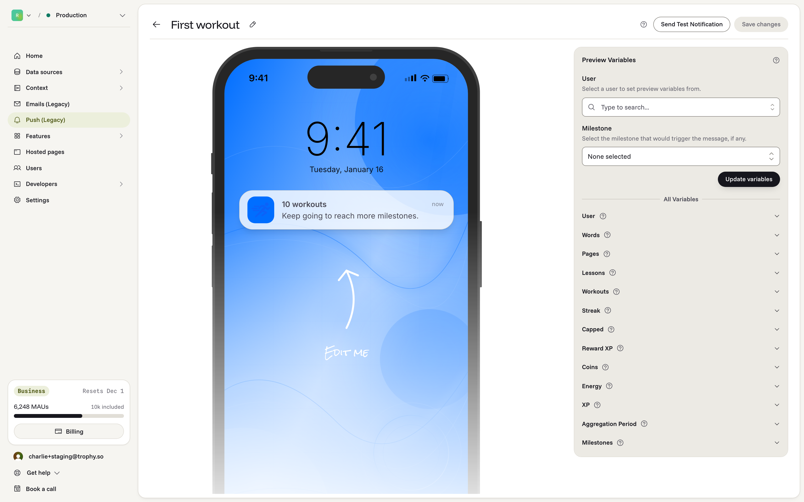

<Info>
  Estas son las notificaciones push heredadas de Trophy, basadas en plantillas y enviadas a partir de activadores fijos. Para los usuarios de la cohorte de [mensajería agéntica](/es/agentic-messaging/overview), la mensajería agéntica las reemplaza: los agentes de ciclo de vida escriben y envían notificaciones push personalizadas en su lugar. Ambas se envían a través de los mismos proveedores push, que configuras en la página de [canales](/es/agentic-messaging/channels#push-notifications).
</Info>

Trophy puede enviar notificaciones push automatizadas a los usuarios basándose en disparadores clave sin requerir código. Aquí veremos cuáles son estos disparadores y cómo pueden ayudar a que los usuarios vuelvan a tu producto.

## Tipos de notificaciones push {#types-of-push-notifications}

Trophy admite 4 tipos de notificaciones push, cada una diseñada para adaptarse a un escenario común de engagement.

Todas las notificaciones push son opcionales, pero las cuatro pueden usarse simultáneamente y pueden controlarse desde la página de [Notificaciones push](https://app.trophy.so/push/configure) en el panel de Trophy.

<Frame>
  <video
    autoPlay
    muted
    loop
    playsInline
    className="w-full aspect-video"
    src="../../assets/features/push/push_notification_types.mp4"
  ></video>
</Frame>

- Las **notificaciones de hitos** se envían a los usuarios cada vez que completan un [Hito](/es/features/milestones).
- Las **notificaciones de resumen** se envían a los usuarios con una frecuencia predefinida para resumir el progreso. Las notificaciones de resumen pueden configurarse para enviarse diaria, semanal, mensual o anualmente dependiendo de tu caso de uso.
- Las **notificaciones de reactivación** se envían a los usuarios después de que se vuelven inactivos con el objetivo de traerlos de vuelta a tu app.
- Las **notificaciones de rachas** se envían automáticamente a los usuarios recordándoles extender su [Racha](/es/features/streaks).

## Canales compatibles {#supported-channels}

<a id="apple-push-notification-service-apns" />
<a id="firebase-cloud-messaging-fcm" />
<a id="expo-push-service" />

Trophy envía notificaciones push a través de [Apple Push Notification Service (APNs)](/es/agentic-messaging/channels#apple-push-notification-service-apns), [Firebase Cloud Messaging (FCM)](/es/agentic-messaging/channels#firebase-cloud-messaging-fcm) o [Expo Push Service](/es/agentic-messaging/channels#expo-push-service). Los proveedores push se comparten con la mensajería agéntica, así que solo tienes que configurarlos una vez. Sigue la guía de [proveedores compatibles](/es/agentic-messaging/channels#supported-channels) de la página de canales.

## Envío de notificaciones push {#sending-push-notifications}

Sigue los pasos a continuación para comenzar a enviar notificaciones push usando Trophy.

<Tip>
  Los usuarios pueden controlar qué notificaciones push reciben a través de la [API de
  preferencias de usuario](/es/data-sources/users#notification-preferences) de Trophy. Esto te permite
  crear un centro de preferencias en tu aplicación donde los usuarios pueden activar o desactivar
  tipos específicos de notificaciones.
</Tip>

<Steps>
  <Step title="Configurar canales">
    Configura un proveedor push siguiendo la guía de [proveedores compatibles](/es/agentic-messaging/channels#supported-channels) de la página de canales. También encontrarás tus proveedores en la pestaña **Channels** de la página [Push](https://app.trophy.so/push/channels).

<Frame>
    <video
    autoPlay
    muted
    loop
    playsInline
    className="w-full aspect-video"
    src="../../assets/features/push/push_channels.mp4"
  ></video>
</Frame>

  </Step>
  <Step title="Agregar plantillas">
    Trophy proporciona una plantilla predeterminada para cada [tipo de notificación push](#types-of-push-notifications) que Trophy admite.

    En la [página de configuración](https://app.trophy.so/push/configure), cada tipo de notificación tiene su propia sección. Agrega plantillas bajo el tipo correspondiente.
    
    Consulta la guía sobre [diseño de notificaciones push](#designing-push-notifications) para obtener más información.

    <Frame>
      
    </Frame>

  </Step>
  <Step title="Asociar tokens de dispositivo">
    Trophy necesita conocer los tokens únicos asignados a los dispositivos de cada usuario para enrutarle las notificaciones. Asocia `deviceTokens` con cada usuario cuando lo identifiques o envíes eventos de métricas. Consulta los [tokens de dispositivo](/es/agentic-messaging/channels#device-tokens) para ver ejemplos.
  </Step>
  <Step title="Activar plantillas">
    El último paso es activar una plantilla dentro de cada sección de [tipo de notificación push](#types-of-push-notifications) que desees enviar.

    En la [página de configuración](https://app.trophy.so/push/configure), activa una plantilla en cada sección de tipo que desees habilitar. Una vez activadas, Trophy comenzará a enviar notificaciones push automáticamente.

    <Tip>
      Los usuarios pueden controlar qué tipos de notificaciones push reciben a través de la [API de preferencias de usuario](/es/data-sources/users#notification-preferences) de Trophy. Cuando un usuario ha desactivado un tipo de notificación en sus preferencias, Trophy respetará esa configuración y no enviará esas notificaciones a ese usuario.
    </Tip>

    <Frame>

  <video
    autoPlay
    muted
    loop
    playsInline
    className="w-full aspect-video"
    src="../../assets/features/push/activating_templates.mp4"
  ></video>
</Frame>

  </Step>
</Steps>

## Diseñar Notificaciones Push {#designing-push-notifications}

Por defecto, Trophy proporciona una plantilla para cada [tipo de notificación push](#types-of-push-notifications) como un buen punto de partida. Las plantillas predeterminadas no se pueden modificar, pero puedes duplicarlas y personalizarlas como desees.

<Tip>
  También puedes crear plantillas en blanco si prefieres empezar desde cero.
</Tip>

### Estructura de Plantilla {#template-structure}

Cada notificación push tiene un título y un cuerpo, y el editor de plantillas de notificaciones push sin código de Trophy te permite personalizar completamente ambos campos.

<Frame>
  
</Frame>

### Usar Variables {#using-variables}

Trophy proporciona un amplio conjunto de variables que pueden utilizarse para insertar datos altamente relevantes y personalizados en tus notificaciones push.

Las variables se pueden insertar escribiendo `@` en el título o el cuerpo de cualquier notificación push, y buscando la variable elegida.

Esto abrirá la ventana del editor de variables donde puedes configurar variables como en la demostración a continuación. También puedes probar diferentes valores de variables y cómo se comporta tu plantilla en distintos escenarios utilizando la barra lateral de vista previa.

<Frame>
  <video
    autoPlay
    muted
    loop
    playsInline
    className="w-full aspect-video"
    src="../../assets/features/push/push_variables.mp4"
  ></video>
</Frame>

### Usar Variaciones {#using-variations}

Las variaciones se pueden usar para agregar aleatoriedad al título y cuerpo de las notificaciones push enviadas por Trophy. Esto evita que las notificaciones se vuelvan monótonas y ayuda a mejorar las tasas de interacción.

Al momento del envío, Trophy selecciona automáticamente una de tus variaciones del título y cuerpo de forma aleatoria y envía la notificación al usuario.

<Frame>
  <video
    autoPlay
    muted
    loop
    playsInline
    className="w-full aspect-video"
    src="../../assets/features/push/push_variations.mp4"
  ></video>
</Frame>

### Usar Condiciones {#using-conditions}

El generador de plantillas de notificaciones push de Trophy permite usar condiciones para enviar contenido diferente a cada destinatario según su contexto único.

Todas las [variables de plantilla](#using-variables) se pueden usar en condiciones para controlar qué contenido se utiliza en el título y cuerpo de las notificaciones enviadas por Trophy.

Al momento del envío, Trophy calcula todas las condiciones usando el contexto único de cada destinatario, entregando notificaciones altamente personalizadas y relevantes a cada usuario.

<Frame>
  <video
    autoPlay
    muted
    loop
    playsInline
    className="w-full aspect-video"
    src="../../assets/features/push/push_conditions.mp4"
  ></video>
</Frame>

## Obtener Soporte {#get-support}

¿Quieres contactar con el equipo de Trophy? Comunícate con nosotros por [correo electrónico](mailto:support@trophy.so). ¡Estamos aquí para ayudarte!
