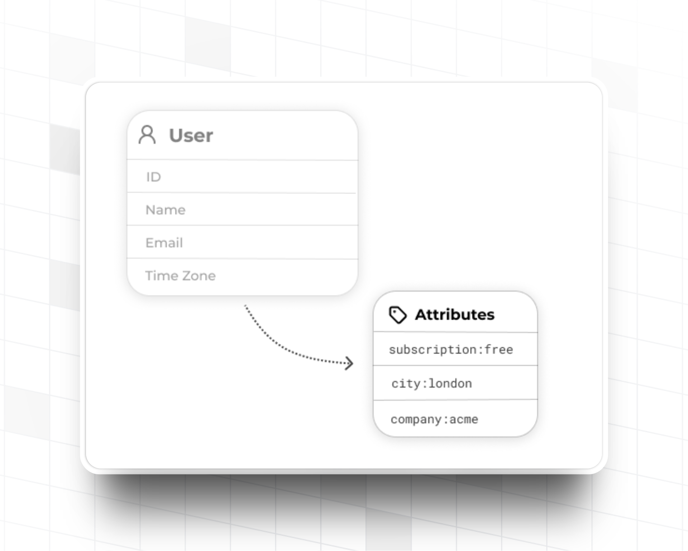
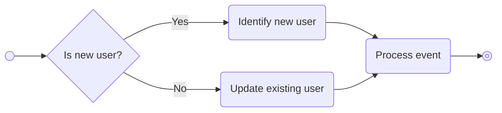
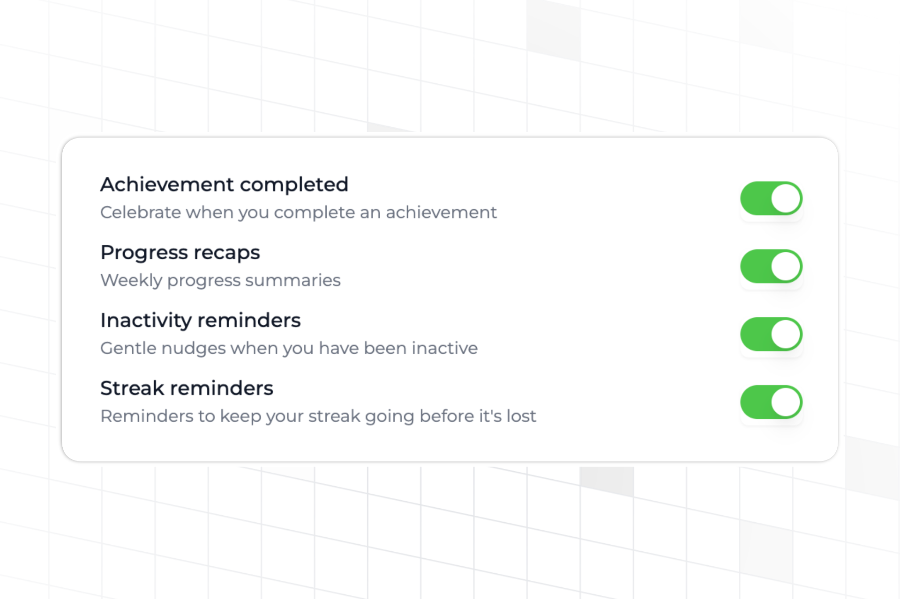
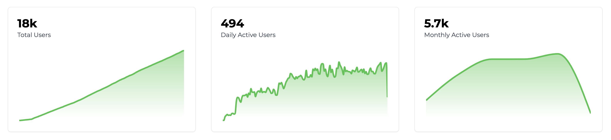
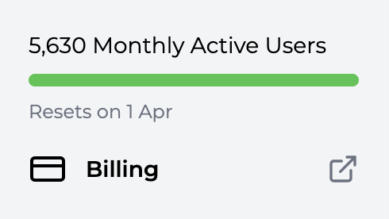

import MetricChangeRequestBlock from "../../snippets/metric-change-request-block.mdx";
import IdentifyUserRequestBlock from "../../snippets/identify-user-request-block.mdx";
import UpdateUserNotificationPreferencesBlock from "../../snippets/update-user-notification-preferences-block.mdx";
import GetUserNotificationPreferencesBlock from "../../snippets/get-user-notification-preferences-block.mdx";
import UserStreakPreferencesResponseBlock from "../../snippets/user-streak-preferences-response-block.mdx";

## ¿Qué son los usuarios? {#what-are-users}

Los usuarios son las personas que utilizan tu producto. Informas a Trophy sobre tus usuarios mediante las API y usas el panel de control para diseñar experiencias de gamificación en torno a ellos.

Los usuarios deben ser personas individuales; no pueden ser empresas ni organizaciones. Para crear estructuras organizativas o agrupaciones de usuarios, considera usar un [atributo de usuario personalizado](#custom-user-attributes).

## Atributos clave {#key-attributes}

Los atributos clave son propiedades de los usuarios que Trophy controla y gestiona, y sirven para cosas como `id` o `email`. Algunos son obligatorios y otros opcionales.

### Atributos obligatorios {#required-attributes}

Trophy solo requiere un atributo clave: `id`. Todos los usuarios que registres en Trophy deben tener un `id`, ya que es lo que los identifica como una persona única.

<ParamField path="id" type="string" required={true}>
  Es el ID del usuario en **tu** base de datos.
</ParamField>

<Tip>
  Para simplificarte las cosas, Trophy te permite usar tu propio `id`, el que ya tienes
  en tu base de datos, en lugar de tener que gestionar otro solo para Trophy.
</Tip>

### Atributos opcionales {#optional-attributes}

Además, puedes informar a Trophy sobre cualquiera de los siguientes atributos clave opcionales, y los pondrá a tu disposición como parte de tu experiencia de gamificación:

<ParamField path="name" type="string">
  El nombre completo del usuario. Está disponible en las plantillas de correo electrónico y en otras áreas
  donde quieras dirigirte al usuario por su nombre.
</ParamField>

<ParamField path="email" type="string">
  La dirección de correo electrónico del usuario. Se usará en todos los
  [correos electrónicos](/es/features/emails) que configures como parte de tu
  experiencia de gamificación con Trophy.
</ParamField>

<ParamField path="tz" type="string">
  La zona horaria del usuario. Debe especificarse como un [identificador de zona
  horaria IANA](https://en.wikipedia.org/wiki/List_of_tz_database_time_zones).
  Se usa para las rachas, las posiciones en la clasificación y el envío de correos electrónicos a los usuarios
  según su hora local.

En JavaScript, puedes obtener la zona horaria del usuario con este fragmento de código:

```js Fetching timezone
// e.g. 'Europe/London'
const timezone = Intl.DateTimeFormat().resolvedOptions().timeZone;
```

</ParamField>

<ParamField path="subscribeToEmails" type="boolean" default="true">
  Si has configurado algún [correo electrónico](/es/features/emails) de Trophy, solo
  se enviará a un usuario cuando este campo sea true. Nota: si no proporcionas
  `email`, intentar establecer este campo en true provocará un error.
</ParamField>

<ParamField path="signUpDate" type="string">
  La fecha en que el usuario se registró en tu plataforma, como `YYYY-MM-DD`. Se aceptan fechas y horas
  ISO 8601 y se almacenan como su día natural en UTC. No debe ser
  posterior a hoy en la zona horaria del usuario. Este campo es independiente de
  `created`, que es la fecha en que Trophy tuvo conocimiento del usuario por primera vez.
</ParamField>

<ParamField path="deviceTokens" type="array<string>">
  La lista de tokens de dispositivo que se asociarán al usuario. Si has configurado
  alguna de las [Notificaciones push](/es/features/push-notifications) de Trophy, solo se
  enviarán a un usuario cuando se proporcione este campo.
</ParamField>

## Atributos de usuario personalizados {#custom-user-attributes}

<Frame>
  
</Frame>

Los atributos de usuario personalizados los gestionas tú y pueden ser lo que quieras, según tu caso de uso.

Por ejemplo, una aplicación de aprendizaje de idiomas podría usar un atributo personalizado para el idioma que estudia un usuario, o una plataforma de estudio podría usar uno para la asignatura favorita del usuario.

Los atributos de usuario personalizados te permiten comunicar a Trophy esta información contextual y usarla para personalizar las funciones de gamificación.

### Crear atributos {#creating-attributes}

Para crear un nuevo atributo de usuario personalizado, ve a la [pestaña de atributos](https://app.trophy.so/users/attributes) de la página de usuarios en el panel de Trophy y haz clic en el botón _Add User Attribute_.

Asigna un nombre y una clave única al atributo. La clave es lo que usarás para hacer referencia al atributo en las llamadas a la API.

<Frame>
  <video
    autoPlay
    muted
    loop
    playsInline
    className="w-full aspect-15/4"
    src="../../assets/features/users/create_custom_user_attribute.mp4"
  ></video>
</Frame>

### Establecer atributos {#setting-attributes}

Es posible asignar valores a los atributos de usuarios específicos mediante su clave única, ya sea en línea, cuando los usuarios incrementan métricas a través de la [API de incremento de métricas](/es/api-reference/endpoints/events/submit-a-metric-event), o de forma explícita mediante las API de [identificación de usuarios](/es/api-reference/endpoints/users/identify-a-user), [creación de usuarios](/es/api-reference/endpoints/users/create-a-user) o [actualización de usuarios](/es/api-reference/endpoints/users/update-a-user).

<Warning>
  Trophy solo establecerá los valores de los atributos que se hayan creado
  previamente en el panel. Lo hacemos para ayudarte a mantener un conjunto de atributos ordenado y
  evitar sobrescrituras accidentales.

Si recibes un error similar al siguiente, es posible que hayas escrito mal la clave del atributo en la solicitud o que primero debas crear el atributo en el panel de Trophy:

{/* vale off */}

```json
{
  "error": "Invalid attribute keys: pln. Please ensure all attribute keys match those set up at https://app.trophy.so/users/attributes."
}
```

{/* vale on */}

</Warning>

En todas las API, el esquema para establecer los valores de los atributos es coherente. Este es un ejemplo de un payload de solicitud que establece el valor de dos atributos de usuario personalizados, `subject` y `plan`:

```json {4-7}
{
  "name": "Joe Bloggs",
  "email": "joe.bloggs@example.com",
  "attributes": {
    "subject": "physics",
    "plan": "free"
  }
}
```

### Usar atributos {#using-attributes}

Usa los atributos de usuario personalizados en todo Trophy para personalizar las funciones de gamificación, agregar y filtrar los datos devueltos por las API, y segmentar y comparar cohortes de usuarios en analítica.

#### Personalización de funciones {#feature-personalization}

Los atributos personalizados de usuario se pueden usar para personalizar los logros, adaptar la forma en que distintos usuarios obtienen puntos y mucho más. Sigue los enlaces a las páginas correspondientes que aparecen a continuación para obtener más información.

<CardGroup>
  <Card
    title="Personalización de logros"
    icon="trophy"
    href="/es/features/achievements#creating-achievements"
  >
    Configura logros que solo pueden desbloquear usuarios específicos.
  </Card>
  <Card
    title="Personalización de puntos"
    icon="sparkle"
    href="/es/features/points#points-triggers"
  >
    Personaliza cómo obtienen puntos los distintos usuarios.
  </Card>
  <Card
    title="Segmentación de correos electrónicos"
    icon="split"
    href="/es/features/emails#limiting-emails-to-specific-types-of-users"
  >
    Controla qué usuarios reciben correos electrónicos de gamificación.
  </Card>
  <Card
    title="Personalización de correos electrónicos"
    icon="braces"
    href="/es/features/emails#email-variables"
  >
    Personaliza el texto y los asuntos de los correos electrónicos con atributos personalizados de usuario.
  </Card>
  <Card
    title="Elegibilidad para las clasificaciones"
    icon="users"
    href="/es/features/leaderboards#eligibility"
  >
    Limita las clasificaciones a grupos específicos de usuarios.
  </Card>
</CardGroup>

#### Agregación y filtrado de datos {#data-aggregation-and-filtering}

Puedes usar atributos personalizados de usuario para agregar y filtrar los datos que devuelven algunas API, y así admitir una amplia variedad de casos de uso de gamificación. En todos los casos, los atributos se incluyen en el parámetro de consulta `userAttributes` mediante un esquema coherente:

`?userAttributes=city:london,subscription-plan:pro`

Esta es la lista de todas las API que admiten el parámetro de consulta `userAttributes`:

- [Resumen de Puntos](/es/api-reference/endpoints/points/get-points-summary)

#### Analíticas segmentadas {#segmented-analytics}

Los atributos personalizados de usuario se pueden usar para segmentar y comparar los gráficos de retención y participación entre grupos de usuarios.

Esto es útil para saber qué cohortes aprovechan al máximo tus funciones de gamificación y cuáles tienen dificultades para participar y, por tanto, requieren atención.

<Frame>
  <video
    autoPlay
    muted
    loop
    playsInline
    className="w-full aspect-15/4"
    src="../../assets/features/users/segmenting_analytics.mp4"
  ></video>
</Frame>

## Identificación de usuarios {#identifying-users}

Cuando le informas a Trophy sobre un usuario de tu plataforma, lo llamamos **identificación**. Hay dos formas de identificar usuarios con Trophy: la identificación [en línea](#inline-identification) y la identificación [explícita](#explicit-identification).

<Tip>
  Te recomendamos empezar con la identificación en línea si eres nuevo en
  Trophy. Si decides que necesitas más control, prueba la identificación explícita.
</Tip>

### Identificación en línea {#inline-identification}

La identificación en línea es la forma más sencilla de informar a Trophy sobre tus usuarios, ya que no requiere ningún código específico de identificación de usuarios. Simplemente informas a Trophy sobre los usuarios a medida que usan tu plataforma con normalidad.

En la práctica, esto significa que cada vez que utilices la [API de eventos de métricas](/es/api-reference/endpoints/events/submit-a-metric-event), envías los datos completos del usuario que desencadenó el evento.

Este es un ejemplo en el que se realiza una llamada a la API de eventos de métricas y los datos del usuario que realizó la interacción se envían en el cuerpo de la solicitud:

<MetricChangeRequestBlock />

En este caso, si es la primera interacción del usuario (es decir, es un usuario nuevo), se creará automáticamente un nuevo registro para él en Trophy.

Sin embargo, si Trophy encuentra un registro existente con el mismo `id`, Trophy actualizará los datos del usuario que se envíen.

En otras palabras, la identificación en línea se realiza mediante una operación `UPSERT`.

<br />



<br />

Identificar a los usuarios de esta manera tiene dos ventajas clave:

- Todos los usuarios nuevos que se registran en tu plataforma e incrementan una métrica se rastrean automáticamente en Trophy sin que tengas que escribir ningún código de identificación explícito
- Cualquier cambio en las propiedades de los usuarios existentes, como el nombre o la dirección de correo electrónico, se sincroniza automáticamente con Trophy la próxima vez que el usuario incremente una métrica

De esta forma, la identificación en línea te permite mantener a toda tu base de usuarios sincronizada de forma constante con Trophy escribiendo la menor cantidad de código posible.

Por eso recomendamos empezar con la identificación en línea y explorar la identificación explícita solo si descubres que necesitas más control.

### Identificación explícita {#explicit-identification}

La identificación explícita consiste en escribir código en tu aplicación que informe a Trophy sobre los usuarios de forma explícita, separada de cualquier interacción con métricas. Es útil si quieres tener control total sobre cómo y cuándo Trophy conoce a tus usuarios.

Algunos escenarios en los que podrías querer usar la identificación explícita son:

- Quieres informar a Trophy sobre los nuevos usuarios inmediatamente después del registro, antes de que incrementen una métrica
- Haces seguimiento de muchas métricas en Trophy y no quieres repetir el código de identificación en línea.
- Quieres informar a Trophy solo sobre una cohorte específica de usuarios, cuyas condiciones controlas tú

En este caso, puedes informar a Trophy sobre los nuevos usuarios mediante la [API de identificación de usuarios](/es/api-reference/endpoints/users/identify-a-user).

<IdentifyUserRequestBlock />

<Tip>
  Al igual que en la identificación en línea, la identificación explícita también funciona
  mediante una operación `UPSERT`, lo que significa que todos los atributos del usuario se mantienen sincronizados
  con Trophy automáticamente.
</Tip>

## Creación de usuarios {#creating-users}

Para crear explícitamente un nuevo usuario en Trophy, usa la [API de creación de usuarios](/es/api-reference/endpoints/users/create-a-user).

## Cómo mantener actualizados a los usuarios {#keeping-users-up-to-date}

Para informar a Trophy sobre una actualización de un usuario en tu plataforma, puedes usar la [API de actualización de usuarios](/es/api-reference/endpoints/users/update-a-user).

Las propiedades que pases a Trophy se actualizarán con los nuevos valores que especifiques.

<Tip>
  Como la [identificación de usuarios](#identifying-users) mantiene actualizados los registros de usuario por
  defecto, normalmente no es necesario actualizar explícitamente a los usuarios en Trophy cada
  vez que cambia una de sus propiedades en tu aplicación. Sin embargo, la API de
  actualización de usuarios está disponible por si realmente la necesitas.
</Tip>

## Configurar las preferencias de usuario {#setting-user-preferences}

Trophy ofrece APIs para ayudarte a crear un centro de preferencias que tus usuarios pueden utilizar para controlar y personalizar cómo interactúan con tus funciones de gamificación.

Esta sección describe todas las preferencias que puedes exponer a tus usuarios y su función.

### Preferencias de notificaciones {#notification-preferences}

Puedes usar Trophy para enviar a tus usuarios [correos electrónicos](/es/features/emails) y [Notificaciones push](/es/features/push-notifications) gamificados.

La [API de actualización de preferencias](/es/api-reference/endpoints/users/update-user-preferences) de Trophy te permite crear un centro de preferencias dentro de tu aplicación con el que tus usuarios pueden controlar qué notificaciones reciben y a través de qué canales.

<Frame>
  
</Frame>

La API te permite actualizar las preferencias de notificación de un usuario para distintos tipos de notificación:

- **achievement_completed**: notificaciones que se envían cuando un usuario completa un Logro
- **recap**: notificaciones periódicas con un resumen del progreso del usuario
- **reactivation**: notificaciones que se envían para volver a captar a usuarios inactivos
- **streak_reminder**: recordatorios para ayudar a los usuarios a mantener sus Rachas

Para cada tipo de notificación, puedes especificar en qué canales debe recibir el usuario las notificaciones: `email`, `push`, o ambos. Para desactivar por completo un tipo de notificación, pasa un array vacío.

Por ejemplo, el siguiente fragmento de código actualiza las preferencias de notificación de un usuario en Trophy:

<UpdateUserNotificationPreferencesBlock />

Para crear una interfaz de centro de preferencias en tu aplicación, primero deberás obtener las preferencias actuales del usuario mediante la [API de obtención de preferencias](/es/api-reference/endpoints/users/get-user-preferences).

Esto devolverá la configuración de notificaciones actual del usuario, que luego puedes mostrar en tu interfaz y permitir que los usuarios la modifiquen.

<GetUserNotificationPreferencesBlock />

La API devuelve una respuesta que contiene las preferencias de notificación actuales del usuario para cada tipo de notificación:

```json Response {3}
{
  "notifications": {
    "achievement_completed": ["email", "push"],
    "recap": ["email"],
    "reactivation": ["push"],
    "streak_reminder": ["email", "push"]
  }
}
```

Puedes usar esta respuesta para:

- **Rellenar los controles del formulario**: preselecciona casillas o interruptores en la interfaz de tu centro de preferencias según los valores actuales
- **Mostrar el estado actual**: muestra qué notificaciones están habilitadas y por qué canales
- **Gestionar preferencias ausentes**: si un tipo de notificación no aparece en la respuesta, significa que el usuario aún no ha configurado preferencias para él, y puedes aplicar la configuración predeterminada de tu aplicación

Una vez que hayas obtenido y mostrado las preferencias, los usuarios podrán hacer cambios en tu interfaz y podrás usar la [API de actualización de preferencias](/es/api-reference/endpoints/users/update-user-preferences) para guardar sus selecciones en Trophy.

### Preferencias de racha {#streak-preferences}

Trophy admite preferencias de usuario para las rachas, lo que permite a los usuarios personalizar las condiciones que deben cumplir para extender su racha, incluidos los días de la semana que cuentan para ella.

<Note>
Para usar las preferencias de racha, debes tener habilitada la [personalización de rachas](/es/features/streaks#streak-personalization).
</Note>

Una vez habilitada la personalización de rachas, la [API de actualización de preferencias](/es/api-reference/endpoints/users/update-user-preferences) te permitirá reemplazar la configuración predeterminada de rachas para un usuario específico.

Las preferencias del usuario pueden reemplazar los siguientes ajustes de racha:
- `enabled`: indica si se calculan las rachas para este usuario. Cuando es `false`, la racha del usuario siempre es `0` y no se envían webhooks ni notificaciones de racha.
- `metrics`: un array de [métricas](/es/features/metrics) con umbrales personalizados necesarios para extender la racha.
- `evaluationMode`: determina cómo se combinan las métricas para extender la racha. Puede ser `ALL` o `OR`.
- `daysOff`: un array de números de días de la semana (`0` = domingo hasta `6` = sábado) que reemplazan los [días libres](/es/features/streaks#days-off) de la organización. El usuario no perderá su racha si está inactivo en esos días.

<UserStreakPreferencesResponseBlock />

Una vez configuradas las preferencias de racha, la [API para obtener preferencias](/es/api-reference/endpoints/users/get-user-preferences) devolverá los ajustes de racha personalizados del usuario.

## Obtener la información de un usuario {#retrieving-user-information}

Para obtener los detalles de un usuario que ya has identificado en Trophy, usa la [API Get User](/es/api-reference/endpoints/users/get-a-single-user).

Esto devolverá todos los detalles del usuario junto con el atributo `control`, que puedes usar para inscribir a los usuarios de forma condicional en cualquier función de gamificación. Más información sobre [Experimentación](/es/platform/experimentation).

```json Response {3}
{
  "id": "user-id",
  "control": false,
  "agenticMessagingEnabled": false,
  "created": "2021-01-01T00:00:00Z",
  "email": "user@example.com",
  "name": "User",
  "signUpDate": "2020-08-20",
  "subscribeToEmails": true,
  "tz": "Europe/London",
  "updated": "2021-01-01T00:00:00Z"
}
```

## Analíticas de usuarios {#user-analytics}

### Analíticas básicas {#basic-analytics}

De forma predeterminada, Trophy incluye analíticas de usuarios de alto nivel, entre ellas las de la [página de usuarios](https://app.trophy.so/users), como:

- El número total de usuarios que has registrado en Trophy
- El número de usuarios activos a diario
- El número de usuarios activos cada mes

<Frame>
  
</Frame>

En esta página también puedes buscar entre todos los usuarios que Trophy ha registrado, lo que puede resultar útil para depurar.

### Usuarios destacados {#top-users}

Además, en el [Dashboard](https://app.trophy.so), Trophy muestra una lista de _Usuarios destacados_ con los usuarios que más han avanzado en las métricas de tu plataforma.

Son tus usuarios más comprometidos, ¡así que conviene saber quiénes son!

## Preguntas frecuentes {#frequently-asked-questions}

<AccordionGroup>
  <Accordion title="¿Cuántos usuarios puedo registrar en Trophy?">
    ¡Tantos como quieras! Trophy solo cobra cada mes por los usuarios _activos_, que son aquellos que interactúan con tu producto al menos una vez en un mes determinado.

    Esto es genial porque, si un usuario deja de usar tu producto, no pagarás por él en los meses siguientes.

    Puedes ver el número total de usuarios por los que se te cobrará cada mes dentro de Trophy en la barra lateral:

    <Frame>
      
    </Frame>

    Puedes estimar los costes de uso en nuestra [página de precios](https://trophy.so/pricing).

  </Accordion>

</AccordionGroup>

## Obtener soporte {#get-support}

¿Quieres ponerte en contacto con el equipo de Trophy? Escríbenos por [correo electrónico](mailto:support@trophy.so). ¡Estamos aquí para ayudarte!
