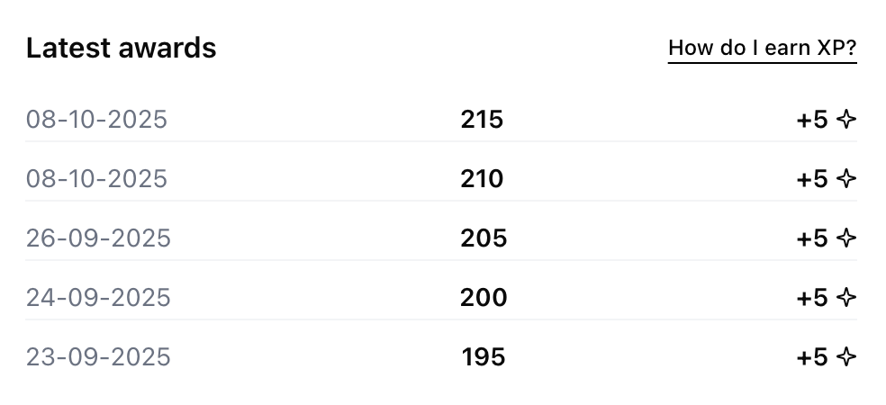
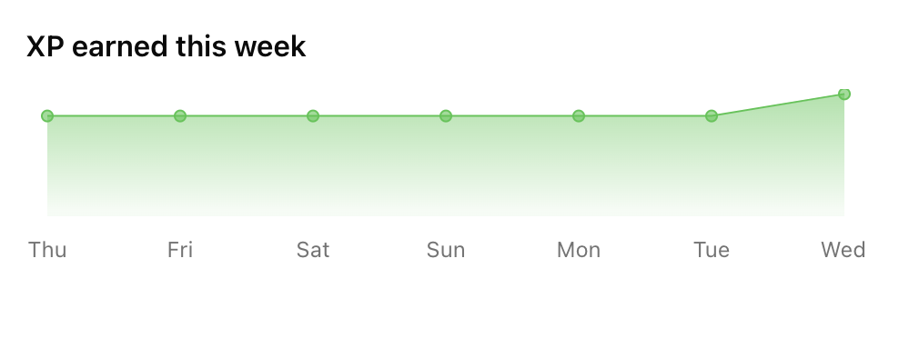
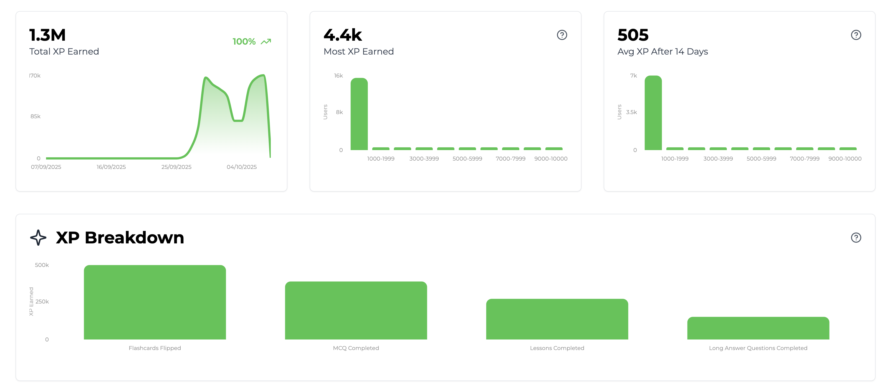

import SDKInstallCommand from "../../snippets/sdk-install-command.mdx";
import MetricChangeRequestBlock from "../../snippets/metric-change-request-block.mdx";
import MetricChangeResponseBlock from "../../snippets/metric-change-response-block.mdx";
import UserPointsRequest from "../../snippets/user-points-request-block.mdx";
import UserPointsResponse from "../../snippets/user-points-response-block.mdx";
import UserPointsEventSummaryRequest from "../../snippets/user-points-summary-request-block.mdx";
import UserPointsEventSummaryResponse from "../../snippets/user-points-summary-response-block.mdx";

La guía describe el proceso completo para añadir una función de XP a tu aplicación web o móvil usando Trophy.

Con fines ilustrativos, usaremos el ejemplo de una plataforma de estudio que utiliza XP para recompensar a los usuarios por realizar diferentes interacciones.

<Tip>
  Para ver un ejemplo completamente funcional de esto en la práctica, consulta la [demostración
  en vivo](https://examples.trophy.so) o el [repositorio de
  github](https://github.com/trophyso/example-study-platform/tree/demo).
</Tip>

## Requisitos previos {#pre-requisites}

- Una cuenta de [Trophy](https://app.trophy.so/sign-up)
- Aproximadamente 10 minutos

## Configuración de Trophy {#trophy-setup}

En Trophy, las [Métricas](/es/features/metrics) son los bloques de construcción de la gamificación y modelan las diferentes interacciones que los usuarios tienen con tu producto.

En esta guía, la interacción que nos interesa es `flashcards-viewed`, pero puedes crear cualquier número de métricas que mejor representen las interacciones por las que deseas recompensar XP.

En el panel de Trophy, dirígete a la [página de métricas](https://app.trophy.so/metrics) y crea una métrica.

<Frame>
  <video
    autoPlay
    muted
    loop
    playsInline
    className="w-full aspect-video"
    src="../../assets/guides/achievements-feature/create_new_metric.mp4"
  ></video>
</Frame>

Una vez que hayas creado tu métrica, dirígete a la [página de puntos](https://app.trophy.so/points) y crea un nuevo sistema de puntos llamado 'XP'.

<Frame>
  <video
    autoPlay
    muted
    loop
    playsInline
    className="w-full aspect-video"
    src="../../assets/guides/xp-feature/create_system.mp4"
  ></video>
</Frame>

Una vez creado, serás redirigido a la página de configuración del sistema de XP donde puedes crear 'disparadores' para cada una de las formas en que deseas recompensar a los usuarios con XP.

<Note>
  Los activadores de puntos añaden XP automáticamente al saldo de un usuario. Si quieres que los usuarios reclamen el XP antes de que se aplique, usa en su lugar una [recompensa de puntos](/es/features/rewards#points-rewards).
</Note>

<Frame>
  <video
    autoPlay
    muted
    loop
    playsInline
    className="w-full aspect-video"
    src="../../assets/guides/xp-feature/create_trigger.mp4"
  ></video>
</Frame>

En Trophy, haces seguimiento de las interacciones de los usuarios enviando [eventos](/es/features/events) desde tu código a la API de Trophy para una métrica específica.

Cuando se registran eventos para un usuario concreto, Trophy comprueba automáticamente si el evento corresponde a una métrica configurada como parte de algún activador de XP.

Si es así, Trophy otorga al usuario la cantidad de XP correspondiente según la configuración del activador.

Esto es lo que hace tan fácil crear experiencias gamificadas con Trophy: hace todo el trabajo por ti en segundo plano.

<Tip>
  También se puede otorgar XP a los usuarios en función de logros, rachas y otros
  activadores. Consulta la [documentación de puntos](/es/features/points#points-triggers)
  para obtener más información.
</Tip>

## Instalar el SDK de Trophy {#installing-trophy-sdk}

Para interactuar con Trophy desde tu código, usarás el SDK de Trophy, disponible en la mayoría de los principales [lenguajes de programación](/es/api-reference/client-libraries).

Instala el SDK de Trophy:

<SDKInstallCommand />

A continuación, obtén tu clave de API en la [página de integración](https://app.trophy.so/integration) de Trophy y añádela como una variable de entorno **solo del lado del servidor**.

```bash
TROPHY_API_KEY='*******'
```

<Warning>
  Asegúrate de **no** exponer tu clave de API en el código del lado del cliente.
</Warning>

## Seguimiento de las interacciones de los usuarios {#tracking-user-interactions}

Para registrar un evento (una interacción del usuario) en tu métrica, usa la [API de cambio de métrica](/es/api-reference/endpoints/events/submit-a-metric-event).

<MetricChangeRequestBlock />

La respuesta a esta llamada a la API es el conjunto completo de cambios en las funciones que hayas creado con Trophy, incluido el XP otorgado al usuario como resultado del evento y los activadores que lo otorgaron.

<Note>
  Si usas [Niveles de Puntos](/es/features/points#points-levels), el objeto `xp` puede incluir un campo **`level`** **solo cuando** el nivel del usuario haya cambiado en esta solicitud; puede omitirse si su nivel no ha cambiado. Consulta la [referencia de la API de cambio de métrica](/es/api-reference/endpoints/events/submit-a-metric-event) para ver el esquema de respuesta completo.
</Note>

{/* vale off */}

```json Response [expandable]
{
  "metricId": "d01dcbcb-d51e-4c12-b054-dc811dcdc623",
  "eventId": "0040fe51-6bce-4b44-b0ad-bddc4e123534",
  "total": 900,
  ...,
  "points": {
    "xp": {
      "id": "0040fe51-6bce-4b44-b0ad-bddc4e123534",
      "key": "xp",
      "name": "XP",
      "description": null,
      "badgeUrl": null,
      "maxPoints": null,
      "total": 450,
      "added": 50,
      "awards": [
        {
          "id": "0040fe51-6bce-4b44-b0ad-bddc4e123534",
          "awarded": 50,
          "date": "2021-01-01T00:00:00Z",
          "total": 450,
          "trigger": {
            "id": "0040fe51-6bce-4b44-b0ad-bddc4e123534",
            "type": "metric",
            "metricName": "Flashcards Flipped",
            "metricThreshold": 100,
            "points": 50
          }
        }
      ]
    }
  },
  ...
}
```

{/* vale on */}

Comprueba que todo funciona correctamente revisando el [panel](https://app.trophy.so) de Trophy.

## Mostrar XP {#displaying-xp}

Tienes varias opciones para mostrar XP en tu aplicación. Aquí veremos las más habituales.

### Notificaciones emergentes {#pop-up-notifications}

Podemos usar la respuesta de la [API de cambio de métrica](/es/api-reference/endpoints/events/submit-a-metric-event) para mostrar notificaciones emergentes a los usuarios cuando se les otorga XP.

Este es un ejemplo en acción:

```ts XP Pop-ups
// Sends event to Trophy
const response = await viewFlashcard();

if (!response) {
  return;
}

const xp = response.points.xp;

// Show toast if user was awarded XP
if (xp.awards.length > 0) {
  const trigger = xp.awards[0].trigger;

  toast({
    title: `You gained ${xp.added} XP`,

    // e.g. "+20 XP for 10 flashcards flipped"
    description: `+${trigger.points} XP for ${
      trigger.metricThreshold
    } ${trigger.metricName.toLowercase()}`,
  });
}
```

<Tip>
  Si quieres reproducir efectos de sonido, usa la [API de audio de
  HTML5](https://developer.mozilla.org/en-US/docs/Web/API/Web_Audio_API) y no
  dudes en copiar estos [archivos de
  audio](https://github.com/trophyso/example-study-platform/tree/demo/public/sounds)
  que recomendamos.
</Tip>

### Mostrar la XP del usuario {#displaying-user-xp}

Para obtener la XP de un usuario, usa la [API de puntos de usuario](/es/api-reference/endpoints/users/get-a-users-points).

<UserPointsRequest />

Esta API devuelve datos sobre la XP total del usuario, pero también puede configurarse para devolver entre 1 y 100 de las recompensas de XP más recientes del usuario mediante el parámetro de consulta `awards`.

<UserPointsResponse />

Este es un ejemplo de una interfaz que muestra a los usuarios una lista de sus recompensas más recientes, a partir de los datos devueltos por la API de puntos de usuario.

<Frame>
  
</Frame>

### Gráfico de XP del usuario {#user-xp-chart}

La [API de resumen de puntos de usuario](/es/api-reference/endpoints/users/get-a-users-points-summary) devuelve datos históricos listos para graficar que muestran cómo ha cambiado la XP de un usuario con el tiempo.

<UserPointsEventSummaryRequest />

Usa los parámetros de consulta `aggregation`, `start_date` y `end_date` para controlar los datos devueltos. Este es un ejemplo de datos de XP agregados por día:

<UserPointsEventSummaryResponse />

Y este es un ejemplo de los tipos de gráficos que puedes crear con estos datos:

<Frame>
  
</Frame>

## Analíticas {#analytics}

En Trophy, la [página del sistema de XP](https://app.trophy.so/points) incluye gráficos de analíticas que muestran datos sobre el total de XP obtenidos y un desglose de qué desencadenantes otorgan más XP.

<Frame>
  
</Frame>

## Obtener soporte {#get-support}

¿Quieres ponerte en contacto con el equipo de Trophy? Escríbenos por [correo electrónico](mailto:support@trophy.so). ¡Estamos aquí para ayudarte!
