{/* TODO(media): re-create in the new dashboard theme: assets/features/emails/achievement_progress_block.mp4 */}

<Info>
  These are Trophy's legacy, template-based emails, sent from fixed triggers. For users in the [agentic messaging](/agentic-messaging/overview) cohort, agentic messaging replaces them: lifecycle agents write and send personalized emails instead. Both send from the same verified domain, which you set up on the [channels](/agentic-messaging/channels#domain-verification) page.
</Info>

Trophy can send automated emails to users based on key triggers without requiring any code. Here we'll look at what these triggers are, and how they can help bring users back to your product.

## Types of emails {#types-of-emails}

Trophy supports 4 types of emails, each of which is designed to suit a common engagement scenario.

All emails are optional, but all four can be used simultaneously and can be controlled from the [Emails](https://app.trophy.so/emails/configure) page in the Trophy dashboard.

<Frame>
  <video
    autoPlay
    muted
    loop
    playsInline
    className="w-full aspect-video"
    src="../assets/features/emails/email_types.mp4"
  ></video>
</Frame>

- **Milestone emails** are sent to users each time they complete a [Milestone](/features/milestones).
- **Recap emails** are sent to users on a pre-defined frequency to summarize progress. Recap Emails can be configured to be sent daily, weekly, monthly or yearly depending on your use case.
- **Reactivation emails** are sent to users after they become inactive with the goal of bringing them back to your app.
- **Streak emails** are automatically sent to users reminding them to extend their [Streak](/features/streaks).

## Sending emails {#sending-emails}

To start sending emails with Trophy, you'll need to [verify your domain](/agentic-messaging/channels#domain-verification) and add and activate email templates for the types you want to send.

<Tip>
  Users can control which email notifications they receive through Trophy's
  [user preferences API](/data-sources/users#notification-preferences). This allows
  you to build a preference center in your application where users can opt in or
  out of specific email types.
</Tip>

### Domain verification {#domain-verification}

<a id="sender-verification-basic" />
<a id="dns-verification-advanced" />

Legacy emails send from the same verified domain as agentic messaging, so you only need to set it up once. Follow the [domain verification](/agentic-messaging/channels#domain-verification) guide on the channels page to set up [Single Sender Verification](/agentic-messaging/channels#sender-verification-basic) or [DNS Verification](/agentic-messaging/channels#dns-verification-advanced).

### Email triggers {#email-triggers}

On the [email configuration](https://app.trophy.so/emails/configure) page, each email type has its own section. Add templates under the relevant type and activate one to start sending.

#### Recap emails {#recap-emails}

**Recap** emails send weekly or monthly progress reports to users. You can change the frequency of these emails on the [Settings](https://app.trophy.so/settings) page using the **Aggregation period** setting, or with the [organization settings Admin API](/admin-api/endpoints/settings/update-organization-settings).

<Frame>
  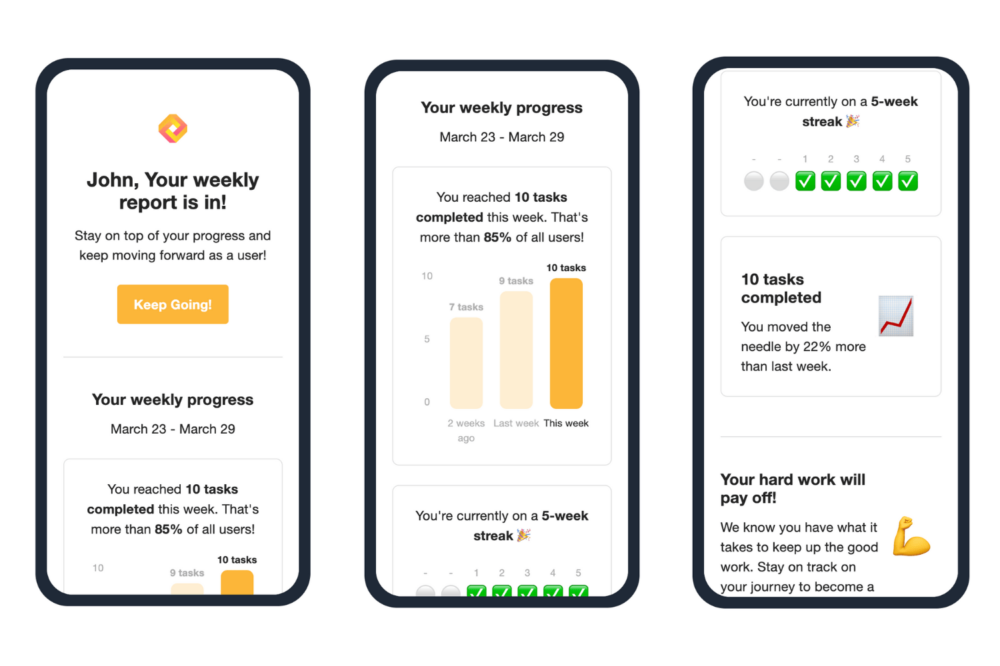
</Frame>

#### Reactivation emails {#reactivation-emails}

**Reactivation** emails send win-back messages to users after they become inactive. These emails are sent according to the following timeline:

- After 3 days of inactivity
- After 5 days of inactivity
- After 7 days of inactivity
- After 14 days of inactivity
- After 30 days of inactivity

<Frame>
  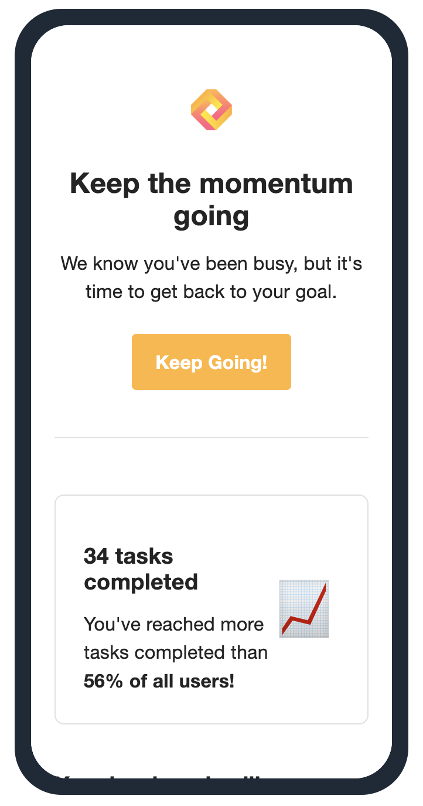
</Frame>

#### Streak emails {#streak-emails}

**Streak** emails remind users to extend their streak before it expires. These emails are sent according to the streak frequency you configured on the [streaks page](https://app.trophy.so/streaks):

- If your app uses a **daily streak**, this email will send four hours before the end of the day (in each user's timezone).
- For **weekly streaks**, it will send on Friday morning.
- For **monthly streaks**, it will send on the 25th of the month.

<Frame>
  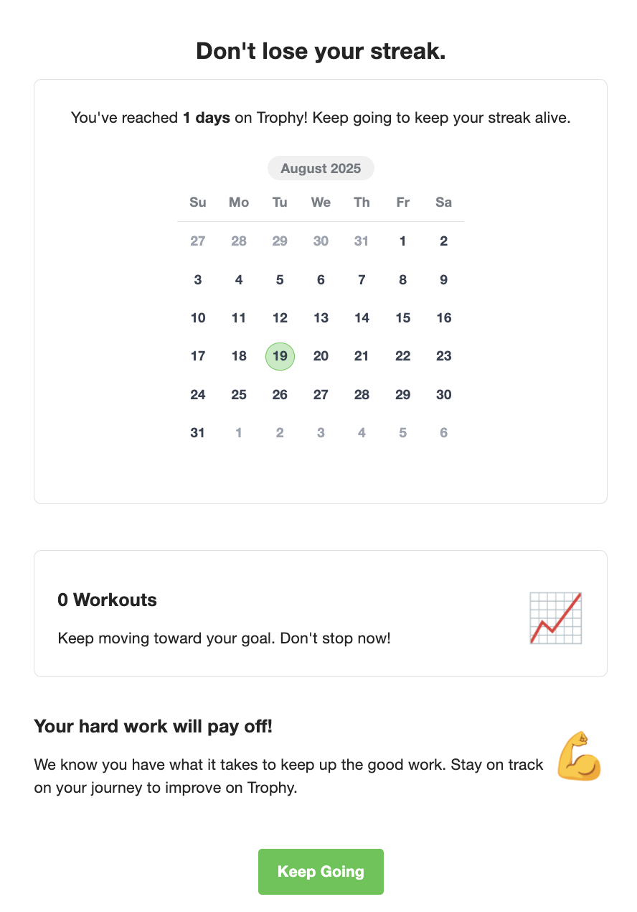
</Frame>

#### Milestone emails {#achievement-emails}

**Milestone** emails congratulate users when they complete a [milestone](/features/milestones) you've configured in Trophy. These emails send between 5-9PM on the day the milestone is completed, or the next day at 5PM if it is past 9PM when the user completes the milestone.

<Frame>
  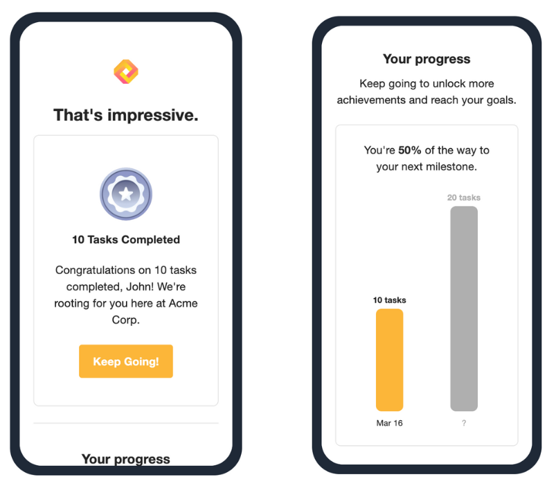
</Frame>

#### Limiting emails to specific types of users {#limiting-emails-to-specific-types-of-users}

Each email template can be limited to users with specific [custom user attribute](/data-sources/users#custom-user-attributes) values.

For each attribute you'd like to restrict the email to, click the plus icon next to the **User Filters** header for the email template, then select the attribute and enter the desired value. Only users that have **all** specified attribute values will receive emails from this template.

<Frame>
  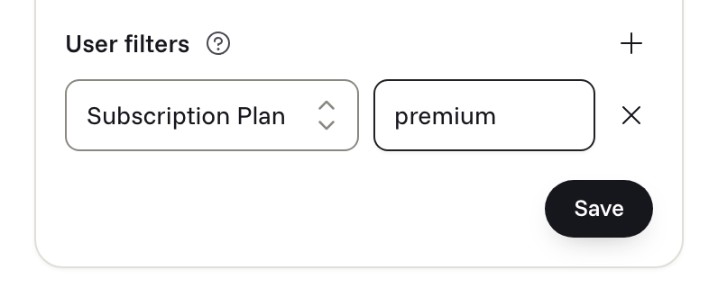
</Frame>

#### Time zones {#time-zones}

If you specify a timezone for each user through [User Identification](/data-sources/users#param-tz), Trophy will use that local time zone to schedule emails according to the logic specified above. If you do not provide time zones for the users you identify, Trophy will default to Eastern Time.

### Sending emails via webhooks {#sending-emails-via-webhooks}

Instead of having Trophy send emails for you, you can subscribe to email webhook events and send messages yourself through your own email provider or pipeline.

When an email would normally be due, Trophy fires the corresponding webhook so you can handle delivery:

- [`emails.recap_due`](/webhooks/events/emails/recap-due)
- [`emails.reactivation_due`](/webhooks/events/emails/reactivation-due)
- [`emails.streak_reminder_due`](/webhooks/events/emails/streak-reminder-due)
- [`emails.achievement_due`](/webhooks/events/emails/achievement-due)

These webhooks fire based on the email triggers themselves, regardless of whether any email templates are enabled or disabled, and regardless of any [user attribute filters](#limiting-emails-to-specific-types-of-users) configured on those templates. If you need equivalent filtering, apply it in your webhook handler.

Email webhooks respect [notification preferences](/data-sources/users#notification-preferences) and the [control attribute](/platform/experimentation#control-ratio) used for experimentation. Trophy will not fire email webhooks for users who have opted out of that email type, or for users in the control group.

<Warning>
  If you are sending emails yourself from these webhooks, make sure the corresponding email templates are turned off in Trophy. Email webhooks still fire when triggers are due even if templates are disabled, but if templates remain enabled Trophy will also send its own emails resulting in duplicate delivery.
</Warning>

## Designing emails {#designing-emails}

Trophy has a fully-featured block-based email builder that allows you to design templates, controlling all email copy and subject lines. On the [emails](https://app.trophy.so/emails/configure) page, add templates under each [email type](#email-triggers) section you want to use.

<Frame>
  <video
    autoPlay
    muted
    loop
    playsInline
    className="w-full aspect-video"
    src="../assets/features/emails/designing_emails.mp4"
  ></video>
</Frame>

### Default templates {#default-templates}

By default, Trophy provides a template for each [email type](#types-of-emails) as a good starting point. The default templates can't be changed, but you can duplicate and customize these as you wish.

<Tip>
  You can also create blank templates if you just want to start from scratch.
</Tip>

### Creating a new template {#creating-a-new-template}

To create a new email template, follow the steps below.

<Steps>
  <Step title="Head to the Emails page">
    Within the Emails page, you'll find the
    [Configure](https://app.trophy.so/emails/configure) tab, where each email type section contains its templates.
  </Step>
  <Step title="Add a template">
    Click the *Add Template* button within the section for the email type you want to create a template for.

    <Frame>
      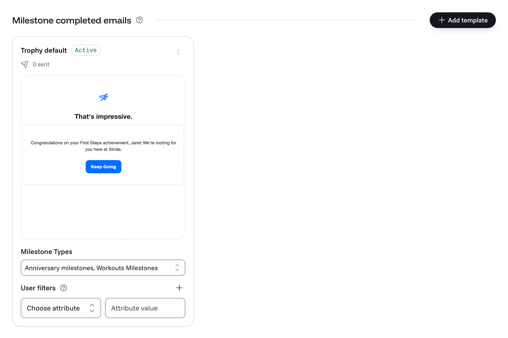
    </Frame>

  </Step>
  <Step title="Design your new template">
    Use the block-based editor to design your email template.

    <Frame>
      <video
        autoPlay
        muted
        loop
        playsInline
        className="w-full aspect-video"
        src="../assets/features/emails/designing_emails.mp4"
      ></video>
    </Frame>

  </Step>
</Steps>

### Block types {#block-types}

Trophy's email builder supports a number of different block types that serve different purposes. All the basic components you'd expect to find in an email editor like paragraphs, headers, and images are called [Basic Blocks](#basic-blocks). There is also a set of more powerful components like charts and streaks that leverage Trophy's user activity data and in-app features. These are called [Smart Blocks](#smart-blocks).

<Frame>
  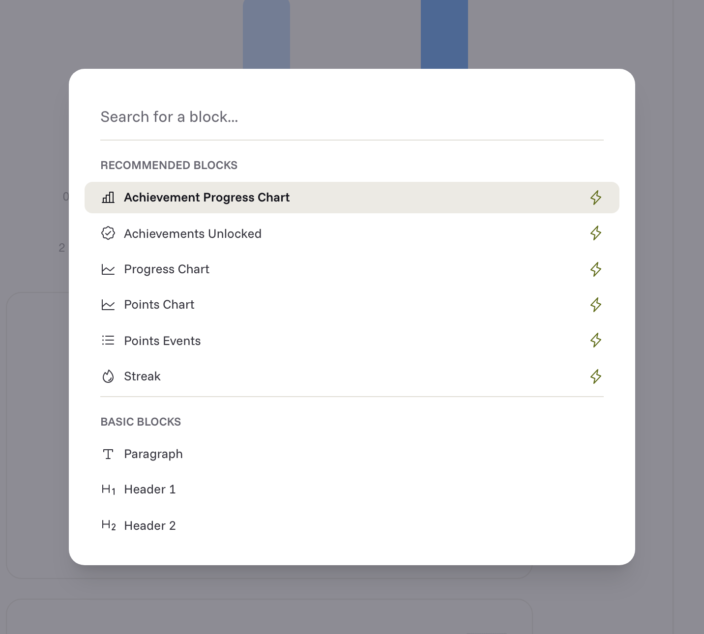
</Frame>

#### Basic blocks {#basic-blocks}

Here's the full list of un-opinionated basic blocks that Trophy supports:

- **Paragraph** - Good for short or longer text snippets.
- **H1, H2, H3** - Useful for headings of varying sizes.
- **Button** - Creates a call to action for users to take in emails.
- **Card** - Can nest other blocks, focusing attention.
- **Divider** - Good for separating content into logical sections.
- **Emoji** - Include any supported emoji, controlling size.
- **Image** - Upload any image and Trophy will render it in emails.
- **Spacer** - Good for giving blocks room to stand out.
- **Columns** - Useful for creating up to 3-column layouts with any content.
- **Logo** - Will render your organization's logo, set on the [Branding](https://app.trophy.so/branding) page.

#### Conditional blocks {#conditional-blocks}

Trophy also has a powerful conditional rendering system powered by the _Conditional_ block type.

By nesting any other block inside a conditional block and setting up the conditions logic, you can create almost any email design that will show different blocks in emails based on the evaluation of conditions at send time.

If you're familiar with the `if/else` logical operators then this will feel very familiar to you. Otherwise here's a quick diagram to explain how it works.

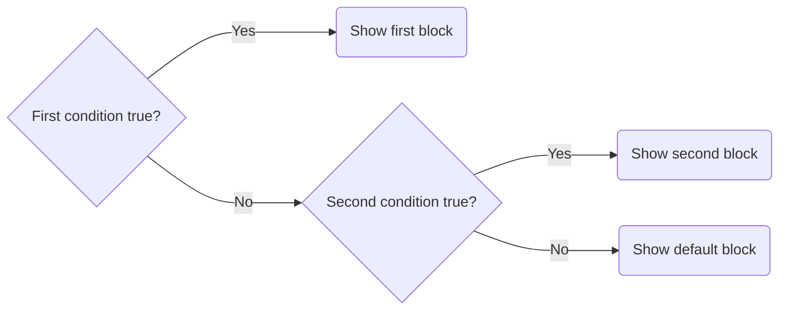

One common use case for the conditional block is to conditionally show a user their streak (one of Trophy's built-in [Smart Blocks](#smart-blocks)) and some streak-related motivational text only if they have an active streak. If the recipient isn't on a streak at the time the email is sent, then a simple message is displayed instead.

<Frame>
  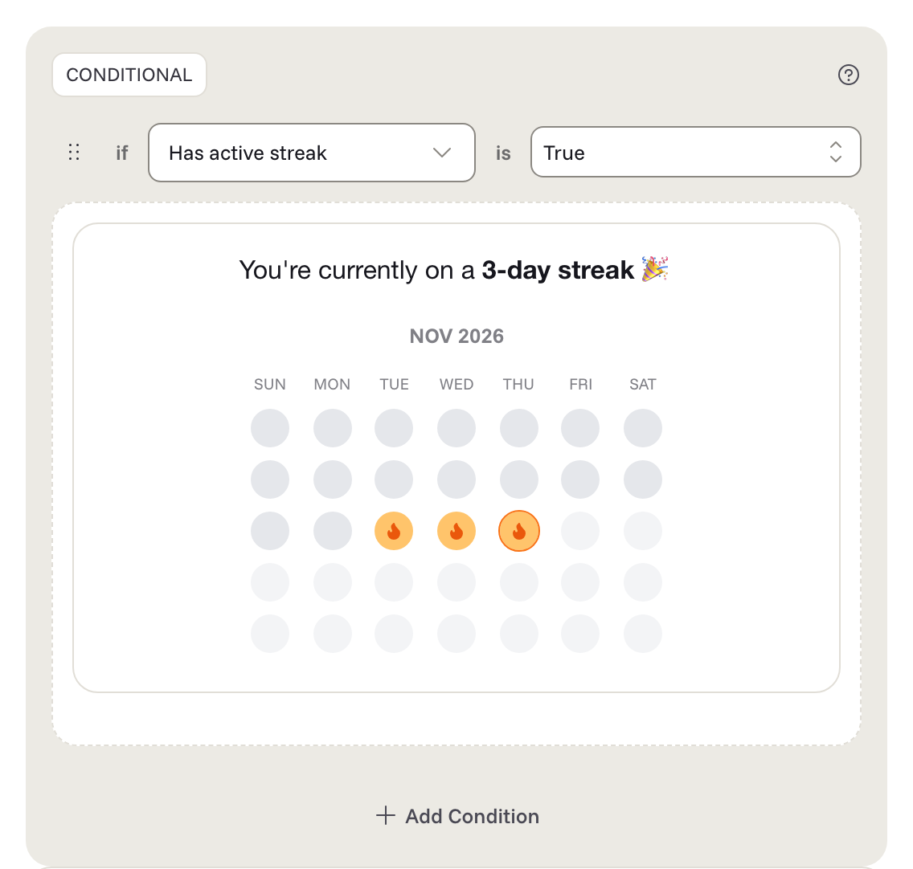
</Frame>

This creates a powerful framework to design emails based on highly relevant and personalized user data and can be used to create a wide-range of emails for common engagement use cases.

#### Smart blocks {#smart-blocks}

Smart blocks are powerful components designed to support common engagement use cases and integrate with all of Trophy's features including metrics, milestones and streaks.

You can find all smart blocks in the _Recommended Blocks_ section, and they are always recognizable by the <Icon icon="zap" /> icon.

Read more about the use case of each smart block:

<AccordionGroup>
  <Accordion title="Achievement Progress Chart" icon="zap">
    The achievement progress chart block displays a chart with bars for up to five milestones for a particular metric, highlighting any that the recipient has unlocked.
    
    Choose the metric to display milestones for using the metric selector.

    <Frame>
      <video
        autoPlay
        muted
        loop
        playsInline
        className="w-full aspect-video"
        src="../assets/features/emails/achievement_progress_block.mp4"
      ></video>
    </Frame>

  </Accordion>

{" "}

<Accordion title="Achievements Unlocked" icon="zap">
  The achievements unlocked block displays the milestone the recipient has completed. This is only useful in the context of milestone emails. If the recipient hasn't completed any milestones, then this block won't show in emails.

Where milestones have badges, these will be automatically shown, as well as the name of the milestone.

  <Frame>
      <video
        autoPlay
        muted
        loop
        playsInline
        className="w-full aspect-video"
        src="../assets/features/emails/achievements_unlocked_block.mp4"
      ></video>
    </Frame>
</Accordion>

{" "}

<Accordion title="Progress Chart" icon="zap">
  The progress chart block shows the recipient's progress against a particular metric over the last 3 [aggregation periods](#aggregation-period).

  <Frame>
      <video
        autoPlay
        muted
        loop
        playsInline
        className="w-full aspect-video"
        src="../assets/features/emails/progress_chart_block.mp4"
      ></video>
    </Frame>
</Accordion>

  <Accordion title="Streak" icon="zap">
    The streak block displays the recipient's current streak according to your account's streak settings.
    
    For daily streaks, a calendar block is shown displaying the last month's streak history. Weekly and monthly streaks display the last 7 periods of streak history.

    <Frame>
      <video
        autoPlay
        muted
        loop
        playsInline
        className="w-full aspect-video"
        src="../assets/features/emails/streak_block.mp4"
      ></video>
    </Frame>

  </Accordion>
</AccordionGroup>

### Email variables {#email-variables}

Trophy provides an expansive set of email variables that can be used to insert highly relevant and personalized copy into the body of emails and subject lines.

Variables bring context from your Trophy account, the recipient's progress data, and email specific settings to your email templates.

Email variables can be inserted by typing `@` in any block that supports rich text, like headers, paragraphs, and buttons, and searching for your chosen variable.

This will open up the variable editor window where you can configure variables as in the demo below.

<Tip>You can also use variables in email subject lines.</Tip>

<Frame>
  <video
    autoPlay
    muted
    loop
    playsInline
    className="w-full aspect-video"
    src="../assets/features/emails/email_variables_demo.mp4"
  ></video>
</Frame>

See below for a full list of all email variables supported by the email builder, broken down by category.

<AccordionGroup>
<Accordion title="User">
Variables related to the recipient of the email.

- **Name**: The recipient's name, if set

Additionally all [custom user attributes](/data-sources/users#custom-user-attributes) are available as email variables.

</Accordion>
<Accordion title="Metrics">
  Variables related to the recipients tracked event data against metrics.

Each Trophy metric supports the following email variables:

- **Metric Name**: The name of the metric
- **Metric Units**: The metric's units
- **Current Total**: The sum of all the recipients event values to date
- **Change This Period**: Absolute change in the recipients current total in the current aggregation period
- **Change This Period (%)**: Percent change in the recipients current total in the current aggregation period
- **Percentile (All Time)**: The recipients current total compared to all other users for all time
- **Percentile (This Period)**: The recipients current total compared to all other users in the current aggregation period

Additionally, the **Highest** and **Lowest** dynamic aliases support the same set of variables. When using these aliases, Trophy will pick the metric where the recipient has either the highest or lowest current total at send time.

When using metric variables, you also have the option of filtering the data that any of the above variables reference through a [custom event attribute](/data-sources/events#custom-event-attributes).

    </Accordion>

<Accordion title="Points">

Similarly to metrics, each points system has the following variables that can be used to add dynamic data to email copy:

- **Current Total**: The recipients total points
- **Change This Period**: Absolute change in the recipients total points in the current aggregation period
- **Change This Period (%)**: Percent change in the recipients total points in the current aggregation period
- **Percentile (All Time)**: The recipients total points compared to all other users for all time
- **Percentile (This Period)**: The recipients total points compared to all other users in the current aggregation period

.

</Accordion>
<Accordion title="Achievements">
  <Note>
  These variables are only relevant for [milestone emails](#achievement-emails).
  </Note>

When configuring a template for use with milestone emails, the following variables are available:

- **Is Final Achievement**: If the milestone triggering the email is part of a series of metric milestones, this is true when the milestone is the final milestone in the series
- **Percent To Next Achievement**: If the milestone triggering the email is part of a series of metric milestones, this is the percentage until the user completes the next milestone in the series
- **Achievement Name**: The name of the milestone that triggered the email
- **Achievement Description**: The description of the milestone that triggered the email

.

  </Accordion>
<Accordion title="Streak">
  Variables related to the recipient's streak.

- **Has Active Streak**: True if the recipient has an active streak at the time the email is sent, false otherwise
- **Streak Length**: The length of the recipient's current streak
- **Streak Extended**: True if the recipient's streak was extended, false otherwise
- **Days Since Last Extended**: The number of days since the user last extended their streak

.

</Accordion>
<Accordion title="Reactivation">
  <Note>
  These variables are only relevant for [reactivation emails](#reactivation-emails).
  </Note>

- **Message Number**: The number of the message in the reactivation sequence (1-5)

.

</Accordion>
<Accordion id="aggregation-period" title="Aggregation Period">
    <Note>
  These variables are only relevant for [recap emails](#recap-emails).
  </Note>

- **Current Period Date Range**: The start and end dates of the current aggregation period

.

</Accordion>
</AccordionGroup>

#### Advanced usage {#advanced-usage}

There are a couple of additional options to consider when using emails variables.

**Prefix & Suffix**

You can provide a prefix and suffix for text variables like the recipients name, or the name of a particular metric.

<Frame>
  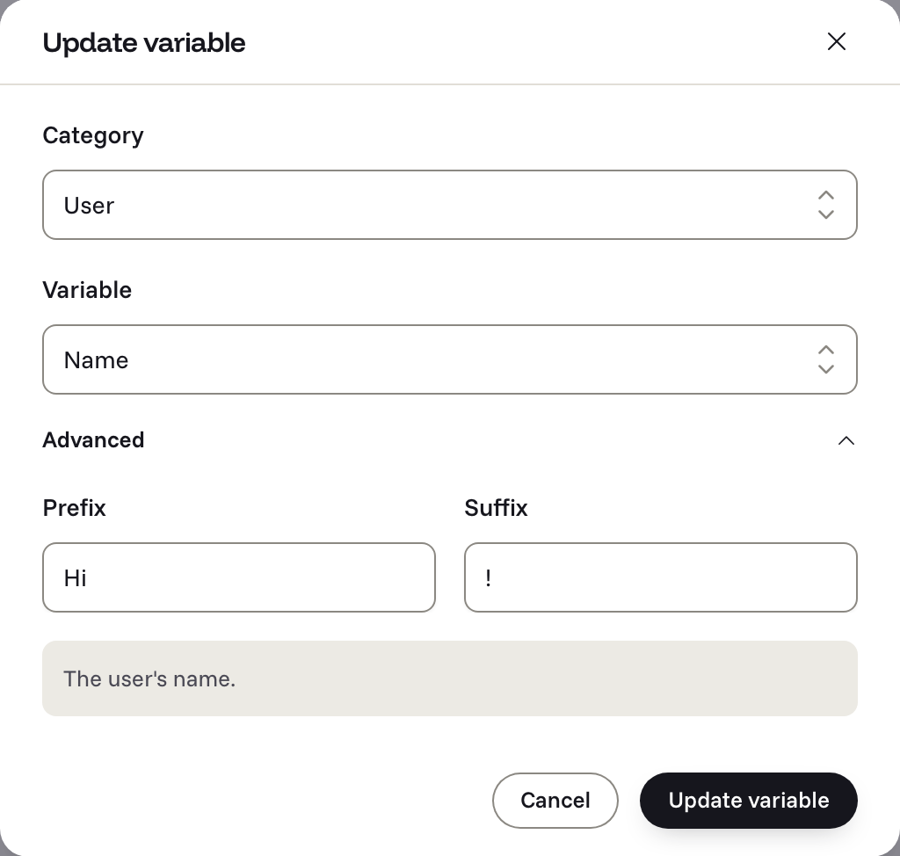
</Frame>

If the value of the variable fails to render when the email is sent, then Trophy won't display the variable or the prefix or suffix to keep emails clean.

**Singular & Plural**

When using numeric variables like the recipients current points total or metric total, you can also provide a singular and plural suffix to accompany it.

<Frame>
  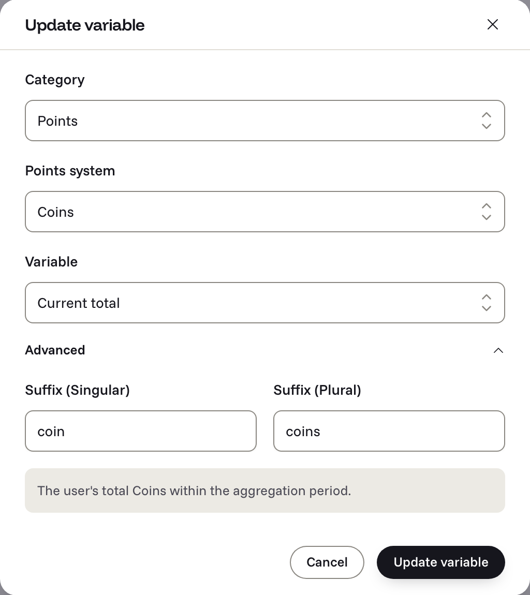
</Frame>

### Text variations {#text-variations}

Variations can be used to add randomness to text within emails sent by Trophy. This prevents emails from getting boring and helps improve open and click rates.

Any block that supports text entry including H1, H2, H3 and paragraph support variations.

<Tip>You can also use variations to add randomness to email subject lines.</Tip>

To create a variation click the _Add Variation_ button on any block that supports them.

<Frame>
  <video
    autoPlay
    muted
    loop
    playsInline
    className="w-full aspect-video"
    src="../assets/features/emails/creating_variations.mp4"
  ></video>
</Frame>

### Using the editor {#using-the-editor}

The email template editor is a blank canvas for designing emails that look great in the inbox. Using pre-configured [Blocks](#block-types) makes it really easy to create email templates that suit common engagement use cases. Here we'll walk through how to best use the editor to create awesome looking emails.

#### Adding blocks {#adding-blocks}

To add a new block an email template hit the <Icon icon="square-slash" /> key, this will open the block selection dialog where you can choose the block you want to add.

<Frame>
  <video
    autoPlay
    muted
    loop
    playsInline
    className="w-full aspect-video"
    src="../assets/features/emails/add_new_block_slash.mp4"
  ></video>
</Frame>

Or if you want to add a block immediately after another block, use the block menu.

<Frame>
  <video
    autoPlay
    muted
    loop
    playsInline
    className="w-full aspect-video"
    src="../assets/features/emails/add_new_block_by_block_menu.mp4"
  ></video>
</Frame>

#### Arranging blocks {#arranging-blocks}

Blocks can be dragged up and down using the block menu.

<Frame>
  <video
    autoPlay
    muted
    loop
    playsInline
    className="w-full aspect-video"
    src="../assets/features/emails/arranging_blocks.mp4"
  ></video>
</Frame>

#### Text formatting {#text-formatting}

The email editor offers rich text formatting including bold, italics, [hyperlinks](https://example.com) and `code` formatting.

<Frame>
  <video
    autoPlay
    muted
    loop
    playsInline
    className="w-full aspect-video"
    src="../assets/features/emails/rich_text_formatting.mp4"
  ></video>
</Frame>

### Font style {#font-style}

On the [email configure page](https://app.trophy.so/emails/configure), you'll find a setting to change the font style used in all emails.

<Frame>
  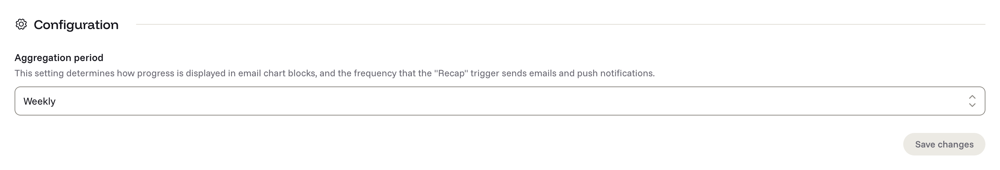
</Frame>

Other email styles are pulled from your Trophy account's [Branding](https://app.trophy.so/branding) settings.

## Handling unsubscribes {#handling-unsubscribes}

All emails that Trophy sends include an unsubscribe link and message. This is important for maintaining compliance with regulations and it's not possible to hide it.

<Info>
  The message will read as follows: You are receiving this email because you
  are subscribed to progress report and milestone emails. If you no longer
  wish to receive these emails, you can unsubscribe.
</Info>

Any recipient that clicks this link will be taken to a branded page that allows them to control which emails notifications they receive.

<Tip>
  As an alternative to the unsubscribe link, you can also build a preference
  center in your application using Trophy's [user preferences
  API](/data-sources/users#notification-preferences). This gives users more granular
  control over which types of emails they receive.
</Tip>

## Email analytics {#email-analytics}

Trophy has built-in analytics for all Emails that it sends. This includes:

- Recipients (The total number of people that received the email)
- Open rate (The percentage of recipients that opened the email)
- Click rate (The percentage of recipients that clicked on at least one link in the email)
- Retention rate (The percentage of users that opened the email that came back and used your platform after at least 2 days)

<Frame>
  <video
    autoPlay
    muted
    loop
    playsInline
    className="w-full aspect-video"
    src="../assets/features/emails/email_analytics.mp4"
  ></video>
</Frame>

## Frequently asked questions {#frequently-asked-questions}

<AccordionGroup>
<Accordion title="Can I send emails from my own domain?">
    Yes! Sending emails from your own domain is supported out-of-the-box. Follow the [domain verification](/agentic-messaging/channels#domain-verification) guide to get started.
  </Accordion>

{" "}

<Accordion title="Do you limit how many emails I can send?">
  No, we don't limit how many emails you can send. However, we do monitor usage
  to prevent abuse.
</Accordion>

</AccordionGroup>

## Get support {#get-support}

Want to get in touch with the Trophy team? Reach out to us via [email](mailto:support@trophy.so). We're here to help!
