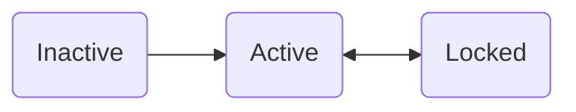
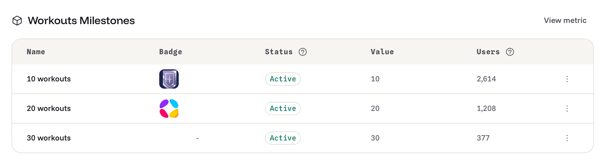
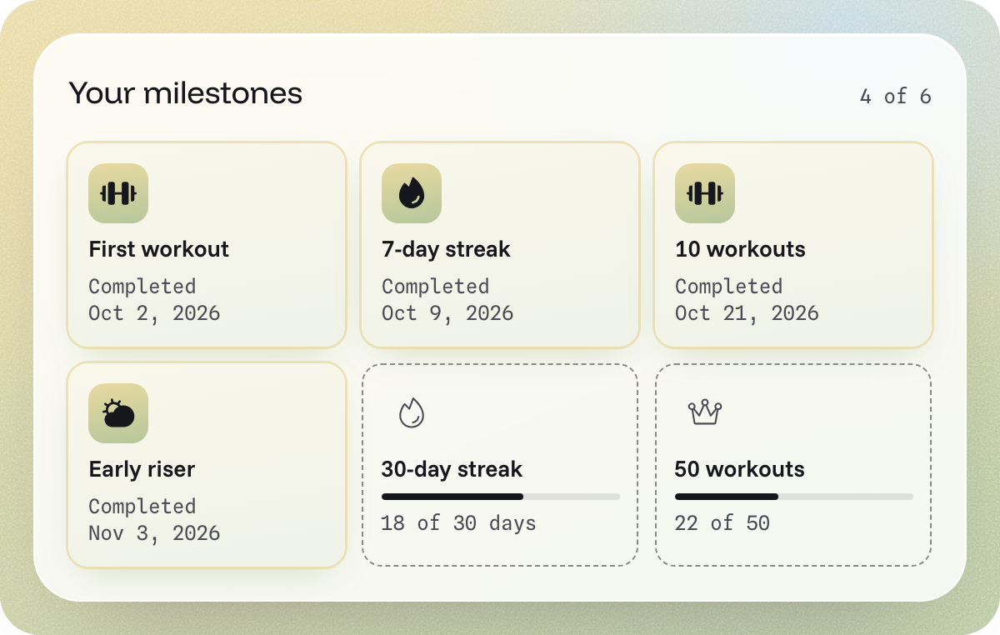
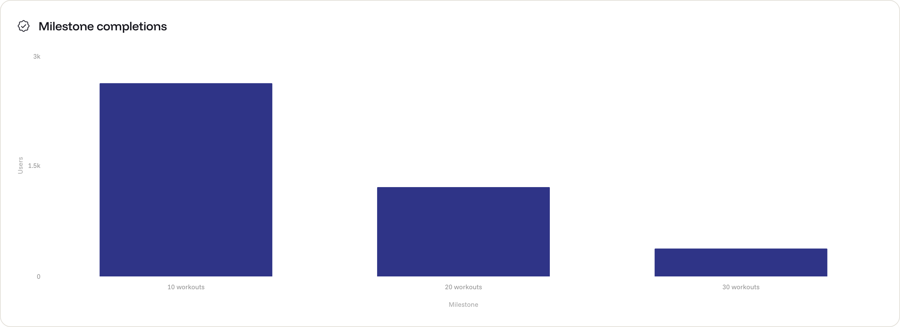

import MetricChangeResponseBlock from "../snippets/metric-change-response-block.mdx";
import AllAchievementsResponseBlock from "../snippets/all-achievements-response-block.mdx";

{/* TODO(media): re-create in the new dashboard theme: assets/features/achievements/displaying_trophy_cabinet.mp4 */}

## What are milestones? {#what-are-achievements}

<Note>
  Milestones are called achievements in the Trophy API, SDKs and webhooks. For example, see the [all achievements endpoint](/api-reference/endpoints/achievements/all-achievements) and the [`achievement.completed` webhook](/webhooks/events/achievements/achievement-completed). Field and endpoint names keep the `achievement` naming.
</Note>

Milestones celebrate progress that users make as they use your platform. They can be used to reward users for making continued progress along core user journeys, or to motivate users to explore more nascent features.

Milestones work best when designed to incentivize users to take actions that
are likely to lead to increased retention.

<Tip>
  Use Trophy's [metric analytics](/data-sources/metrics#metric-analytics) to compare
  the retention of each user interaction, then configure milestones around
  these interactions to maximize retention impact.
</Tip>

Here we'll look at the types of milestones you can build with Trophy, the different ways to use them, and how to integrate them into your platform.

## Milestone types {#achievement-types}

Trophy offers five types of milestones, [Metric](#metric-achievements), [API](#api-achievements), [Streak](#streak-achievements), [Anniversary](#anniversary-achievements) and [Composite milestones](#composite-achievements), detailed below.

### Metric milestones {#metric-achievements}

Metric milestones are tied to [Metrics](/data-sources/metrics) and are best used when you want to incentivize users to take the same action over and over again.

Let's take the example of a study platform that uses Trophy to encourage users to view more flashcards with metric milestones as follows:

- 1,000 flashcards
- 2,500 flashcards
- 5,000 flashcards
- 10,000 flashcards
- 25,000 flashcards
- 50,000 flashcards

In this case you would create a metric called _Flashcards Flipped_ and create a milestone against the metric for each threshold.

Since these milestones are directly tied to the _Flashcards Flipped_ metric, Trophy will automatically track when users unlock these milestones as they [increment the metric](/data-sources/events#tracking-metric-events).

When milestones are unlocked, Trophy includes information about the unlocked milestones in the [Event API](/api-reference/endpoints/events/submit-a-metric-event) response, and automatically triggers [milestone emails](/features/emails#achievement-emails) if configured.

<MetricChangeResponseBlock />

### API milestones {#api-achievements}

API milestones can only be completed once and are useful for rewarding users for taking specific actions.

Common examples include:

- A user completing their profile after signing up
- A user linking their social account to a platform
- A user sharing their product experience on social media

API milestones serve as an easy way to reward users for completing any action that you think is important for retention.

Just like metric milestones, API milestones can also trigger automated [milestone emails](/features/emails#achievement-emails) if configured.

### Streak milestones {#streak-achievements}

Streak milestones are directly tied to a user's [Streak](/features/streaks) and are automatically unlocked when users reach a particular streak length.

You can create as many streak milestones as you like for increasing lengths of streak, for example 7 days, 30 days and 365 days to motivate users to use your app more and more.

Just like metric and API milestones, you can add a custom name and assign a badge to streak milestones.

### Anniversary milestones {#anniversary-achievements}

Anniversary milestones unlock automatically when a user reaches a specific anniversary of their sign-up date.

Create one milestone for each year you want to celebrate, for example 1 year, 2 years and 5 years. Trophy unlocks each milestone when the user's [`signUpDate`](/data-sources/users#optional-attributes) plus that number of years is reached.

Users without a `signUpDate` are not eligible. Set `signUpDate` when you [identify](/data-sources/users#identifying-users) or [update](/data-sources/users#keeping-users-up-to-date) users so Trophy can detect anniversaries.

Trophy evaluates the anniversary on the calendar day in the user's [`tz`](/data-sources/users#optional-attributes). Set `tz` so the milestone unlocks on the correct local day.

Just like other milestone types, anniversary milestones can trigger [milestone emails](/features/emails#achievement-emails) when unlocked.

### Composite milestones {#composite-achievements}

Composite milestones unlock automatically when a user has completed all of the prerequisite milestones you select. They're ideal for creating tiered or mastery-level rewards that recognize users who have accomplished a specific set of milestones.

For example, you could create a "Study Master" composite milestone that unlocks when a user has completed:
- 1,000 flashcards
- 7-day streak
- Complete onboarding

Composite milestones are useful for creating progression pathways and encouraging users to engage across different areas of your app. Just like other milestone types, they can trigger [milestone emails](/features/emails#achievement-emails) when unlocked.

## Creating milestones {#creating-achievements}

To create new milestones, head to the [milestones page](https://app.trophy.so/milestones) in the Trophy dashboard and click the **New milestone** button:

<Tip>
You can also create, update, and delete milestones programmatically with the [Admin API](/admin-api/endpoints/achievements/create-achievements).
</Tip>

<Frame>
  <video
    autoPlay
    muted
    loop
    playsInline
    className="w-full aspect-video"
    src="../assets/features/achievements/create_new_achievement.mp4"
  ></video>
</Frame>

<Steps>
<Step title="Enter a name">
  Enter a name for the milestone. This will be returned from APIs and made available for use in emails and other areas of Trophy where appropriate.
</Step>

<Step title="Enter a description (Optional)">
  Enter a short description of the milestone. This will be returned from APIs
  and made available for use in emails and other areas of Trophy where
  appropriate.
</Step>

<Step title="Add a badge (Optional)">
  You can add a badge by uploading an image or by entering a custom image URL.
  The URL is returned in API responses and used in emails and other areas of
  Trophy where appropriate.
</Step>

<Step title="Choose a trigger type">
  Choose how you want this milestone to be unlocked.
  
- Choosing **Metric** will mean the milestone will be automatically unlocked when the user's metric total reaches the milestone trigger value.

- Choosing **Streak** will mean the milestone will be automatically unlocked when the user's streak length reaches the milestone trigger value.

- Choosing **Anniversary** will mean the milestone will be automatically unlocked when the user reaches the specified anniversary of their [`signUpDate`](/data-sources/users#optional-attributes).

- Choosing **API Call** will mean the milestone will only be unlocked when explicitly marked as completed by your code through a request to the [complete achievement API](/api-reference/endpoints/achievements/mark-an-achievement-as-completed).

- Choosing **Composite** will mean the milestone will be automatically unlocked when the user has completed all of the prerequisite milestones you select.

</Step>

<Step title="Set up trigger">
  Once you've chosen the trigger type for the milestone, you need to set up the trigger settings.

- If you chose the **Metric** trigger, you'll need to choose the metric and the user's total value that should unlock the milestone when reached.

- If you chose the **Streak** trigger, you'll need to set the streak length that should unlock the milestone.

- If you chose the **Anniversary** trigger, you'll need to set the number of years after sign-up that should unlock the milestone.

- If you chose the **API Call** trigger, you'll need to choose a unique reference `key` you'll use to complete the milestone via the [API](/api-reference/endpoints/achievements/mark-an-achievement-as-completed).

- If you chose the **Composite** trigger, you'll need to select the prerequisite milestones that must all be completed for this milestone to unlock. The composite milestone will automatically unlock when a user completes the final prerequisite.

</Step>

<Step title="Add attribute filters (Optional)">
You can assign attribute filters to a milestone to further restrict who can unlock them and when.

- To limit a **Metric** milestone to only apply to events with specific [custom event attributes](/data-sources/events#custom-event-attributes), add one or more filters in the **Event Attributes** section.

- To limit any type of milestone to only apply to a user with one or more specific [custom user attributes](/data-sources/users#custom-user-attributes), add attributes and the desired values in the **User Attributes** section.

<Note>
  When you set multiple event attribute filters, all of them must match for the
  metric milestone to apply. In API responses, `eventAttributes` is the
  canonical field and `eventAttribute` is deprecated for legacy compatibility.
</Note>

</Step>

<Step title="Click save">
  Save the new milestone.
</Step>
</Steps>

## Managing milestones {#managing-achievements}

Trophy has built in tools to help you test and control which milestones can be unlocked, by who and when, without affecting production.

### Milestone statuses {#achievement-statuses}

Here's an overview of the different milestone statuses and what they mean.

**Inactive**

All milestones are created as inactive. Inactive milestones can't be completed and aren't returned in any milestone APIs. Users won't see them until you make them active.

**Active**

When you make a milestone active, it makes it 'live'. Users can complete it and it will be returned from all milestone APIs.

**Locked**

When you lock a milestone, users who haven't unlocked it yet won't be able to unlock it anymore, but users who have already unlocked it won't be affected.

Locked milestones are only returned in APIs for users who have already achieved them.

### Milestone workflow {#achievement-workflow}

Milestones can be moved through different statuses according to the following workflow:



## Completing milestones {#completing-achievements}

If you're using metric milestones, there's no need to explicitly _complete_ milestones. Once you've set up [metric tracking](/data-sources/events#tracking-metric-events) in your code, all milestones linked to the metric will be automatically tracked.

Similarly, if you're using streak milestones, all milestones related to the user's streak will automatically be unlocked when a user reaches the respective streak length.

Anniversary milestones are also completed automatically. They unlock when a user reaches the configured anniversary of their [`signUpDate`](/data-sources/users#optional-attributes). Users without a `signUpDate` cannot unlock them.

Composite milestones are also completed automatically. They unlock as soon as a user has completed all of their prerequisite milestones. No additional API calls are needed.

However if you're using any API milestones, you will have to mark them as completed for each user as appropriate. To do this, you can use the [Complete Achievement API](/api-reference/endpoints/achievements/mark-an-achievement-as-completed) using the `key` of the milestone you want to complete.

This will return back a response that contains details of the milestone that was completed that can be used in any post-completion workflows, like showing an in-app notification.

{/* vale off */}

```json Response
{
  "completionId": "0040fe51-6bce-4b44-b0ad-bddc4e123534",
  "achievement": {
    "id": "5100fe51-6bce-6j44-b0hs-bddc4e123682",
    "trigger": "api",
    "name": "Finish onboarding",
    "description": "Complete the onboarding process.",
    "badgeUrl": "https://example.com/badge.png",
    "key": "finish-onboarding",
    "achievedAt": "2021-01-01T00:00:00Z"
  }
}
```

{/* vale on */}

## Backdating milestones {#backdating-achievements}

By default, whenever you move a milestone to 'Active' [status](#managing-achievements), Trophy will check if any existing users meet the requirements of the milestone and complete it for them behind the scenes.

This means when you release new milestones into production, or edit an existing live milestone, backdating will happen automatically.

The same applies when you set or change a user's [`signUpDate`](/data-sources/users#optional-attributes). If the user already qualifies for any active anniversary milestones, Trophy completes them silently.

<Note>
  When milestones are completed in this way, users don't receive any
  notifications this has happened. This is to prevent changes to your
  milestones in Trophy resulting in users getting lots of notifications.
</Note>

You can check how many users have completed milestones at any time on the [milestones page](https://app.trophy.so/milestones) in the Trophy dashboard. The _Users_ column in the milestones can update during backdating.

<Frame>
  
</Frame>

## Using badges {#using-badges}

<Frame>
  <video
    autoPlay
    muted
    loop
    playsInline
    className="w-full aspect-video"
    src="../assets/features/achievements/upload_badge.mp4"
  ></video>
</Frame>

You can assign a badge to any milestone by uploading an image—Trophy serves it and returns the URL—or by providing your own image URL. Relevant API responses include that value in `badgeUrl` for use as the `src` on `` tags.

```json Response {8}
{
  "completionId": "0040fe51-6bce-4b44-b0ad-bddc4e123534",
  "achievement": {
    "id": "5100fe51-6bce-6j44-b0hs-bddc4e123682",
    "trigger": "api",
    "name": "Finish onboarding",
    "description": "Complete the onboarding process.",
    "badgeUrl": "https://example.com/badge.png",
    "key": "finish-onboarding",
    "achievedAt": "2021-01-01T00:00:00Z"
  }
}
```

## Displaying milestones {#displaying-achievements}

Trophy has a number of APIs that support displaying milestones within your applications. Here we'll look at the different ways to use them and the types of UI's you can build.

### All milestones {#all-achievements}

To display a high-level overview of all milestones users can complete, use the [all achievements endpoint](/api-reference/endpoints/achievements/all-achievements). Use this data to build UI that gives users an idea of the progression pathways within your application.

<Frame>
  <video
    autoPlay
    muted
    loop
    playsInline
    className="w-full aspect-video"
    src="../assets/features/achievements/displaying_trophy_cabinet.mp4"
  ></video>
</Frame>

The all milestones endpoint returns a list of all milestones within your Trophy account. Each milestone returned also includes `completions` (the number of users who have completed the milestone) and `rarity` (the percentage of users who have completed the milestone) as follows:

<AllAchievementsResponseBlock />

### User milestones {#user-achievements}

If instead you're building user-specific UI elements, then use the [user achievements endpoint](/api-reference/endpoints/users/get-a-users-completed-achievements) to return milestones a specific user has completed.

<Tip>
  You can also include milestones that a user has yet to complete by including
  the query parameter `includeIncomplete=true`.
</Tip>

<Frame>
  
</Frame>

## Milestone analytics {#achievement-analytics}

If you have milestones set up for any of your [Metrics](/data-sources/metrics), then the metric analytics page displays a chart that shows you the current progress of all Users as follows:

<Frame>
  
</Frame>

## Frequently asked questions {#frequently-asked-questions}

<AccordionGroup>
  <Accordion title="What type of milestones should I use?">
    Use metric milestones for rewarding users for taking the same action over and over again, and to incentivise them to do it more.

    Use streak milestones for rewarding users for keeping their streak.

    Use anniversary milestones for rewarding users for remaining on your platform over time.

    Use API milestones when you want to reward users for taking specific actions that they only need to take once.

    Use composite milestones when you want to create tiered or mastery-level rewards that unlock when users complete a specific set of prerequisite milestones.

  </Accordion>

    <Accordion title="What milestones should I create?">
    Milestones offer the best retention when tightly aligned to the user's core reason for using your platform.

    Use Trophy's [metric analytics](/data-sources/metrics#metric-analytics) to compare the retention of each user interaction, then configure milestones around these interactions to maximize retention impact.

</Accordion>

</AccordionGroup>

## Rewarding milestones {#rewarding-achievements}

To give users something when they unlock a milestone, like bonus points they claim or a prize you fulfill yourself, add a milestone trigger to a [reward](/features/rewards#achievement-triggers). If you just want points added automatically, use a [points trigger](/features/points#achievement-triggers) instead.

## Milestones in agentic messaging {#milestones-in-agentic-messaging}

Milestones also give [agentic messaging](/agentic-messaging/overview) a reason to reach out. Lifecycle agents can celebrate milestones users have just completed, or encourage users who are close to their next one, picking the best message for each user at the best moment.

## Get support {#get-support}

Want to get in touch with the Trophy team? Reach out to us via [email](mailto:support@trophy.so). We're here to help!
