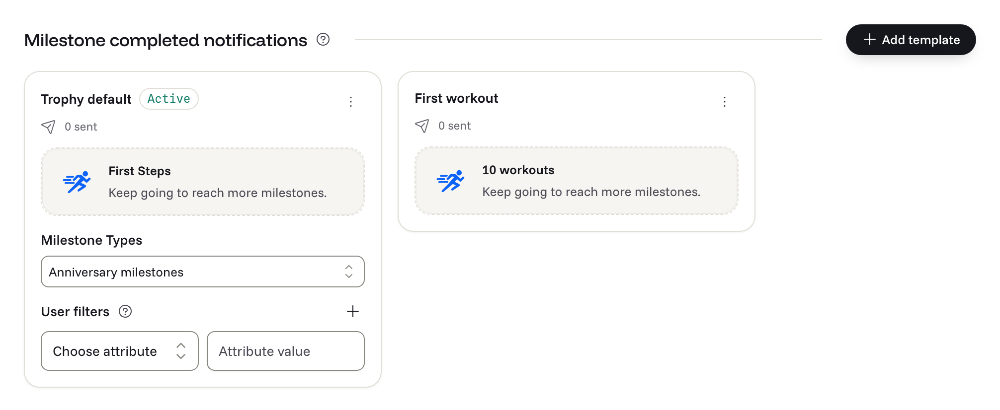
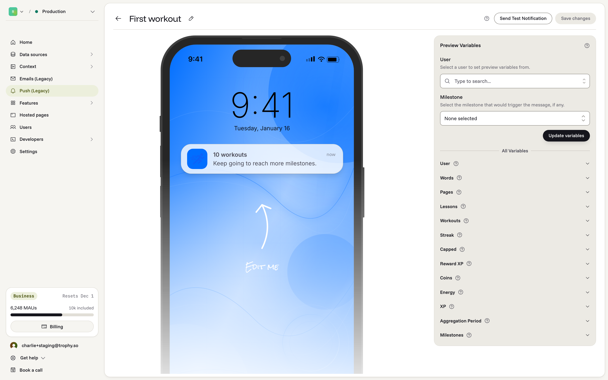

<Info>
  These are Trophy's legacy, template-based push notifications, sent from fixed triggers. For users in the [agentic messaging](/agentic-messaging/overview) cohort, agentic messaging replaces them: lifecycle agents write and send personalized push notifications instead. Both send through the same push providers, which you set up on the [channels](/agentic-messaging/channels#push-notifications) page.
</Info>

Trophy can send automated push notifications to users based on key triggers without requiring any code. Here we’ll look at what these triggers are, and how they can help bring users back to your product.

## Types of push notifications {#types-of-push-notifications}

Trophy supports 4 types of push notifications, each of which is designed to suit a common engagement scenario.

All push notifications are optional, but all four can be used simultaneously and can be controlled from the [Push Notifications](https://app.trophy.so/push/configure) page in the Trophy dashboard.

<Frame>
  <video
    autoPlay
    muted
    loop
    playsInline
    className="w-full aspect-video"
    src="../assets/features/push/push_notification_types.mp4"
  ></video>
</Frame>

- **Milestone notifications** are sent to users each time they complete a [Milestone](/features/milestones).
- **Recap notifications** are sent to users on a pre-defined frequency to summarize progress. Recap notifications can be configured to be sent daily, weekly, monthly or yearly depending on your use case.
- **Reactivation notifications** are sent to users after they become inactive with the goal of bringing them back to your app.
- **Streak notifications** are automatically sent to users reminding them to extend their [Streak](/features/streaks).

## Supported channels {#supported-channels}

<a id="apple-push-notification-service-apns" />
<a id="firebase-cloud-messaging-fcm" />
<a id="expo-push-service" />

Trophy sends push notifications through [Apple Push Notification Service (APNs)](/agentic-messaging/channels#apple-push-notification-service-apns), [Firebase Cloud Messaging (FCM)](/agentic-messaging/channels#firebase-cloud-messaging-fcm) or [Expo Push Service](/agentic-messaging/channels#expo-push-service). Push providers are shared with agentic messaging, so you only need to set them up once. Follow the [supported providers](/agentic-messaging/channels#supported-channels) guide on the channels page.

## Sending push notifications {#sending-push-notifications}

Follow the steps below to start sending push notifications using Trophy.

<Tip>
  Users can control which push notifications they receive through Trophy's [user
  preferences API](/data-sources/users#notification-preferences). This allows you to
  build a preference center in your application where users can opt in or out of
  specific notification types.
</Tip>

<Steps>
  <Step title="Set up channels">
    Configure a push provider by following the [supported providers](/agentic-messaging/channels#supported-channels) guide on the channels page. You'll also find your providers on the **Channels** tab of the [Push](https://app.trophy.so/push/channels) page.

<Frame>
    <video
    autoPlay
    muted
    loop
    playsInline
    className="w-full aspect-video"
    src="../assets/features/push/push_channels.mp4"
  ></video>
</Frame>

  </Step>
  <Step title="Add templates">
    Trophy provides a default template for each [type of push notification](#types-of-push-notifications) that Trophy supports.

    On the [configure page](https://app.trophy.so/push/configure), each notification type has its own section. Add templates under the relevant type.
    
    Follow the guide on [designing push notifications](#designing-push-notifications) to learn more.

    <Frame>
      
    </Frame>

  </Step>
  <Step title="Associate device tokens">
    Trophy needs to know the unique tokens assigned to each user's devices to route notifications to them. Associate `deviceTokens` with each user when you identify them or send metric events. See [device tokens](/agentic-messaging/channels#device-tokens) for examples.
  </Step>
  <Step title="Activate templates">
    The last step is to activate a template within each [type of push notification](#types-of-push-notifications) section that you want to send.

    On the [configure page](https://app.trophy.so/push/configure), activate one template in each type section you want to enable. Once activated, Trophy will start sending push notifications automatically.

    <Tip>
      Users can control which push notification types they receive through Trophy's [user preferences API](/data-sources/users#notification-preferences). When a user has disabled a notification type in their preferences, Trophy will respect that setting and won't send those notifications to that user.
    </Tip>

    <Frame>

  <video
    autoPlay
    muted
    loop
    playsInline
    className="w-full aspect-video"
    src="../assets/features/push/activating_templates.mp4"
  ></video>
</Frame>

  </Step>
</Steps>

## Designing push notifications {#designing-push-notifications}

By default, Trophy provides a template for each [type of push notification](#types-of-push-notifications) as a good starting point. The default templates can’t be changed, but you can duplicate and customize these as you wish.

<Tip>
  You can also create blank templates if you just want to start from scratch.
</Tip>

### Template structure {#template-structure}

Each push notification has a title and body, and Trophy's no-code push notification template editor allows you to fully customize both fields.

<Frame>
  
</Frame>

### Using variables {#using-variables}

Trophy provides an expansive set of variables that can be used to insert highly relevant and personalized data into your push notifications.

Variables can be inserted by typing `@` in the title or body of any push notification, and searching for your chosen variable.

This will open up the variable editor window where you can configure variables as in the demo below. You can also test different variable values and how your template behaves in different scenarios by using the preview sidebar.

<Frame>
  <video
    autoPlay
    muted
    loop
    playsInline
    className="w-full aspect-video"
    src="../assets/features/push/push_variables.mp4"
  ></video>
</Frame>

### Using variations {#using-variations}

Variations can be used to add randomness to the title and body of push notifications sent by Trophy. This prevents notifications from getting boring and helps improve engagement rates.

At send time, Trophy automatically picks one of your variations of the title and body at random and sends the notification to the user.

<Frame>
  <video
    autoPlay
    muted
    loop
    playsInline
    className="w-full aspect-video"
    src="../assets/features/push/push_variations.mp4"
  ></video>
</Frame>

### Using conditions {#using-conditions}

Trophy's push notification template builder supports using conditions to send different content to each recipient based on their unique context.

All [template variables](#using-variables) can be used in conditions to control what content is used in the title and body of notifications sent by Trophy.

At send time Trophy computes all conditions using each recipients unique context, delivering highly personalized and relevant notifications to each user.

<Frame>
  <video
    autoPlay
    muted
    loop
    playsInline
    className="w-full aspect-video"
    src="../assets/features/push/push_conditions.mp4"
  ></video>
</Frame>

## Get support {#get-support}

Want to get in touch with the Trophy team? Reach out to us via [email](mailto:support@trophy.so). We're here to help!
